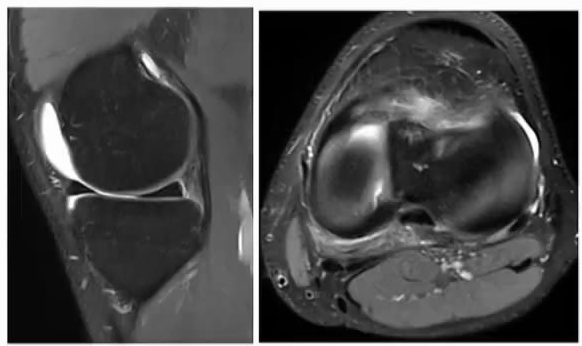
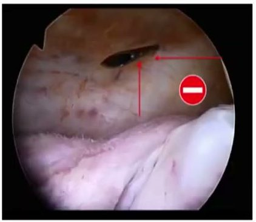
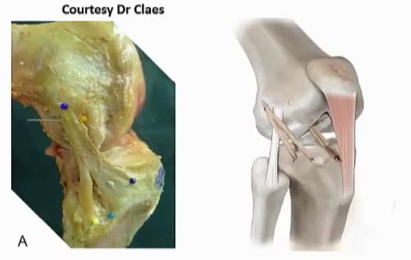

# Actualités sur le traitement chirurgical du LCA

> [!abstract] L'essentiel
> **Chez le jeune pivoteur, LCA + ligament antérolatéral divise par 2,5 à 3 le risque de re-rupture** : et toute lésion de la rampe méniscale doit être cherchée puis suturée.

> [!success] À retenir
> 1. **Lésion de la rampe** (corne postérieure du ménisque médial) dans **9 à 17 %** des ruptures du LCA, **≈ 20 % cachées** à l'arthroscopie antérieure → la chercher activement en IRM.
> 2. Facteurs de risque de re-rupture à signaler : **âge < 20 ans**, sport pivot en compétition, **encoche condylienne latérale profonde** (*lateral notch sign*), ressaut explosif → indication de **LCA + LAL**.
> 3. **Moignon du LCA** (vascularisé, mécanorécepteurs) préservable (technique SAMBA) : décrire sa présence et son aspect.

## Images clés
 [▶ 6:23](https://www.youtube.com/watch?v=3Jn0mMXbmhw&t=383s)
 [▶ 7:37](https://www.youtube.com/watch?v=3Jn0mMXbmhw&t=457s)
 [▶ 4:33](https://www.youtube.com/watch?v=3Jn0mMXbmhw&t=273s)

## Points clés
- Les progrès en anatomie, biomécanique et biologie du LCA ont conduit au double faisceau, aux reconstructions sélectives d'un faisceau puis à la **préservation complète du moignon**.
- Le moignon du LCA rompu a un potentiel de cicatrisation (vascularisation par la gaine synoviale) et conserve des mécanorécepteurs permettant la réinnervation de l'autogreffe ; augmentations biologiques avec de bons résultats dans les lésions partielles.
- Technique **SAMBA** (*single antero-medial bundle biological augmentation*) décrite par l'équipe : tunnels fémoral et tibial sous arthroscopie, lacet autour du moignon, greffe passée dans le moignon qui la recouvre entièrement ; bonne intégration IRM à un an et cicatrisation au second look.
- **Ligament antérolatéral** : remis en lumière en 2013 (publication de Claes, déjà décrit auparavant) ; questions sur son statut, son rôle rotatoire et l'intérêt de le reconstruire. Technique de dissection décrite par l'équipe en 2016 ; il se tend en flexion et rotation interne.
- Résultats actuels insuffisants : re-rupture jusqu'à environ 28 % dans les populations à risque, réopération jusqu'à 26 %, retour au même niveau sportif de 50 à 65 % seulement.
- Reconstruction **combinée LCA + LAL** proposée chez les patients à risque : moins de 20 ans, sport pivot en compétition, *lateral notch sign* et/ou ressaut rotatoire explosif.
- Série prospective comparative de 502 patients (16-30 ans, sport pivot, recul moyen 38 mois) : pas de différence tendon patellaire vs ischio-jambiers ; **3 fois moins de ruptures** avec ischio-jambiers + LAL vs ischio-jambiers seuls, **2,5 fois moins** vs tendon patellaire ; après 2 ans, quasiment plus de rupture dans le groupe LAL.
- Seconde série de 548 patients (recul 35 mois, âge moyen 24 ans) : 13 % de réopérations, sans complication spécifique à la technique.
- **Lésions de la rampe** (segment postérieur du ménisque médial ; décrites par Strobel dans les années 1980) : associées aux ruptures du LCA dans 9 à 17 % des cas ; lésions ménisco-synoviales, capsulo-méniscales ou du ligament ménisco-tibial ; contribuent au contrôle de la translation tibiale.

## Sémiologie et technique d'imagerie
- Lésions de la rampe difficiles à diagnostiquer en imagerie et souvent invisibles au crochet par la voie antérieure : exploration arthroscopique systématique de la gouttière postéro-médiale (passage de l'optique le long du condyle médial).
- Réparation par voie postéro-médiale avec avivement, rotation interne de la jambe pour dégager le ménisque, passage de fil par un crochet dédié ; près de 600 réparations depuis 2013, soit environ 21 % des reconstructions ; cicatrisation complète observée à 6 semaines au second look.

## Pièges et diagnostics différentiels
- Absence d'hypermobilité méniscale au crochet n'exclut pas une lésion de la rampe : jusqu'à 20 % de lésions « cachées ».

> [!WARNING] À ne pas manquer
> Les ruptures surviennent dans tous les groupes jusqu'à 24 mois : chez le jeune pivoteur, le risque de re-rupture justifie de signaler les facteurs de risque (encoche latérale profonde).

> [!TIP] Pour le compte rendu
> Mentionner la présence et l'aspect d'un moignon du LCA (préservable), l'encoche condylienne latérale, l'état du LAL et rechercher activement une lésion de la rampe du ménisque médial.

## Liens
- Congrès : [[SIMS 2017 - Index]]
- Voir aussi : [[Imagerie des atteintes du pivot central]], [[Imagerie des atteintes des structures périphériques dont le LAL]], [[Imagerie postopératoire des complications de ligamentoplastie]]
