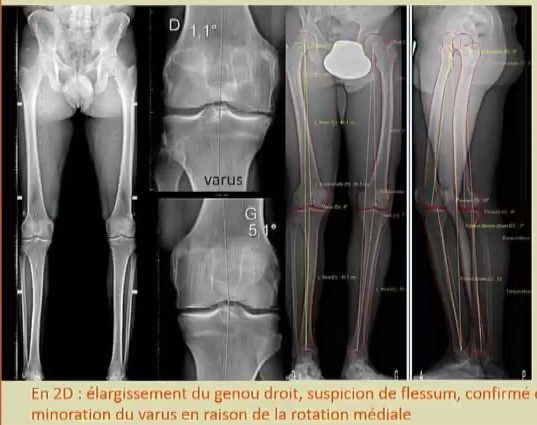
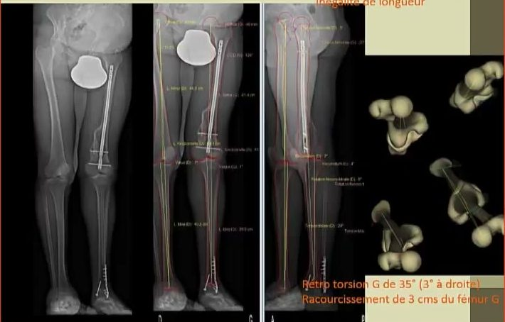
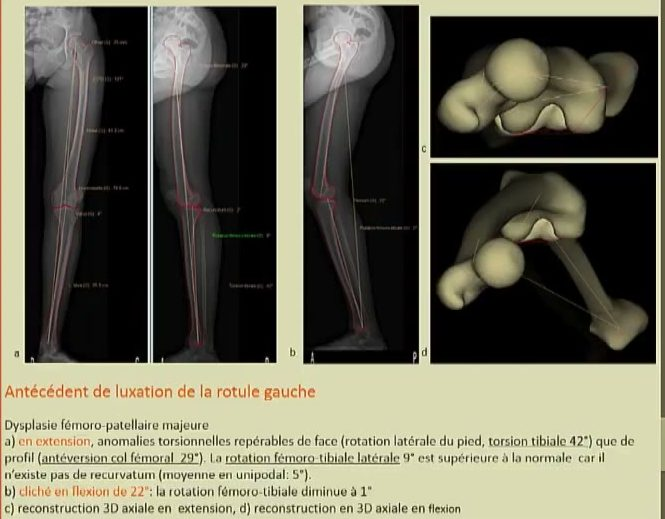

# Apports du système EOS dans les pathologies du genou

> [!abstract] L'essentiel
> **Gonométrie 2D suffisante dans 3/4 des cas ; passer en EOS 3D si flessum ou rotation > 10°** : torsions mesurées aussi bien qu'au scanner, à dose bien moindre.

> [!success] À retenir
> 1. **Flessum ou rotation > 10°** → HKA 2D faux de **> 2°** (écart 2D/3D > 2° dans **22 %** des cas) : demander l'EOS 3D.
> 2. Torsions fémorale/tibiale EOS 3D ≈ scanner, **meilleure reproductibilité**, dose réduite ; **rotation fémorotibiale** latérale majorée dans l'**instabilité patellaire**.
> 3. **PTG non modélisées** et têtes fémorales difficiles à repérer (dysplasie, coxarthrose) : le **scanner** reste la référence pour la prothèse.

## Images clés
 [▶ 4:45](https://www.youtube.com/watch?v=--l0yWDW1JI&t=285s)
 [▶ 9:05](https://www.youtube.com/watch?v=--l0yWDW1JI&t=545s)
 [▶ 11:16](https://www.youtube.com/watch?v=--l0yWDW1JI&t=676s)

## Points clés
- Expérience d'une équipe équipée depuis 2009 ; les membres inférieurs représentent environ un quart des examens EOS.
- **Acquisitions** : face basse dose, clichés segmentaires, gonométrie face-profil bipodale (en léger 3/4 pour éviter les superpositions) ou monopodale (double acquisition) ; modélisation par contourage (têtes fémorales, condyles, plateaux, pince bimalléolaire), « pas une vraie 3D ».
- **Irradiation** : classiquement 9-10 fois moins que la radiographie conventionnelle, plutôt 4-5 fois face aux capteurs plans récents ; nettement moins que le scanner (une étude : 24 fois moins pour les testicules) ; mode micro-dose acceptable pour les mesures.
- **Longueurs** : mesure 2D faussée en cas de flessum ou recurvatum ; EOS 3D à l'échelle 1.
- **Plan frontal** : écart HKA 2D/3D de 1,4° en moyenne, supérieur à 2° dans 22 % des cas ; la 2D suffit pour plus de 3/4 des patients. Sur fantômes, une rotation > 10° entraîne une erreur > 2° de l'HKA, aggravée par la flexion.
- **Plan sagittal** : détection des flessums (mieux en monopodal pour juger l'irréductibilité) et recurvatums (seuil cité d'environ 15°), mesure de la pente tibiale.
- **Plan axial** : torsions fémorale et tibiale comparables au scanner, meilleure reproductibilité inter-observateur, dose moindre.
- **Index de cumul des torsions** (version fémorale et torsion tibiale latérale) comparé à l'angle du pas (normal 10-15°).
- **Rotation fémorotibiale** (plan bicondylien vs tangente aux plateaux) : environ 2° de rotation latérale debout, jusqu'à 4,5° en monopodal ; augmentée dans les instabilités patellaires. Étude de l'équipe : torsion fémorale et rotation fémorotibiale significativement majorées chez les patients avec luxation ou instabilité potentielle vs témoins, sans différence entre les deux groupes ; pas de différence pour la torsion tibiale ni le valgus.

## Sémiologie et technique d'imagerie
- Au scanner, la mesure de l'antéversion varie selon le niveau du col (différence de 8° illustrée) : l'orateur recommande un MIP en coupes épaisses ; tangente postérieure aux plateaux (pas l'épiphyse fibulaire), pince bimalléolaire plutôt que talus.
- Analyse corps entier rachis-bassin-membres en charge ou assis.

## Pièges et diagnostics différentiels
- Repérage difficile des têtes fémorales en cas de dysplasie ou coxarthrose majeure.
- **PTG non modélisées** par le logiciel : préférer l'acquisition monopodale ; le scanner reste nécessaire pour le bilan torsionnel fin et les descellements.
- Immobilité de 10-15 s (balayage) : risque de déformation ; erreur classique d'inversion des condyles.

> [!WARNING] À ne pas manquer
> Une gonométrie 2D est faussée par un flessum ou une rotation > 10° : demander l'EOS 3D dans ces cas.

> [!TIP] Pour le compte rendu
> HKA 3D, flessum/recurvatum, pente tibiale, torsions fémorale et tibiale, index de cumul des torsions et rotation fémorotibiale ; préciser bipodal ou monopodal.

## Liens
- Congrès : [[SIMS 2017 - Index]]
- Voir aussi : [[Imagerie de l'instabilité fémoropatellaire]], [[L'instabilité patellaire objective - indications chirurgicales]]
