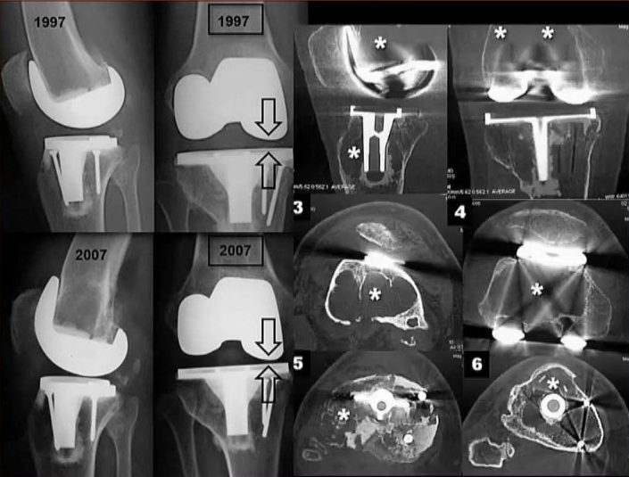
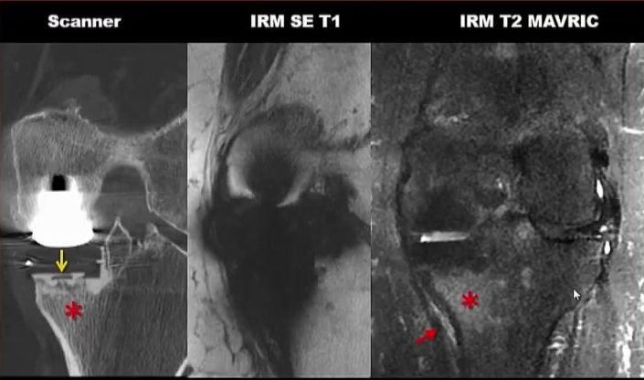
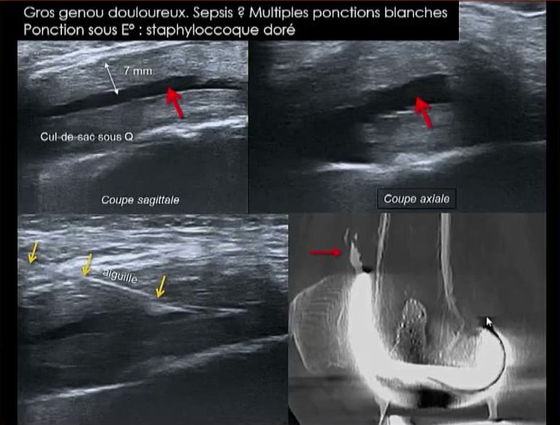

# Arthroplasties du genou et imagerie en coupes : scanner, IRM et échographie

> [!abstract] L'essentiel
> **PTG douloureuse avec radios rassurantes = scanner systématique** : superpositions levées, rotation des pièces mesurée ; échographie pour les parties molles et la ponction.

> [!success] À retenir
> 1. **Scanner** : démasque descellement et **granulomes** cachés par la quille ou l'embase (faux négatif radio par superposition).
> 2. **Rotation tibiale** : angle axe de l'embase / centre de quille-TTA **≈ 18°** ; au-delà = rotation interne ; les rotations internes (fémur, PE, embase) **s'additionnent**.
> 3. **Ponctions chirurgicales blanches ≠ pas d'infection** : ponction **échoguidée** du cul-de-sac (pannus) ; IRM **MAVRIC** pour l'œdème péri-prothétique.

## Images clés
 [▶ 4:04](https://www.youtube.com/watch?v=zZktA6soI-0&t=244s)
 [▶ 7:59](https://www.youtube.com/watch?v=zZktA6soI-0&t=479s)
 [▶ 10:18](https://www.youtube.com/watch?v=zZktA6soI-0&t=618s)

## Points clés
- **Scanner** : réduction des artefacts par augmentation du débit, coupes fines, filtres mous, fenêtres larges ; le **double énergie** avec images monochromatiques virtuelles (VMS) et les algorithmes de réduction d'artefacts (type MARS) rendent les parties molles partiellement analysables.
- Trois apports du scanner : supprimer les **superpositions**, mesurer la **rotation** des pièces dans le plan axial, apprécier l'**encombrement**.
- Superpositions « sournoises » : ailettes ou quille cruciforme de l'embase masquant un descellement (prothèse hyperfixante en scintigraphie, descellement visible seulement au scanner) ; platine non tangente au rayon ; os spongieux masquant d'énormes **granulomes** à débris de polyéthylène.
- **Mesure de rotation** : axe bi-épicondylien parallèle à l'axe bicondylien postérieur ; tangente postérieure au polyéthylène et à l'embase parallèles ; angle entre l'axe sagittal de l'embase et la ligne centre de la quille-TTA d'environ 18° ouvert en dehors (supérieur = rotation interne de la pièce tibiale, inférieur = rotation externe).
- La malrotation entraîne instabilité fémoropatellaire, inconfort, douleurs, synovites, tendinopathies, voire descellement ; les rotations internes s'additionnent (fémur, polyéthylène, embase).
- **Encombrement** : débord de pièce mieux vu au scanner et en 3D, conflit avec le LCM confirmé en échographie.
- **IRM** : séquences MAVRIC (et équivalents selon constructeur : SEMAC, etc.) permettant de voir épanchement, parties molles, hypersignal du spongieux péri-prothétique et de l'interface ; très bonnes pour la hanche, encore moins pour la PTG.
- **Échographie** : sans artefact, haute résolution, dynamique, comparative ; saillie du polyéthylène vis-à-vis du tendon patellaire, conflit et hypervascularisation, ponction et infiltration échoguidées.

## Sémiologie et technique d'imagerie
- Radios de prothèse sous scopie pour obtenir un rayon tangent à la platine.
- Cas illustratif : genou volumineux douloureux à ponctions chirurgicales blanches ; l'échographie montre une cavité très réduite par un pannus synovial, la ponction échoguidée retrouve un *Staphylococcus aureus*.
- Conclusions rappelées (symposium SOFCOT 2015) : radiographies indispensables malgré leurs limites, scanner systématique si prothèse problématique, échographie statique et dynamique pour les parties molles.

## Pièges et diagnostics différentiels
- Faux négatif radiographique de descellement ou d'ostéolyse par superposition.
- Ponction blanche n'excluant pas une infection.

> [!WARNING] À ne pas manquer
> Une PTG douloureuse avec radiographies rassurantes peut cacher descellement, granulomes ou malrotation majeure : demander un scanner.

> [!TIP] Pour le compte rendu
> Donner la rotation de chaque pièce et la rotation cumulée, l'état des interfaces, l'encombrement et, en échographie, les conflits avec les parties molles.

## Liens
- Congrès : [[SIMS 2017 - Index]]
- Voir aussi : [[La prothèse douloureuse - que rechercher sur les radiographies]], [[La prothèse douloureuse - les attentes du chirurgien]]
