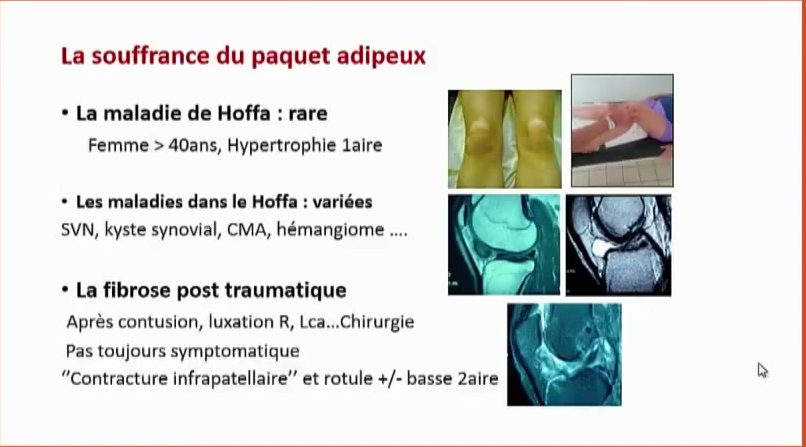
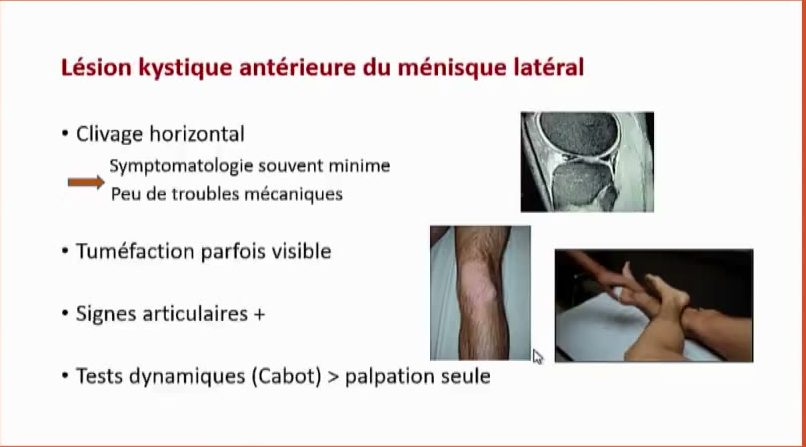
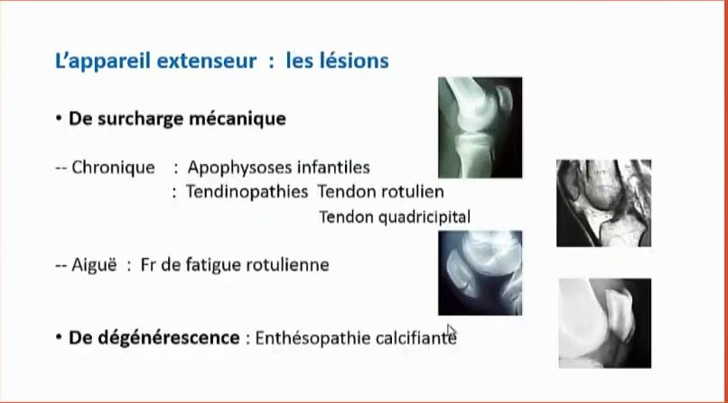

# Bilan clinique des douleurs antérieures de genou

> [!abstract] L'essentiel
> **Douleur antérieure ≠ fémoropatellaire ≠ chondropathie** : l'examen trie appareil extenseur, fémoropatellaire ou espace antérieur avant toute imagerie.

> [!success] À retenir
> 1. **Butée douloureuse en extension** = souffrance fémorotibiale (kyste méniscal antérolatéral, Hoffa), **jamais fémoropatellaire**.
> 2. Appareil extenseur : **ni synovite ni butée** ; jeune sportif en surcharge → tendinopathie ou **fracture de fatigue patellaire** (débute en avant).
> 3. **Chondropathie de surface après 40 ans** et **plica** (présente dans **70 %** des genoux) : ne pas les retenir comme cause par défaut ; rotule contuse → pas d'arthroscopie.

## Images clés
 [▶ 10:16](https://www.youtube.com/watch?v=N1WCsEOl728&t=616s)
 [▶ 11:33](https://www.youtube.com/watch?v=N1WCsEOl728&t=693s)
 [▶ 4:50](https://www.youtube.com/watch?v=N1WCsEOl728&t=290s)

## Points clés
- Environ **75 % des consultations pour genou douloureux** ; parler de « syndrome douloureux antérieur » plutôt que fémoropatellaire d'emblée.
- Faire préciser les mots du patient (blocage, gonflement, dérobement, déboîtement) : ils ne recouvrent pas la même réalité.
- Éliminer d'emblée la **hanche** (examen des rotations, qui dépiste aussi les troubles de torsion), les bursites et le SDRC.
- **Âge** : enfant = apophysoses ; adolescent = syndrome fémoropatellaire commun (jeune fille de 13-17 ans), ostéochondrites ; adulte jeune = surcharge (tendinopathies, fractures de fatigue patellaires, « rotule forcée »), dysplasies douloureuses ; sujet âgé = arthrose, tendinopathies dégénératives.
- **Contexte de surcharge** constante ou récente (marathon, ski, randonnée, squats en salle).
- **Appareil extenseur** : jamais de synovite ni de butée en extension ; douleur à l'étirement et à la contraction adaptée à la fonction, palpation du tendon et de la face antérieure de la patella (fracture de fatigue débutant en avant).
- **Fémoropatellaire** : pas de butée douloureuse en extension, épanchement rare et minime ; rechercher désaxation (valgus, baïonnette à 30°, torsions, strabisme convergent, rétraction de l'aileron latéral), anomalies de course (signe du J / « gifle »), signes de surface (peu spécifiques après 40 ans) et dysfonctions augmentant la contrainte (flessum, amyotrophie, tiroir postérieur, rétractions, pronation dynamique).
- **Rotule contuse** : contusion isolée, souvent en accident du travail, qui dure des mois ; l'imagerie trouve des anomalies incidentes et l'arthroscopie précipite la catastrophe.
- **Espace antérieur** : souffrance du Hoffa (maladie de Hoffa, signe de Hoffa, tumeurs et kystes, fibrose post-traumatique proche de l'arthrofibrose), kyste méniscal antérieur (épanchement, butée), pathologies de frottement sans signe articulaire : plica médio-patellaire (présente dans 70 % des genoux, tests discutables) et **conflit antéro-latéral** (test d'engagement douloureux vers 20-40°, souvent rotule haute et trochlée saillante).

## Sémiologie et technique d'imagerie
- L'imagerie intervient après la clinique, pour confirmer : notamment kyste méniscal, pathologies du Hoffa, ostéochondrites, fractures de fatigue.

## Pièges et diagnostics différentiels
- **Butée douloureuse en extension** = souffrance fémorotibiale, jamais fémoropatellaire ; ne pas la confondre avec un flessum fixé.
- Épanchement allégué non confirmé (simple congestion sous-patellaire).
- Plica rendue responsable à tort (diagnostic à retenir en dernier).

> [!WARNING] À ne pas manquer
> Devant une rotule contuse, l'imagerie trouvera toujours « quelque chose » : ne pas orienter vers une arthroscopie qui aggrave le tableau.

> [!TIP] Pour le compte rendu
> Répondre à la question clinique (appareil extenseur, fémoropatellaire ou espace antérieur) et ne pas assimiler une chondropathie de surface à la cause des douleurs.

## Liens
- Congrès : [[SIMS 2017 - Index]]
- Voir aussi : [[Itinéraire d'imagerie des syndromes douloureux antérieurs chroniques]], [[Comment je prends en charge un syndrome fémoropatellaire douloureux chez un jeune adulte]], [[Imagerie des tendons de l'appareil extenseur du genou]]
