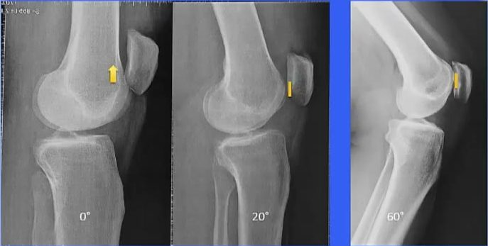
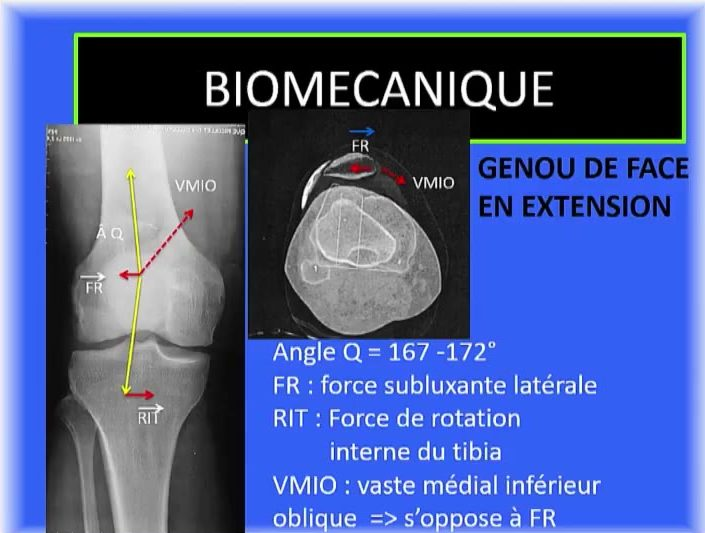
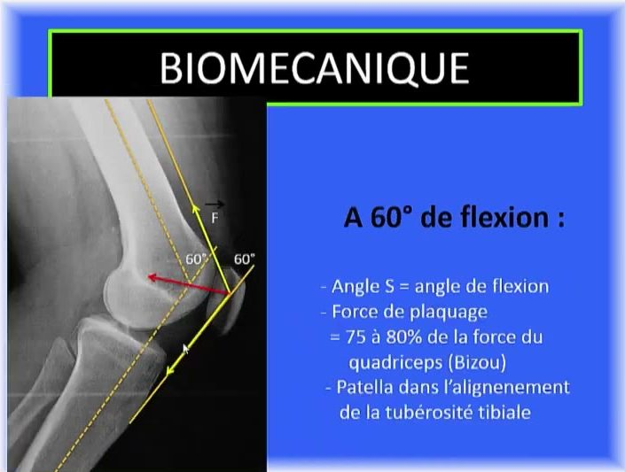

# Biomécanique de la fémoropatellaire et de l'appareil extenseur

> [!abstract] L'essentiel
> **La patella s'engage dans la trochlée entre 0 et 20° de flexion : c'est en extension que l'appareil extenseur est le plus instable** : force subluxante latérale, plaquage faible.

> [!success] À retenir
> 1. Hauteur patellaire : **Caton-Deschamps** (normale **0,6–1,2**), préféré à Insall-Salvati / Blackburne-Peel (dépendants de la pointe patellaire et de la pente tibiale).
> 2. **TA-GT** normale **10–12 mm** pour l'orateur (seuil historique de 20 mm trop élevé) ; peu fiable sur trochlée plate.
> 3. Contraintes FP énormes sur **≈ 4 cm²** : 20 kg au pied → **400 kg à 45°**, **900 kg à 90°** ; descente d'escalier ≈ **2,9 × poids du corps** → douleur antérieure typique.

## Images clés
 [▶ 0:23](https://www.youtube.com/watch?v=7Lh6ahhKsow&t=23s)
 [▶ 3:35](https://www.youtube.com/watch?v=7Lh6ahhKsow&t=215s)
 [▶ 6:36](https://www.youtube.com/watch?v=7Lh6ahhKsow&t=396s)

## Points clés
- **Zones de contact** : début de flexion = tiers inférieur de la patella ; 30-60° = tiers moyen ; au-delà = tiers supérieur ; après 90°, contact par les facettes latérales dans l'échancrure.
- **Quadriceps** : vaste latéral, vaste intermédiaire, droit fémoral (dans l'axe mécanique du fémur) et vaste médial en deux faisceaux, dont le **vaste médial oblique** (orienté à environ 60° de l'axe de la jambe), « gardien de la rotule ».
- Le fond de la trochlée doit être dans l'alignement du bord antérieur de la diaphyse fémorale (profil).
- **Indice de Bernageau** : la hauteur varie d'environ ± 6 mm entre quadriceps contracté et relâché.
- **Hauteur patellaire** : en France, Caton-Deschamps (limite haute 1,2 ; basse 0,6) ; indices d'Insall-Salvati et de Blackburne-Peel peu retenus (pente tibiale et pointe patellaire variables).
- **TA-GT** : difficile à mesurer en cas de trochlée plate ; pour l'orateur, normale entre 10 et 12 mm (le seuil historique de 20 mm lui paraît trop élevé).
- En extension : angle Q ouvert en dehors → force résultante subluxante latérale compensée par le vaste médial oblique ; dans le plan sagittal, angle de 15-18° ouvert en arrière et force de plaquage faible → moyens de stabilisation faibles (bascule et translation fréquentes au scanner).
- Entre 0 et 30° : rotation interne automatique du tibia ; à 60°, force de plaquage = 75-80 % de la force du quadriceps ; à 90°, 110 %.
- **Roulement-glissement** fémorotibial indispensable, plus marqué dans le compartiment latéral, expliquant la rotation interne en flexion.

## Sémiologie et technique d'imagerie
- Chiffres de contraintes cités : 20 kg au bout du pied → environ 400 kg sur la patella à 45° et 900 kg à 90°, sur environ 4 cm² (pour une surface articulaire moyenne de 12 cm²).
- En pourcentage du poids du corps : marche 0,8 ; marche rapide 1,5 ; montée d'escalier 1,8 ; descente environ 2,9 (travail excentrique du quadriceps).
- Flexion à 130° : environ 260 kg ; à 145° : environ 420 kg, sans charge.

## Pièges et diagnostics différentiels
- TA-GT peu fiable dans les dysplasies sévères (fond de trochlée non repérable).
- Indices de hauteur dépendant de la pente tibiale.

> [!WARNING] À ne pas manquer
> La phase d'engagement (0-20°) est la phase critique : la patella doit être dans le rail et le rail doit la laisser passer.

> [!TIP] Pour le compte rendu
> Donner la hauteur patellaire (Caton-Deschamps), la TA-GT avec ses limites de mesure, et signaler une bascule ou une translation latérale en extension.

## Liens
- Congrès : [[SIMS 2017 - Index]]
- Voir aussi : [[Imagerie de l'instabilité fémoropatellaire]], [[Bilan clinique des douleurs antérieures de genou]]
