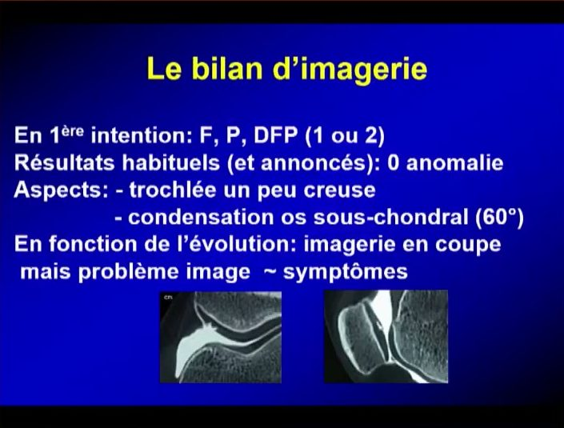
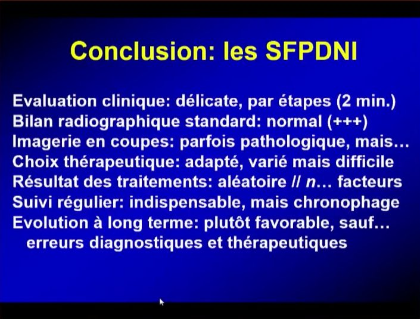

# Comment je prends en charge un syndrome fémoropatellaire douloureux chez un jeune adulte

> [!abstract] L'essentiel
> **SFP douloureux sans instabilité : radiographies normales, diagnostic clinique par étapes, traitement conservateur personnalisé** : chirurgie exceptionnelle.

> [!success] À retenir
> 1. Bilan initial = **face, profil, 1-2 défilés fémoropatellaires** : attendus **normaux** → écrire « radiographies normales », jamais « vous n'avez rien ».
> 2. Imagerie en coupes seulement selon l'évolution : une **chondropathie** ou une **condensation sous-chondrale** n'explique pas forcément les symptômes.
> 3. Toute **sensation d'instabilité** change de cadre ; une **disproportion plainte / bilan normal** doit faire évoquer une composante **psychogénique**.

## Images clés
 [▶ 3:16](https://www.youtube.com/watch?v=JMpg4vxYwNI&t=196s)
 [▶ 11:12](https://www.youtube.com/watch?v=JMpg4vxYwNI&t=672s)

## Points clés
- Pathologie fréquente, physiopathologie complexe à double composante **physique et psychologique** ; patients souvent mal considérés par les médecins.
- **Diagnostic en trois étapes** : interrogatoire + examen de débrouillage ; bilan radiographique standard seul ; second examen clinique plus méthodique pour identifier l'entité.
- Interrogatoire : caractère des douleurs, **absence totale de sensation d'instabilité** (sinon on change de cadre), activités professionnelles, sportives, contexte familial et socioprofessionnel.
- Examen debout contre un mur : strabisme convergent (banal) ou divergent (plus rare et plus grave) ; couché : épanchement (oriente la stratégie), mobilité de la patella, baïonnette, rabot, tests de Smillie et de Zohlen (à interpréter avec prudence), **rétractions** des ischiojambiers et du droit fémoral.
- **Imagerie initiale** : face, profil, une ou deux incidences fémoropatellaires ; normales. Ne jamais écrire « vous n'avez rien » : écrire « radiographie normale ».
- Trois grandes catégories : **post-contusif** (à prendre en charge rapidement), **de surmenage** (cyclisme, volley, saut, course, ski), **psychogénique** (troubles fonctionnels, conversion, hypocondrie, dépression masquée…), à évoquer devant une disproportion entre gêne fonctionnelle et normalité du bilan.
- Traitement conservateur : lutte contre la douleur (pharmacologique et non pharmacologique, à varier), rééducation adaptée aux anomalies détectées (pas d'ordonnance stéréotypée de renforcement du quadriceps), modification des activités, prophylaxie (escaliers, cinéma), éducation thérapeutique, assistance psychologique.
- **Genouillères à évidement patellaire** pour le sport (appréciées des patients) ; taping/kinésiotaping jugé de peu d'intérêt ; acupuncture, sophrologie, yoga, hypnose peuvent aider.
- Chirurgie exceptionnelle, prudence dans les cas limites douleur-instabilité (syndrome d'engagement).

## Sémiologie et technique d'imagerie
- Bilan standard limité à face, profil, défilés fémoropatellaires, attendu normal.
- Imagerie en coupes seulement pour préciser un point : elle est parfois pathologique sans être la traduction du problème.

## Pièges et diagnostics différentiels
- Confondre douleur et instabilité (rechercher appréhension, luxation vraie).
- Attribuer les douleurs à une anomalie incidente de l'imagerie en coupes.

> [!WARNING] À ne pas manquer
> Toute disproportion entre la plainte fonctionnelle et un bilan normal doit faire rechercher une composante psychogénique, sous-évaluée et insuffisamment prise en charge.

> [!TIP] Pour le compte rendu
> Formuler « radiographies normales » plutôt que « absence d'anomalie » ; éviter de sur-interpréter une chondropathie modérée en coupes.

## Liens
- Congrès : [[SIMS 2017 - Index]]
- Voir aussi : [[Bilan clinique des douleurs antérieures de genou]], [[Itinéraire d'imagerie des syndromes douloureux antérieurs chroniques]]
