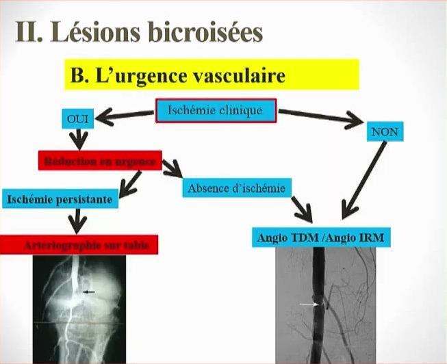
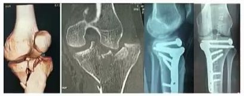
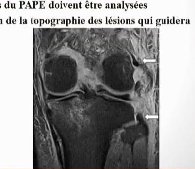

# Genou traumatique de l'adulte - les vraies urgences

> [!abstract] L'essentiel
> **Luxation bicroisée, avulsion du pied du LCA, point d'angle postérolatéral frais, ménisque suturable et avulsion ostéochondrale = urgences chirurgicales** : les signaler explicitement.

> [!success] À retenir
> 1. Luxation du genou **réduite 1 fois sur 2** à l'arrivée ; atteinte artérielle **8-20 %** → **angio-TDM/angio-IRM systématique** même sans ischémie (flap intimal, thrombose retardée jusqu'à **12-14 j**).
> 2. Chirurgie des lésions bicroisées idéalement **< 21 jours** ; **fracture de Segond** ou arrachement de la tête fibulaire = rechercher une lésion du **PAPE**, à décrire structure par structure.
> 3. Anse de seau / lésion périphérique récente = **suture** (≈ **70 %** de cicatrisation ; reprise du sport au même niveau **90 %** vs **50 %** après méniscectomie).

## Images clés
 [▶ 1:31](https://www.youtube.com/watch?v=Ws2ZZ2IsvBw&t=91s)
 [▶ 4:41](https://www.youtube.com/watch?v=Ws2ZZ2IsvBw&t=281s)
 [▶ 7:23](https://www.youtube.com/watch?v=Ws2ZZ2IsvBw&t=443s)

## Points clés
- **Lésions bicroisées** (ex-luxations du genou) : rares (2 à 3 par an dans un CHU référent), AVP surtout moto, sport dans un tiers des cas ; **une fois sur deux réduites** à l'arrivée. Atteinte artérielle 8 à 20 %, nerveuse 30-40 %.
- Urgence vasculaire prioritaire : réduction, puis bloc si l'ischémie persiste ; en l'absence d'ischémie, exploration vasculaire (angioscanner ou angio-IRM) pour dépister un **flap intimal** pouvant thromboser jusqu'à 12-14 jours après.
- Symposium SOFCOT 2008 : testing sous anesthésie générale avec radiographies dynamiques, IRM préopératoire ; distinguer lésions par glissement (décollements capsulo-périostés, cicatrisation favorable) et par bâillement.
- Traitement orthopédique (immobilisation 45 jours sans appui) réservé à certains cas (pontage poplité, luxation ouverte, plus de 60 ans, laxité modérée) ; chirurgie idéalement **dans les 21 premiers jours** chez le jeune, en privilégiant LCP et formations périphériques ; raideur et laxités latérales résiduelles dans plus de 50 % des cas.
- **Avulsion du pied du LCA** : surtout chez l'enfant, 1 % des lésions du LCA ; réinsertion (vis, ostéosuture, endobouton) avec 1 % de reprise par ligamentoplastie contre 10 % après traitement orthopédique ; flessum postopératoire possible. Chez l'adulte, possible composante d'une fracture du tibia proximal : scanner.
- **Lésions capsulo-ligamentaires postérolatérales fraîches** : cicatrisent mal en chronique, rarement isolées (1,6 %), associées aux LCA/LCP ; hématome postérolatéral ; recurvatum et test de Hughston.
- **Lésions méniscales réparables** : conservation méniscale ; zone rouge périphérique vascularisée, rouge-blanche intermédiaire, blanche axiale avasculaire (Arnoczky). Méniscectomie pour languette, lésions en zone blanche, dégénératives, anse de seau ancienne irréductible ; suture pour lésions traumatiques et anses de seau récentes (cicatrisation d'environ 70 % en arthroscanner).
- **Avulsions ostéochondrales** (fémoropatellaires, condyliennes) : fixation par broches ou vis, mosaïcplastie, microfractures recouvertes de membrane, voire allogreffe ostéochondrale pour les grands défects.

## Sémiologie et technique d'imagerie
- Radiographies : arrachement de la tête fibulaire, fracture de Segond (arrachement antérolatéral, stade minimal des lésions postérolatérales), avulsion épineuse.
- Clichés dynamiques en varus : éviter la laxité maximale pour ne pas mettre en tension le nerf fibulaire commun.
- IRM : difficile à la phase aiguë pour le point d'angle postérolatéral mais utile à la cartographie chirurgicale ; précise œdème osseux, lésions associées et caractère purement chondral de certaines avulsions ; sensible et spécifique pour l'anse de seau et les lésions périphériques.

## Pièges et diagnostics différentiels
- Luxation réduite à l'arrivée : diagnostic sous-estimé si l'on ne teste pas la laxité.
- Lésions des insertions ménisco-synoviales postérieures parfois invisibles en IRM (visibles en flexion).
- Ménisque discoïde, le plus souvent latéral, exposé à la rupture.

> [!WARNING] À ne pas manquer
> Toute luxation du genou, même réduite et sans ischémie, impose une exploration artérielle (flap intimal à thrombose retardée jusqu'à 12-14 jours).

> [!TIP] Pour le compte rendu
> Signaler explicitement les lésions relevant d'une réparation précoce : avulsion du LCA et son déplacement, point d'angle postérolatéral (structure par structure), lésion méniscale périphérique suturable, fragment ostéochondral et sa taille.

## Liens
- Congrès : [[SIMS 2017 - Index]]
- Voir aussi : [[Imagerie des atteintes des structures périphériques dont le LAL]], [[Imagerie des atteintes du pivot central]], [[Les lésions traumatiques des cornes et racines postérieures des ménisques après rupture du LCA]]
