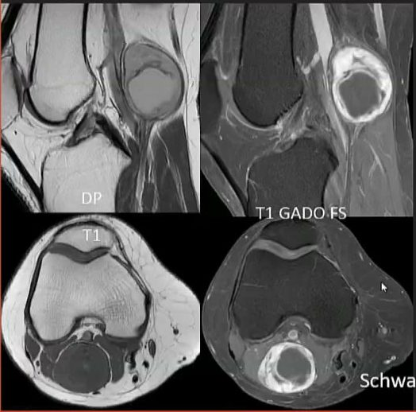
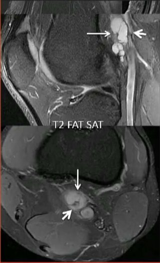
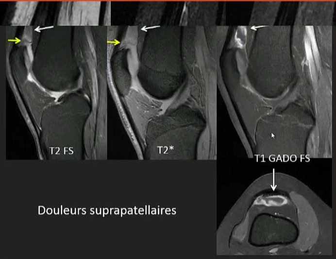

# IRM du genou - quand et pourquoi injecter

> [!abstract] L'essentiel
> **Plus d'injection systématique au genou : décider en direct, sur les séquences non injectées** : macrocyclique, dose minimale, seulement si la réponse en dépend.

> [!success] À retenir
> 1. **Dépôts cérébraux de gadolinium** (dose-dépendants, surtout **linéaires**) → linéaires suspendus (EMA, **mars 2017**), macrocycliques uniquement.
> 2. Injection **certaine** : **tumeur** (masse hyperT2 « kystique » = schwannome ou sarcome possible), **infection**, **synoviale**.
> 3. Au cas par cas : tendon, ligament, os sous-chondral, genou opéré, **douleur inexpliquée** (ex. synovite suprapatellaire visible seulement en T1 gado FS).

## Images clés
 [▶ 5:42](https://www.youtube.com/watch?v=UYmFyB01Ins&t=342s)
 [▶ 5:27](https://www.youtube.com/watch?v=UYmFyB01Ins&t=327s)
 [▶ 7:48](https://www.youtube.com/watch?v=UYmFyB01Ins&t=468s)

## Points clés
- Deux familles de chélates : **macrocycliques** (gadolinium « enchâssé comme une perle dans une huître », plus stables) et **linéaires** (liaison plus fragile, gadolinium plus facilement libéré).
- Historique : produit considéré comme sûr jusqu'en 2006 ; fibrose systémique néphrogénique chez l'insuffisant rénal (surtout linéaires) ; 2015 : description des **dépôts cérébraux** de gadolinium chez des patients à fonction rénale préservée ayant eu plusieurs IRM injectées, dose-dépendants, surtout avec les linéaires (confirmés par une étude autopsique), sans preuve actuelle de toxicité.
- Mars 2017 : l'Agence européenne du médicament recommande la suspension de l'AMM des linéaires et l'usage des macrocycliques à la **dose la plus faible possible et uniquement si nécessaire**.
- Effets indésirables à connaître : insuffisance rénale aiguë, crises convulsives, hypersensibilité (plus rare qu'avec l'iode ; prudence chez le patient sous bêtabloquant, qui répond mal aux bêtastimulants ; un antécédent d'hypersensibilité contre-indique la réinjection).
- **Indications peu discutables** : pathologie tumorale (différencier contingent tissulaire et nécrotique/liquidien), infectieuse (synovite vs épanchement, prise de contraste osseuse et extension aux parties molles en faveur d'une arthrite septique), synoviale.
- **Indications au cas par cas** : pathologies tendineuses, ligamentaires, osseuses, et surtout syndromes douloureux inexpliqués par les séquences non injectées.

## Sémiologie et technique d'imagerie
- Séquences injectées : écho de spin T1 avec saturation de la graisse ; **Dixon** (images avec et sans saturation, saturation plus homogène, moins d'artefacts sur matériel orthopédique).
- **Arthro-IRM indirecte** : séquences T1 fat-sat après environ 10 minutes d'exercice ; intérêt pour les lésions cartilagineuses et méniscales et les ménisques déjà opérés ; peu utilisée en France.
- **Angio-IRM 4D** : cartographie vasculaire et cinétique de rehaussement (tumeurs malignes et bénignes dont l'ostéome ostéoïde, pathologie vasculaire et synoviale).
- **dGEMRIC** : T1 réalisé 90 minutes après double dose et exercice ; la fixation est d'autant plus importante que le contenu en glycosaminoglycanes est faible (suivi de l'arthrose, des réparations cartilagineuses, méniscopathies dégénératives).
- Exemples : synoviosarcome hyperT2 avec rehaussement tissulaire intense ; kyste adventitiel de l'artère poplitée (confirmation kystique et retentissement sur la lumière) ; bursite prétibiale inflammatoire ; tendinopathie du gastrocnémien latéral ou du quadriceps visible uniquement après injection ; synovite d'un récessus suprapatellaire séquestré par une plica complète ; inflammation du coussinet graisseux suprapatellaire.

## Pièges et diagnostics différentiels
- TCG ténosynoviale (SVN) forme nodulaire : diagnostic sur l'écho de gradient T2 sans injection, mais l'injection aide au bilan d'extension (atteinte en plaques d'un récessus).
- Un aspect pseudo-SVN du Hoffa sans dépôt d'hémosidérine en écho de gradient doit faire évoquer une plica remaniée.
- Kyste vs tumeur pseudo-kystique : l'injection est déterminante.

> [!WARNING] À ne pas manquer
> Une masse hyperT2 d'allure kystique autour du genou peut être un sarcome : injecter avant de conclure à un kyste ou une bursite.

> [!TIP] Pour le compte rendu
> Justifier l'injection par la question non résolue par les séquences non injectées ; préciser le produit macrocyclique et la dose minimale ; surveiller l'examen en direct pour décider de l'injection.

## Liens
- Congrès : [[SIMS 2017 - Index]]
- Voir aussi : [[Pathologie synoviale tumorale et pseudotumorale]], [[Imagerie postopératoire des ménisques]]
