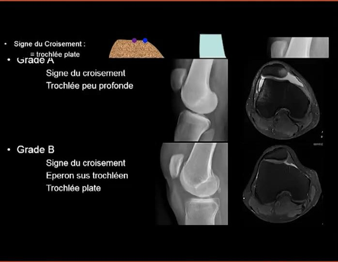
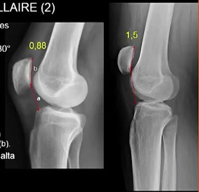
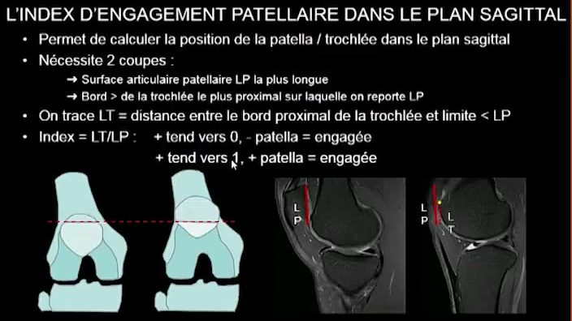

# Imagerie de l'instabilité fémoropatellaire

> [!abstract] L'essentiel
> **Instabilité patellaire = 3 facteurs à chiffrer : dysplasie trochléenne, patella alta, TA-GT** : profil strict à 30° puis IRM chez ce sujet jeune, souvent féminin.

> [!success] À retenir
> 1. **Dysplasie trochléenne** chez **≈ 100 %** des instables : sur profil strict, **signe du croisement**, **double contour**, **éperon sus-trochléen** → grade de **Dejour (A à D)**.
> 2. **Caton-Deschamps** : normal **0,8 à 1,2** ; **> 1,2 = patella alta** (60 % des luxations récidivantes), mesurable aussi en IRM.
> 3. **Bascule patellaire** pathologique si **> 20°** (quadriceps décontracté) ; ce n'est plus un facteur indépendant. Torsions : **EOS** (irradiation 4 à 30 fois moindre) plutôt que scanner.

## Images clés
 [▶ 5:47](https://www.youtube.com/watch?v=ufVL2kr2-kY&t=347s)
 [▶ 6:45](https://www.youtube.com/watch?v=ufVL2kr2-kY&t=405s)
 [▶ 8:46](https://www.youtube.com/watch?v=ufVL2kr2-kY&t=526s)

## Points clés
- La patella s'engage dans la trochlée vers 15-20° de flexion ; stabilité = équilibre entre quadriceps (angle Q d'environ 15°), relief osseux et structures rétinaculo-ligamentaires.
- **Ligament fémoropatellaire médial (LFPM)** : environ 60 % de la stabilité de 0 à 20° ; deux faisceaux, insertion proximale sous le tubercule du grand adducteur (recouvrant partiellement le LCM), distale sur les deux tiers supérieurs de la patella.
- Deux tableaux : **instabilité patellaire objective** (au moins un épisode de luxation) et **instabilité patellaire potentielle** (sans épisode).
- **Trois facteurs principaux** : dysplasie de la trochlée (retrouvée chez près de 100 % des patients instables), patella alta, TA-GT augmentée. La bascule (tilt) n'est plus un facteur indépendant mais une conséquence.
- **Signes de dysplasie sur le profil** (tiers proximal) : signe du croisement (trochlée plate), double contour (berge médiale hypoplasique, trochlée convexe), éperon sus-trochléen (« tremplin »).
- **Classification de Dejour** en 4 grades (A à D), décrite au scanner, transposable à l'IRM.
- **Index de Caton-Deschamps** : normal entre 0,8 et 1,2 ; mesurable aussi en IRM, sans différence significative avec la radiographie pour le seuil de 1,2.
- **Index d'engagement patellaire** sagittal et axial (IRM) : plus l'index tend vers 1, plus la patella est engagée ; vers 0, non engagée.
- **Facteurs secondaires** : dysmorphie patellaire (types de Wiberg), troubles torsionnels (torsion fémorale > 25°, rotation du genou > 11°), valgus, recurvatum.

## Sémiologie et technique d'imagerie
- **Profil strict à 30° de flexion** avec superposition parfaite des condyles postérieurs ; l'axiale à 15° serait idéale mais irréalisable sur table standard (axiale à 30° moins pertinente).
- **Bascule patellaire** en coupe : angle entre grand axe de la patella et tangente bicondylienne postérieure, quadriceps décontracté puis contracté (séquences rapides en IRM) ; seuil 20°, majoration de 6° à la contraction.
- **Scanner torsionnel** : 4 niveaux (col fémoral, condyles, plateaux tibiaux, bimalléolaire), décubitus, membres en extension, bilatéral.
- **EOS** : mesures 3D automatisées en charge, torsions comparables au scanner avec une irradiation 4 à 30 fois moindre ; axes frontal et sagittal sur la même acquisition ; immobilité d'environ 10 s.
- IRM : couvrir en axial du pôle supérieur de la patella jusqu'à la tubérosité tibiale.

## Pièges et diagnostics différentiels
- Profil mal superposé : faux signes de dysplasie ou signes manqués.
- Coupes axiales IRM insuffisantes ne permettant pas de mesurer la TA-GT.
- Placement délicat des coupes du col fémoral au scanner (multiplication des acquisitions).

> [!WARNING] À ne pas manquer
> Pathologie de sujets jeunes, souvent féminins : préférer IRM et EOS au scanner irradiant lorsque c'est possible.

> [!TIP] Pour le compte rendu
> Grade de dysplasie trochléenne, Caton-Deschamps (normale < 1,2), TA-GT, bascule, index d'engagement sagittal et axial, type de patella ; torsions si demandées.

## Liens
- Congrès : [[SIMS 2017 - Index]]
- Voir aussi : [[L'instabilité patellaire objective - indications chirurgicales]], [[Biomécanique de la fémoropatellaire et de l'appareil extenseur]], [[Apports du système EOS dans les pathologies du genou]]
