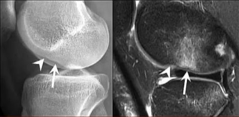
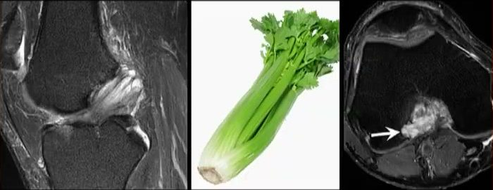
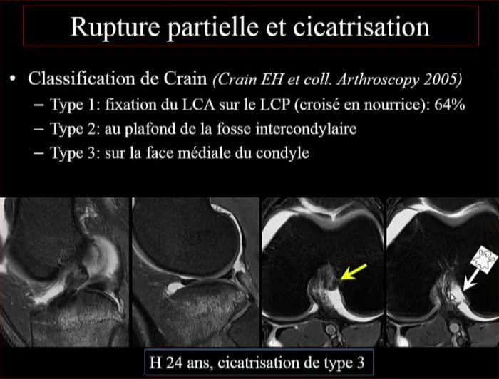

# Imagerie des atteintes du pivot central

> [!abstract] L'essentiel
> **LCA rompu ou non : facile ; rupture partielle et cicatrisation : le vrai défi** → coupes sagittales obliques ou 3D, et corrélation laximétrique (GNRB).

> [!success] À retenir
> 1. Radio : **encoche condylienne latérale > 1,5 mm** ou **double encoche** = rupture du LCA (**spécificité 100 %**, sensibilité 17 %).
> 2. **Signes indirects** (tiroir antérieur spontané, ménisque latéral découvert) = rupture **complète** ; horizontalisation/bombement distal évoquent plutôt une partielle.
> 3. Pièges : **kyste mucoïde** « en tige de céleri » et ligament méniscofémoral antéromédial ; cicatrisation à typer selon **Crain** (type 1 sur le LCP **64 %**).

## Images clés
 [▶ 2:58](https://www.youtube.com/watch?v=zUYVrGV8DQU&t=178s)
 [▶ 6:46](https://www.youtube.com/watch?v=zUYVrGV8DQU&t=406s)
 [▶ 12:23](https://www.youtube.com/watch?v=zUYVrGV8DQU&t=743s)

## Points clés
- LCA : faisceaux **antéromédial** et **postérolatéral** (nommés d'après leur insertion tibiale) ; insertion du postérolatéral près de la corne antérieure du ménisque latéral, en arrière du **tubercule de Parsons** (petite crête sous le ligament intermeniscal). Parallèles en extension, enroulés en flexion.
- Radiographie systématique avant l'IRM : signes de rupture, facteurs favorisants (échancrure étroite), arthrose.
- **Fracture de l'éminence intercondylaire** : scanner pour le déplacement et le choix du traitement.
- **Encoche condylienne latérale** de plus de 1,5 mm (a fortiori 2 mm) : très spécifique de rupture du LCA. La **double encoche** (fracture-impaction en arrière de l'encoche physiologique, moins profonde) a la même valeur : sensibilité 17 %, spécificité 100 %.
- Sensibilité et spécificité de l'IRM supérieures à 90 % quel que soit le matériel, car les études se limitent à « rompu / non rompu » ; les machines et séquences performantes font la différence pour les ruptures partielles et les cicatrisations. Le 3 T est supérieur pour le cartilage et le point d'angle postérolatéral.
- Une rupture partielle de 50 % évolue bien dans 50 % des cas (cicatrisation complète possible, sans tiroir ni plainte).
- **Classification de Crain** des cicatrisations : type 1 sur le LCP, type 2 au toit de l'échancrure, type 3 sur la face médiale du condyle latéral (sous l'empreinte physiologique vide, sans tiroir) ; importante pour les techniques chirurgicales de préservation du moignon.

## Sémiologie et technique d'imagerie
- IRM 2D (DP fat-sat 3 plans + T1) ou 3D (très efficace à 3 T ; compressed sensing à venir).
- Coupes **sagittales obliques** dans le plan du LCA (pratique nancéienne) : individualisation des deux faisceaux sans gêner le reste de l'analyse.
- Séquences à codage radial (BLADE/PROPELLER) : réduisent surtout les artefacts de pulsatilité de l'artère poplitée.
- Coupes perpendiculaires au grand axe du LCA (proposées par certains) ou reformations MPR depuis une 3D pour les ruptures partielles.
- Signes directs : discontinuité partielle ou totale, hypersignal focal ou diffus, absence du ligament, échancrure vide ; **horizontalisation** et bombement antérieur de la portion distale (préfigurant le « battant de cloche », plus fréquent en rupture partielle), dépassement antérieur de la ligne de Blumensaat.
- Signes indirects très spécifiques de **rupture complète** (incompétence fonctionnelle) : tiroir antérieur spontané, ménisque latéral « découvert », rotation tibiofémorale. Contusions du condyle latéral et du rebord postérieur du plateau latéral, surtout en rupture complète.
- Analyse fonctionnelle : Telos, remplacé par le **GNRB** (laximètre automatisé sans radiographie).

## Pièges et diagnostics différentiels
- **Kyste mucoïde** du LCA : aspect en « tige de céleri », extension osseuse quasi constante.
- **Ligament méniscofémoral antéromédial** (de la corne antérieure du ménisque médial vers l'échancrure) : à ne pas prendre pour un LCA intact ou rompu.
- Ligament ménisco-méniscal oblique (variante).
- Contusions osseuses possibles sans rupture chez le sujet jeune et laxe.

> [!WARNING] À ne pas manquer
> Une double encoche du condyle latéral, même de moins de 1,5 mm, a la même valeur que l'encoche profonde : spécificité de 100 % pour la rupture du LCA.

> [!TIP] Pour le compte rendu
> Préciser complet vs partiel (faisceau atteint), signes de cicatrisation et leur type (Crain), présence d'un moignon exploitable, signes indirects d'incompétence et lésions associées ; proposer une corrélation fonctionnelle (GNRB) dans les cas difficiles.

## Liens
- Congrès : [[SIMS 2017 - Index]]
- Voir aussi : [[Actualités sur le traitement chirurgical du LCA]], [[Imagerie des atteintes des structures périphériques dont le LAL]], [[Imagerie postopératoire des complications de ligamentoplastie]]
