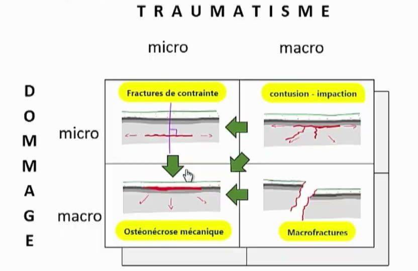
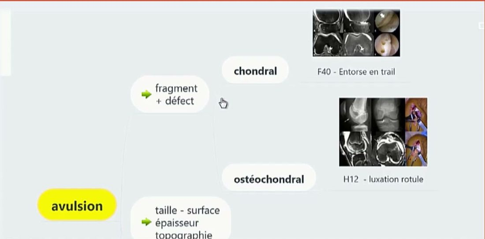
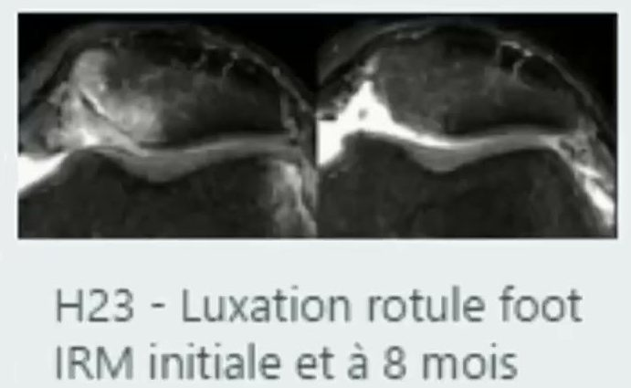
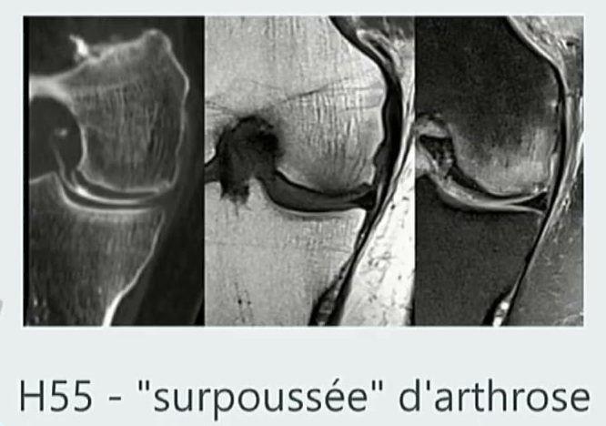

# Imagerie des lésions osseuses traumatiques

> [!abstract] L'essentiel
> **Classer toute lésion ostéochondrale traumatique dans la grille traumatisme (micro/macro) × dommage (micro/macro) et en préciser l'épicentre** : surface, sous-chondral superficiel ou profond.

> [!success] À retenir
> 1. **Avulsion ostéochondrale** après luxation patellaire du jeune : mesurer **fragment et défect** (taille, surface, épaisseur, topographie) → refixation possible.
> 2. Distinguer **contusion simple** (oriente le mécanisme : LCA, luxation patellaire) et **impact sous-chondral** = vraie fracture → décharge ; parler le même langage que le chirurgien.
> 3. **Ostéonécrose mécanique** : lésion de surface **> 4 mm** d'épaisseur avec déformation ; fracture de fatigue = épicentre **profond métaphysaire**, visible en IRM avant la radio.

## Images clés
 [▶ 18:07](https://www.youtube.com/watch?v=5wxlw9mH744&t=1087s)
 [▶ 8:26](https://www.youtube.com/watch?v=5wxlw9mH744&t=506s)
 [▶ 10:21](https://www.youtube.com/watch?v=5wxlw9mH744&t=621s)
 [▶ 17:09](https://www.youtube.com/watch?v=5wxlw9mH744&t=1029s)

## Points clés
- Communication présentée sous forme de film humoristique, avec interviews de chirurgiens, puis deux **cartes mentales** (cartilage, os).
- Vision du chirurgien : besoin de coupes sagittales et 3D ; classifications des fractures accessibles via l'application du Collège des jeunes orthopédistes (citée « CJO », sans but commercial) ; le traumatisme cartilagineux initial (contusion vue en arthroscopie) pourrait expliquer l'arthrose ultérieure après rupture du LCA, mais preuves faibles ; manque d'outils de quantification et d'un « carnet de santé du cartilage ».
- Désaccord de nomenclature entre radiologue (« bone bruise ») et chirurgien (« fracture ») : s'entendre sur le démembrement des lésions.
- Grille : contexte (**macrotraumatisme unique** vs **microtraumatismes répétés**) × dommage (**macro** vs **micro**). La case microtraumatismes/microdommage chronique aboutit à l'arthrose, hors sujet mais à garder à l'esprit.
- **Cartilage** : avulsions chondrales pures ou ostéochondrales (macro/macro) : mesurer fragment et défect (taille, surface, épaisseur, topographie) ; rares, surtout instabilité fémoropatellaire aiguë, pronostic important chez le jeune ; trois options : ablation, régénération, fixation. Contusion cartilagineuse (« cartilage bruise ») visible seulement en T2 mapping, pouvant évoluer vers l'abrasion en quelques mois. Souffrance microtraumatique liée au sport, au surpoids, aux antécédents de fracture, à l'instabilité et au morphotype.
- **Os** : contusion simple (épicentre sous-chondral superficiel, oriente vers le mécanisme : condyle latéral et rebord postérieur du plateau latéral dans la rupture du LCA, patella et condyle dans la luxation patellaire) ; **impact** sous-chondral (vraie fracture, préférer le terme « impact » ou « contusion » avec le chirurgien ; implication thérapeutique de décharge) ; macrofractures par impact ou par traction (avulsion capsulo-ligamentaire).
- Fractures de contrainte : **de fatigue** (os sain surmené, épicentre profond métaphysaire, trait net en IRM avant la radiographie) et **par insuffisance** (épicentre sous-chondral superficiel).
- **Ostéonécrose mécanique** (microtraumatismes répétés, macrodommage) : lésion de plus de 4 mm d'épaisseur avec déformation des contours, épicentre de surface ; parfois sans déformation (bande en hyposignal sur terrain de surcharge, varus, contraintes professionnelles) ; à différencier des nécroses systémiques.

## Sémiologie et technique d'imagerie
- Fractures du plateau tibial : reformations 3D, frontales et sagittales ; classifications de Schatzker, AO, et une classification dérivée de Duparc (enfoncement, séparation, refend métaphysaire, lésions associées) utilisée localement à Grenoble.
- Classification du microdommage cartilagineux citée (probablement OARSI) : décrit surface et composition, pas l'épaisseur.
- Recherche : imagerie synchrotron à Grenoble, résolution cellulaire (chondrocytes).

## Pièges et diagnostics différentiels
- Ne pas confondre contusion simple et impact sous-chondral (stade fracturaire).
- Fracture de fatigue invisible initialement en radiographie.
- Ostéonécrose mécanique sans déformation pouvant ressembler à une « ostéosclérose inflammatoire ».

> [!WARNING] À ne pas manquer
> Une avulsion ostéochondrale après luxation de la patella chez un jeune peut être repositionnée en urgence : la chercher sur la radiographie (petite écaille) et la mesurer en IRM.

> [!TIP] Pour le compte rendu
> Situer la lésion dans la grille (contexte, ampleur du dommage), préciser l'épicentre (surface, sous-chondral superficiel ou profond), mesurer fragment et défect, et employer une terminologie partagée avec le chirurgien.

## Liens
- Congrès : [[SIMS 2017 - Index]]
- Voir aussi : [[Imagerie du cartilage - que retenir]], [[Genou traumatique de l'adulte - les vraies urgences]]
