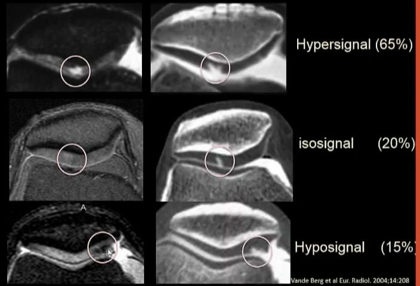
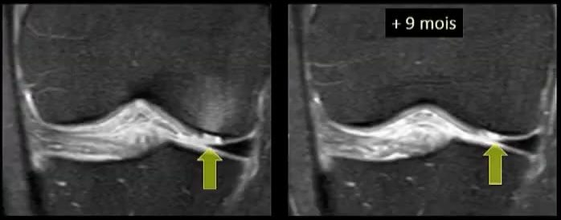
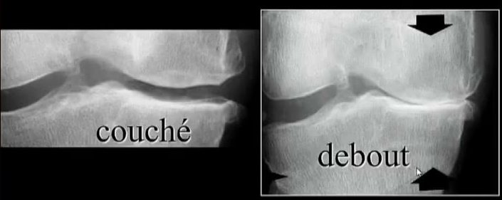

# Imagerie du cartilage - que retenir

Doublon : https://www.youtube.com/watch?v=lKvlX9DNPeo

> [!abstract] L'essentiel
> **IRM DP fat-sat (TE ≈ 35-40 ms) pour la chondropathie focale, cliché debout en flexion pour le pincement** : la cartographie T2 reste un outil de recherche.

> [!success] À retenir
> 1. Analyser **surface, substance et moelle sous-chondrale** ; un **œdème sous-chondral** signe probablement une chondropathie **évolutive**.
> 2. Signal du liquide dans une fissure : hypersignal **65 %**, isosignal **20 %**, **hyposignal 15 %** → piège de la fissure « invisible ».
> 3. Pincement : cliché **debout en flexion 20-30° (schuss)**, jamais couché ; interligne normal **médial 3,8 ± 0,3 mm**, **latéral 5,3 ± 0,7 mm** → comparer au controlatéral et à l'antérieur.

## Images clés
 [▶ 5:29](https://www.youtube.com/watch?v=hNVs1K6447c&t=329s)
 [▶ 7:11](https://www.youtube.com/watch?v=hNVs1K6447c&t=431s)
 [▶ 8:07](https://www.youtube.com/watch?v=hNVs1K6447c&t=487s)

## Points clés
- Cartilage : réseau collagénique ancré dans l'os sous-chondral ; les protéoglycanes chargés négativement attirent le sodium puis l'eau (« éponge ») et assurent la résistance mécanique.
- **Cartographie T2** : technique quantitative la plus répandue et robuste (valeur moyenne dans une ROI, biomarqueur) ; validée pour la recherche et le suivi de nouvelles thérapeutiques. Limites : variations selon les régions anatomiques, reproductibilité (écart de 20 % chez un même patient à 6 semaines), lésions très précoces sans prise en charge codifiée. Place clinique incertaine.
- En clinique, analyser trois zones : **surface, substance, socle ostéomédullaire**.
- L'IRM a une sensibilité très élevée pour les modifications du cartilage ; elle montre des fissures « fermées » invisibles en arthroscanner.
- Les anomalies de la moelle sous-chondrale signeraient probablement des chondropathies évolutives ; elles peuvent régresser alors que la chondropathie persiste ; corrélation clinique médiocre.
- Radiographie standard : examen de choix de l'arthrose évoluée, mais faible sensibilité pour les chondropathies focales (micro-géodes rares et inconstantes).

## Sémiologie et technique d'imagerie
- Séquence de référence : **pondération intermédiaire (DP) fat-sat, TE de l'ordre de 35-40 ms** ; TE trop court : faible contraste liquide-cartilage ; trop long : perte de signal du cartilage. L'écho de gradient a fait son temps.
- Le liquide pénétrant une fissure peut être en signal faible (environ 15 % des cas) : piège.
- Radiographie en **charge et en flexion** (schuss) : met en contrainte les zones d'usure ; l'équipe la réalise en postéro-antérieur (bassin, genou et pieds contre la table : stable, sans agrandissement, plus reproductible).
- Interligne normal : **3,8 ± 0,3 mm en médial** (extrêmes 2,33 à 6,33 mm) et **5,3 ± 0,7 mm en latéral** (2,5 à 7,5 mm), avec d'énormes variations individuelles ; reproductibilité meilleure en médial (surfaces convexe/concave) qu'en latéral (deux surfaces convexes).
- Signe subtil d'abrasion complète : irrégularité et aspect flou, plus dense, de la lame sous-chondrale.
- La comparaison évolutive peut montrer une dégradation progressive du cartilage, avec d'énormes variations individuelles : pincement fémorotibial médial moyen **0,26 mm/an** (0 à 0,59 mm/an, IC 95 % ; Lequesne 1992), **0,24 ± 0,50 mm en deux ans** (Vignon 2003) ; une perte ≥ 2 mm/an évoque une chondrolyse rapide.

## Pièges et diagnostics différentiels
- Cliché réalisé couché non signalé par le manipulateur : faux interligne normal.
- Hyperintensités profondes du cartilage attribuées à tort à une chondromalacie, correspondant à des réalités différentes.
- On ne peut définir une valeur « normale » d'interligne : comparer au côté controlatéral ou à l'antérieur.

> [!WARNING] À ne pas manquer
> Une radiographie normale n'élimine pas une chondropathie focale ; une IRM normale en arthroscanner peut cacher une fissure fermée, et inversement un liquide en hyposignal peut masquer une fissure.

> [!TIP] Pour le compte rendu
> Décrire surface, substance et socle sous-chondral (œdème = chondropathie probablement évolutive) ; préciser si le cliché est en charge et en flexion ; rappeler que l'image ne prédit ni la douleur ni l'évolution (« on soigne des patients, pas des images »).

## Liens
- Congrès : [[SIMS 2017 - Index]]
- Voir aussi : [[Imagerie des lésions osseuses traumatiques]], [[Itinéraire diagnostique d'un gros genou du sujet âgé]]
