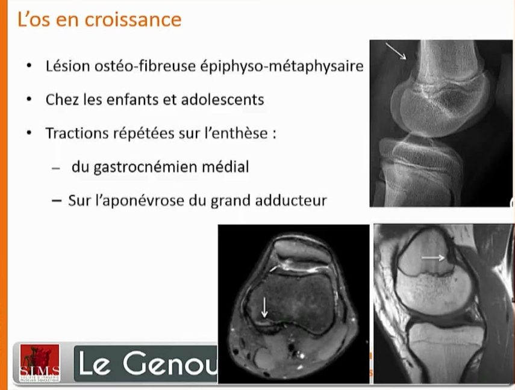
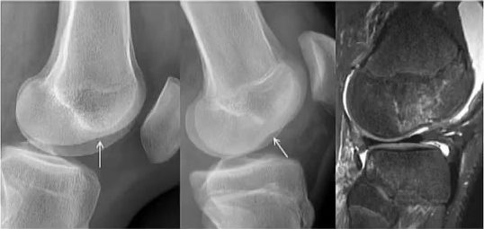
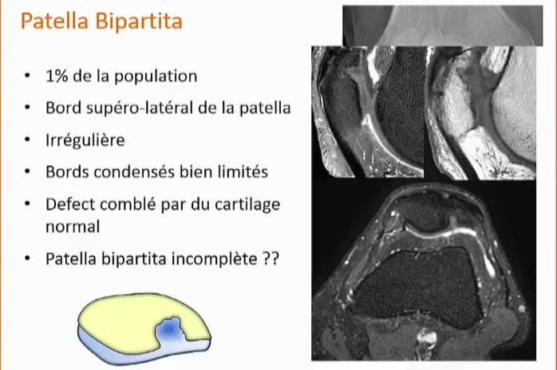

# Imagerie du genou - variantes à connaître

> [!abstract] L'essentiel
> **Une variante se reconnaît à son siège typique, ses contours nets et un cartilage normal** : ne pas la décrire comme une lésion.

> [!success] À retenir
> 1. Irrégularité épiphysaire fémorale de l'enfant (condyle médial) = **variante d'ossification** si **pas d'inflammation, pas de séquestre, cartilage normal** (≠ ostéochondrite).
> 2. **Desmoïde périosté** (face postérieure du condyle médial, enthèse du gastrocnémien médial / grand adducteur) : ne pas biopsier.
> 3. **Encoche du condyle latéral > 1,5-2 mm** = impaction → chercher une **rupture du LCA** ; l'encoche médiale est physiologique.
> 4. **Défect dorsal** / patella bipartite : supéro-latéral, bords condensés, **cartilage d'encroûtement normal**.

## Images clés
 [▶ 1:33](https://www.youtube.com/watch?v=qCEolpHedBc&t=93s)
 [▶ 2:03](https://www.youtube.com/watch?v=qCEolpHedBc&t=123s)
 [▶ 5:33](https://www.youtube.com/watch?v=qCEolpHedBc&t=333s)

## Points clés
- **Enfant** : bandes métaphysaires condensantes entre 2 et 5 ans (os en croissance, non métaboliques) ; noyaux épiphysaires irréguliers, « efflorescents », surtout au condyle médial ; plus tard aspect pseudo-lacunaire condylien (médial, latéral ou bilatéral), bien limité.
- Critères de variante d'ossification (échographie, IRM) : **pas d'élément inflammatoire, pas de séquestre** évoquant une ostéochondrite, **cartilage normal**.
- **Desmoïde périosté** : remaniement ostéofibreux de la face postérieure de la métaphyse fémorale distale, à l'enthèse du gastrocnémien médial ou de l'aponévrose du grand adducteur (adaptation aux tractions répétées), pouvant persister chez l'adulte (érosion, irrégularité).
- **Encoche condylienne latérale** : ne doit pas dépasser 1,5 à 2 mm de profondeur (sinon lésion du pivot central, impaction ; signe de la double encoche). **Encoche condylienne médiale** : moins connue, plus antérieure et périphérique, adaptation fonctionnelle à l'extension complète ; ne pas en tenir compte pour mesurer l'interligne (intérêt du cliché en schuss).
- **Pseudo-appositions périostées** : proéminence de la crête interosseuse tibiale ou fibulaire, à ne pas prendre pour une réaction périostée néoplasique.
- **Éperons osseux** (tubercule du grand adducteur, enthèse du soléaire sur la fibula) : sans coiffe cartilagineuse, à distinguer d'un ostéochondrome.
- **Fabella** : sésamoïde le plus fréquent, postérolatéral, souvent bilatéral, dans le gastrocnémien latéral, articulé avec le condyle latéral ; remaniements dégénératifs, possible source de douleur sous-estimée ; pathologie propre traumatique ou microtraumatique rare.
- **Patella bipartite ou multipartite** : forme la plus fréquente supéro-latérale, souvent bilatérale ; cartilage d'encroûtement normal ; peut souffrir lors d'un traumatisme (traction, vraie fracture avec dissociation).
- **Défect dorsal de la patella** : supéro-latéral, lacune à contours nets condensés, comblée de cartilage, cartilage d'encroûtement normal ; parfois vu comme forme mineure de bipartition.
- Ménisque discoïde : complet, incomplet (moins de 80 %), type Wrisberg (défaut d'attache postérieure, hypermobilité, seul ligament de Wrisberg volumineux) ; formes annulaires très rares. **Ossicule méniscal** : rare, surtout médial, plutôt traumatique ou dégénératif, souvent avec lésions méniscales associées.
- **Plica infrapatellaire** : faisceaux d'organisation variable dans le Hoffa, s'insérant en avant du LCA ; rarement symptomatique.
- « Bourses » souvent récessus articulaires, fréquemment secondaires à une pathologie articulaire (bourse de la patte d'oie, bursite infrapatellaire profonde communicante avec synovite).

## Sémiologie et technique d'imagerie
- Cartilage : signal modulé par la structure en couches, l'**effet d'angle magique** (majoration du T2 vers 55° par rapport à B0) et le **déplacement chimique** dans le sens du codage en fréquence (variation apparente d'épaisseur).
- Un **hyposignal** intracartilagineux peut être pathologique : fissure à berges collabées, visible en s'ouvrant sur les coupes adjacentes.

## Pièges et diagnostics différentiels
- Variante d'ossification vs ostéochondrite : séquestre, inflammation, atteinte cartilagineuse.
- Patella bipartite vs double patella ou fracture.
- Crête interosseuse vs réaction périostée ; éperon vs exostose.

> [!WARNING] À ne pas manquer
> Toutes les anomalies cartilagineuses ne sont pas en hypersignal : une fissure collabée peut être en hyposignal.

> [!TIP] Pour le compte rendu
> Nommer la variante, préciser l'absence d'inflammation et l'intégrité du cartilage, et ne signaler une portée clinique que si des signes de souffrance (œdème, rupture cartilagineuse) sont présents.

## Liens
- Congrès : [[SIMS 2017 - Index]]
- Voir aussi : [[Interprétation comparée et évolutive des caractéristiques et des variantes du genou]], [[Le genou douloureux non traumatique de l'enfant (partie 2)]]
