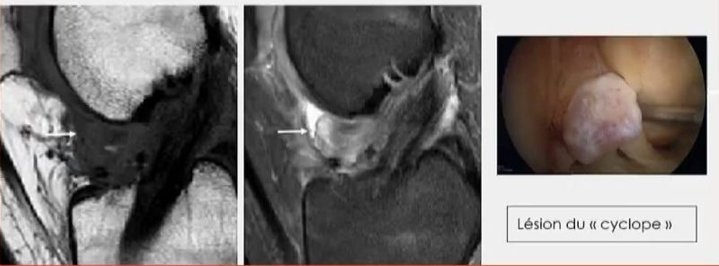
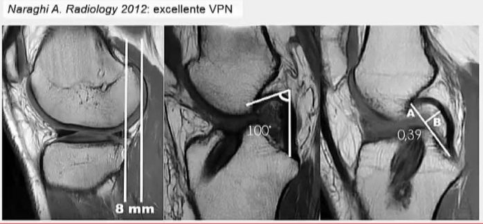
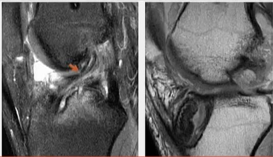

# Imagerie postopératoire des complications de ligamentoplastie

Doublon : https://www.youtube.com/watch?v=voQGRWxtVhQ

> [!abstract] L'essentiel
> **Plastie du LCA : radio pour les tunnels, IRM pour les complications** : toujours lire avec la technique (KJ ou DIDT) et le délai postopératoire.

> [!success] À retenir
> 1. **Hypersignal du greffon normal jusqu'à 18 mois** (ligamentisation) ; tunnel à bords parallèles, diamètre **KJ < 14 mm, DIDT < 20 mm**.
> 2. Laxité : **tiroir ≥ 8 mm**, angle du LCP **< 100°**, ratio d'incurvation du LCP **0,39** (excellente VPN, Naraghi 2012).
> 3. **Cyclope** ou **conflit du greffon** avec le toit de l'échancrure → chercher un **tunnel tibial trop antérieur**.

## Images clés
 [▶ 5:04](https://www.youtube.com/watch?v=C7X3Nlk6fkk&t=304s)
 [▶ 4:02](https://www.youtube.com/watch?v=C7X3Nlk6fkk&t=242s)
 [▶ 5:49](https://www.youtube.com/watch?v=C7X3Nlk6fkk&t=349s)

## Points clés
- Radiographies postopératoires systématiques : face et profil en charge et en extension. Arthroscanner réservé aux contre-indications à l'IRM.
- Analyse successive : **position des tunnels, diamètre, signal du transplant**.
- Tunnel trop antérieur : conflit avec le toit de l'échancrure en flexion ; trop postérieur : verticalisation du greffon et excès de tension en extension.
- Signal du greffon : avasculaire et en hyposignal en postopératoire immédiat ; **ligamentisation** jusqu'à 18 mois (néovascularisation, hypersignal T1 et T2) ; puis maturation (hyposignal). Des stries en hypersignal T2 peuvent persister sans caractère pathologique.
- Laxité postopératoire (1 à 8 % selon les séries), évaluation essentiellement clinique ; trois signes IRM très spécifiques avec excellente valeur prédictive négative (Naraghi, Radiology 2012) : tiroir antérieur d'au moins 8 mm, angle du LCP inférieur à 100°, ratio d'incurvation du LCP d'environ 0,39.
- Rupture de plastie : souvent après un nouveau traumatisme, le plus souvent complète ; solution de continuité de toutes les fibres avec interposition liquidienne, tiroir, épanchement, contusions osseuses.
- **Arthrofibrose** : lésion du **cyclope** (nodule à la partie antérieure de l'échancrure, signal hétérogène) ; cyclopes « durs » symptomatiques ; formes postérieures ou diffuses.
- **Conflit (cisaillement) du greffon** avec la partie antéro-inférieure de l'échancrure : signes de rupture partielle (greffon aminci, effiloché, incurvé) ; rechercher un tunnel tibial trop antérieur.
- Kystes de tunnel (surtout tibiaux) : non associés à l'instabilité mais douloureux s'ils s'extériorisent en sous-cutané.
- Complications de matériel : conflit d'une vis fémorale avec la bandelette iliotibiale, migration intra-articulaire au contact du paquet vasculaire.

## Sémiologie et technique d'imagerie
- Protocole IRM minimal : sagittal pondéré T1 ou DP, et DP fat-sat dans les trois plans ; séquences isotropes utiles pour les reformations mais sans supériorité démontrée.
- Tunnel fémoral (face) : partie haute de la face axiale du condyle latéral, environ 2 h (genou gauche) ou 10 h (genou droit), angle d'environ 40° avec la diaphyse ; (profil) à l'intersection ligne de Blumensaat-corticale postérieure, 1 à 2 mm en avant de la corticale.
- Tunnel tibial : débouche en regard des épines, plus vertical (environ 70° sur le plateau) ; de profil parallèle à la ligne de Blumensaat, s'ouvrant au niveau du 2e quart antérieur du plateau.
- Tunnel à bords strictement parallèles ; diamètre dépendant du greffon (KJ < 14 mm, DIDT < 20 mm), peut croître sans caractère pathologique la première année.

## Pièges et diagnostics différentiels
- Hypersignal T2 résiduel du greffon mature vs **infiltration mucoïde** (greffon élargi en hypersignal, pouvant s'étendre au tunnel).
- Kyste de tunnel vs infiltration liquidienne physiologique jusqu'à 18 mois (bords du tunnel restant parallèles).
- Spécificités : KJ (tendon patellaire) : douleurs du site de prélèvement, restauration complète en 2 ans, tendinopathie patellaire possible ; DIDT : lésion de la branche infrapatellaire (sartoriale) du nerf saphène, névrome mieux vu en échographie.

> [!WARNING] À ne pas manquer
> Un tunnel tibial trop antérieur est la cause à rechercher devant un cyclope ou un conflit du greffon ; un matériel migré peut menacer le paquet vasculaire poplité.

> [!TIP] Pour le compte rendu
> Préciser technique opératoire (KJ, DIDT), délai, position et diamètre des tunnels, continuité et signal du greffon, cyclope, kystes, matériel, et signes indirects de laxité.

## Liens
- Congrès : [[SIMS 2017 - Index]]
- Voir aussi : [[Actualités sur le traitement chirurgical du LCA]], [[Imagerie des atteintes du pivot central]], [[Imagerie postopératoire des ménisques]]
