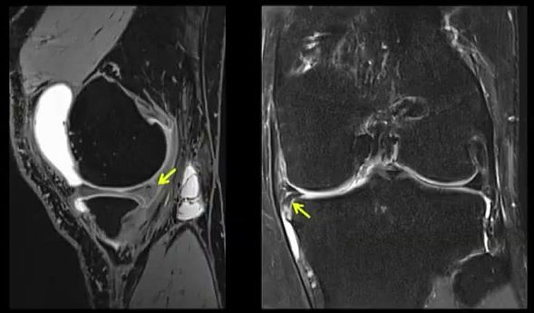
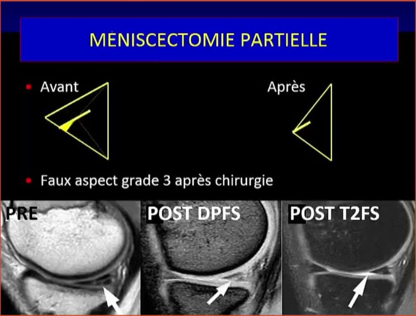
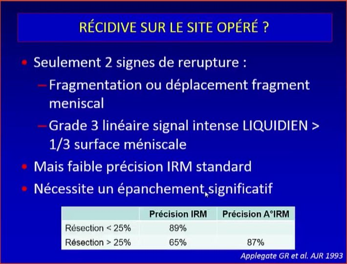

# Imagerie postopératoire des ménisques

> [!abstract] L'essentiel
> **Ménisque opéré : seuls 2 signes affirment la re-rupture, fragment déplacé ou hypersignal liquidien de grade 3 > 1/3 de la surface** : sinon, cicatrice.

> [!success] À retenir
> 1. Après méniscectomie partielle, un **faux aspect de grade 3** (cicatrice communiquant avec la surface) est la règle : ne pas conclure à une récidive.
> 2. Après suture : grade 3 transfixiant chez **39,5 % en DP FS** mais **5,3 % en T2 TE 85 ms** → ajouter un **T2 à TE long** ; extinction du signal = cicatrisation (**Se et Sp ≈ 80 %**).
> 3. Chercher systématiquement : **languette luxée** (récessus méniscotibial), **fracture sous-chondrale** « ostéonécrose » post-méniscectomie, **chondrolyse rapide** ; si doute ou résection **> 25 %** → **arthro-IRM directe** (précision 87 % contre 65 % en IRM).

## Images clés
 [▶ 5:07](https://www.youtube.com/watch?v=xQluDjEpZL0&t=307s)
 [▶ 9:24](https://www.youtube.com/watch?v=xQluDjEpZL0&t=564s)
 [▶ 5:42](https://www.youtube.com/watch?v=xQluDjEpZL0&t=342s)

## Points clés
- Imagerie postopératoire en règle **pas avant 6 mois** (temps de cicatrisation méniscale), sauf symptôme nouveau (blocage, douleur aiguë) qui impose des radiographies.
- La littérature recommande souvent une injection intra-articulaire d'emblée (suture méniscale, ou méniscectomie de plus de 25 %), mais en pratique le compte rendu opératoire est rarement disponible : l'orateur propose une **IRM conventionnelle d'abord**, l'arthrographie seulement en cas de non-contribution.
- L'IRM conventionnelle détecte de nombreuses complications sans arthrographie : chondrolyse rapide (comparer à l'imagerie préopératoire), fractures par insuffisance et évolution vers l'ostéonécrose, algodystrophie, kyste paraméniscal, granulome à corps étranger, migration de matériel, lésion neurovasculaire, piégeage du tendon poplité ou d'un faisceau du LCM, fragment méniscal déplacé (récessus méniscotibial), nouvelle fissure à distance ou sur le ménisque controlatéral.
- Signes de re-rupture sur la zone opérée : fragment déplacé, ou persistance d'un hypersignal linéaire de **grade 3 d'intensité liquidienne** sur plus d'un tiers de la surface méniscale (diapo). Précision de l'IRM standard 89 % si résection < 25 %, mais 65 % si résection > 25 % (87 % en arthro-IRM ; Applegate, AJR 1993).
- Aucun seuil d'étendue fiable : rester **descriptif** plutôt que conclure à une cicatrisation « satisfaisante » ou non.
- Arthroscanner après suture : quantifier l'opacification de la zone suturée en proportion de la hauteur méniscale (cicatrisation partielle ou d'environ 50 %).
- L'apport de l'injection intra-articulaire est plus net à 1,5 T qu'à 3 T.

## Sémiologie et technique d'imagerie
- Séquences 3D de bonne qualité (écho de spin rapide) pour l'analyse fine du cartilage et des reformations (fragment déplacé en axial).
- Matériel métallique associé : séquences de réduction d'artefacts, voire scanner.
- **Allonger le TE** (pondération T2 vers 80-85 ms) : la diminution ou l'extinction de l'hypersignal intraméniscal plaide pour une cicatrisation ; la persistance d'un signal liquidien plaide contre. Gain de spécificité au prix d'une perte de sensibilité.
- Arthro-IRM : un hypersignal en densité de protons non opacifié en T1 n'est pas significatif.

## Pièges et diagnostics différentiels
- Après méniscectomie partielle, la portion stable laissée en place garde un **hypersignal cicatriciel** communiquant avec la surface, pouvant mimer une récidive de grade 3 (faux positif).
- Arthro-IRM indirecte peu adaptée après suture : rehaussement fibro-vasculaire de la zone suturée.

> [!WARNING] À ne pas manquer
> Un hypersignal intraméniscal sur la zone opérée n'est pas synonyme de re-rupture : vérifier sur une pondération T2 longue et, en cas de doute, proposer une arthrographie.

> [!TIP] Pour le compte rendu
> Décrire l'étendue de l'hypersignal sur la zone opérée, sa persistance en T2 long, la présence ou non d'un fragment déplacé, et rechercher les complications ostéochondrales et périarticulaires ; conclure à un doute éventuel avec proposition d'arthroscanner ou d'arthro-IRM.

## Liens
- Congrès : [[SIMS 2017 - Index]]
- Voir aussi : [[Imagerie postopératoire des complications de ligamentoplastie]], [[IRM du genou - quand et pourquoi injecter]]
