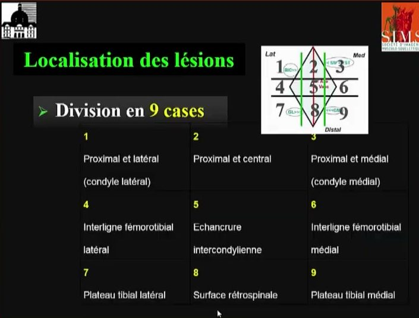
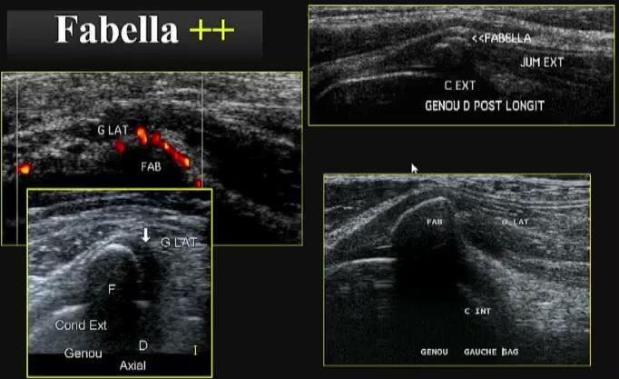
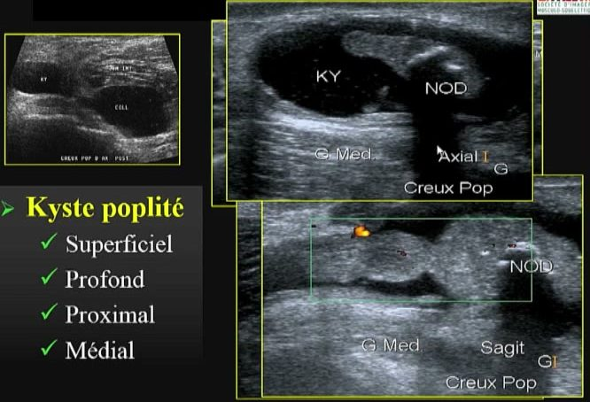

# Itinéraire d'imagerie d'une douleur postérieure - place de l'imagerie

> [!abstract] L'essentiel
> **Creux poplité douloureux ≠ kyste poplité** : balayer en échographie les **9 cases** (3 × 3) avec comparaison controlatérale et palpation sous la sonde.

> [!success] À retenir
> 1. Case proximale latérale : **fabella** 9 fois sur 10 (conflit condylien, fragmentation, Doppler) ; case centrale : **ganglions**.
> 2. **Kyste poplité** : affirmer le **collet** entre semi-membraneux et gastrocnémien médial ; analyser paroi, **nodules** et vascularisation avant ponction ; rupture souvent prise pour une **phlébite** (anticoagulants délétères).
> 3. **Jamais de ponction** d'un **kyste adventitiel** ou d'une masse avec rameau artériel afférent ; nodules ostéochondromateux → **radiographie** indispensable.

## Images clés
 [▶ 0:23](https://www.youtube.com/watch?v=JVdSTD4B2Qo&t=23s)
 [▶ 0:53](https://www.youtube.com/watch?v=JVdSTD4B2Qo&t=53s)
 [▶ 5:00](https://www.youtube.com/watch?v=JVdSTD4B2Qo&t=300s)

## Points clés
- Approche essentiellement **échographique**, avec comparaison controlatérale (avantage majeur de l'échographie) et palpation sous la sonde.
- **Case 1 (proximale latérale)** : neuf fois sur dix la **fabella** (dans le tendon du gastrocnémien latéral) : hyperpression contre le cartilage condylien en hyperextension, irritation tendineuse, fragmentation avec réaction Doppler, voire conflit avec le nerf fibulaire commun si hypertrophique ; plus rarement nodules ostéochondromateux, enthésopathie sur la coque.
- **Case 2** : quasiment uniquement des **kystes mucoïdes (ganglions)** ; vus en IRM, plus difficiles en échographie (Doppler, douleur provoquée à la pression).
- **Case 3 (proximale médiale)** : expansions proximales de kyste poplité sous la jonction myotendineuse du semi-membraneux, fréquentes, douloureuses, pouvant se rompre ; enthésopathie calcifiante du gastrocnémien médial, pathologie du semi-tendineux, désinsertions myotendineuses du semi-membraneux.
- **Interligne latéral** : jonction myotendineuse du poplité et capsule ; lésions du ligament collatéral latéral, selon l'orateur souvent **isolées** chez le sportif (rupture complète compatible avec la course).
- **Kyste poplité** : n'en parler qu'après avoir vu son passage entre semi-membraneux et gastrocnémien médial ; aspect bilobé en bissac ; la portion profonde, proche de l'axe neurovasculaire, peut donner des irradiations atypiques. Analyser paroi, nodules et vascularisation pariétale avant ponction.
- **Rupture de kyste poplité** : souvent prise pour une phlébite, les anticoagulants aggravant le tableau ; vue tardivement, seule persiste une lame liquidienne superficielle au gastrocnémien médial : interroger sur un antécédent de kyste.
- Axe vasculaire : **kyste adventitiel** de l'artère poplitée (kyste articulaire colonisant la paroi) à ne pas ponctionner ; thrombose veineuse poplitée parfois trompeuse (prise pour un syndrome des loges) ; anévrisme.
- **Récessus postérieur au LCP** : distinct du kyste du croisé, souvent douloureux, répond bien aux infiltrations échoguidées. Lésions récentes du LCA et lésions partielles du LCP visibles en échographie.
- **Case 6** : ténosynovite du semi-membraneux, souvent associée à une souffrance débutante de l'interligne fémorotibial ; nodules ostéochondromateux dans la gaine ; désinsertions périphériques du ménisque (comparaison controlatérale) ; rupture du semi-tendineux, quasi constamment manquée cliniquement.
- **Partie distale** : insertion du biceps sur la tête fibulaire (expansion tibiale), fractures du plateau tibial, lésions du muscle poplité (collection ou hématome pouvant comprimer le nerf tibial). **Case 8** : nodules ostéochondromateux, mal vus en échographie (radiographie indispensable). **Case 9** : insertion distale du semi-membraneux et son tendon réfléchi (ténosynovites), séquelles de prélèvement DIDT.

## Sémiologie et technique d'imagerie
- Ganglion : petite plage ovalaire, Doppler parfois positif, reproduction de la douleur à la pression.
- Masse avec **rameau artériel afférent** : ne pas ponctionner ; ce n'est pas un kyste.
- Faisceaux musculaires accessoires hypertrophiés chez le sportif simulant une tumeur : épreuve de contraction.

## Pièges et diagnostics différentiels
- TCG ténosynoviale (SVN) : l'échographie est mauvaise, ce n'est pas le bon examen.
- Petit sarcome méconnu en IRM à cause des artefacts de battements artériels.
- Vider complètement un kyste contenant un nodule : frottement de la paroi, majoration de la douleur.

> [!WARNING] À ne pas manquer
> Rupture de kyste poplité prise pour une thrombose et traitée par anticoagulants ; masse vascularisée par un rameau artériel prise pour un kyste : ne jamais ponctionner un kyste adventitiel ni une masse vascularisée.

> [!TIP] Pour le compte rendu
> Récuser la demande réductrice « kyste poplité » : explorer systématiquement les 9 cases, préciser le collet du kyste, sa paroi, ses nodules, une rupture, et toujours demander une radiographie pour les nodules ostéochondromateux.

## Liens
- Congrès : [[SIMS 2017 - Index]]
- Voir aussi : [[Pathologie synoviale tumorale et pseudotumorale]], [[Imagerie du genou - variantes à connaître]], [[IRM du genou - quand et pourquoi injecter]]
