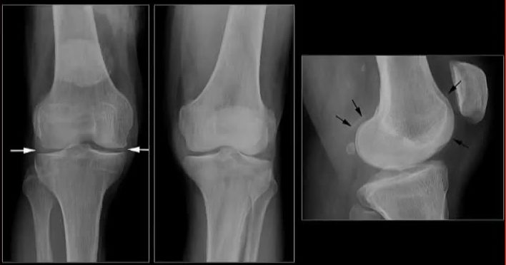
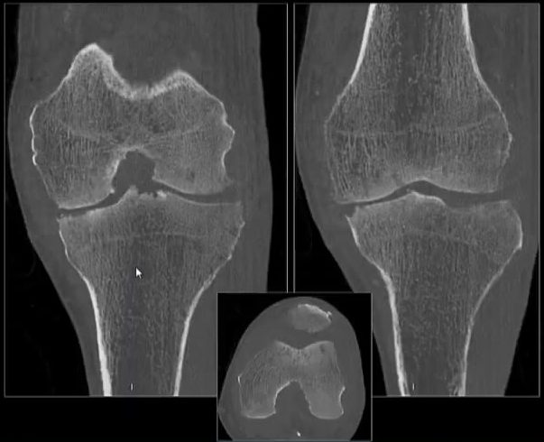
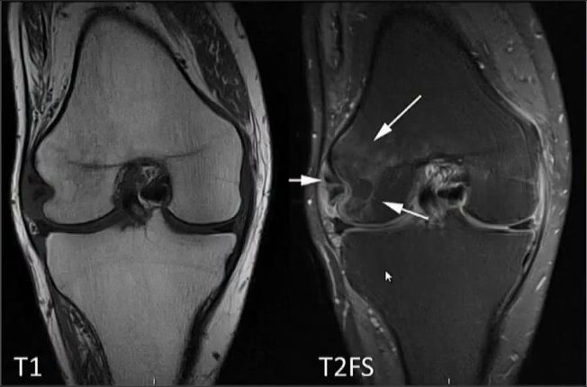

# Itinéraire diagnostique d'un gros genou du sujet âgé

> [!abstract] L'essentiel
> **Gros genou du sujet âgé = ponction d'abord : l'aspect du liquide (hémorragique, clair, trouble) dicte l'enquête et l'imagerie** : radiographie systématique, IRM rarement.

> [!success] À retenir
> 1. **Hémarthrose** : chute, **surdosage AVK**, puis **chondrocalcinose** sévère (première cause articulaire), arthrose évoluée, arthropathie nerveuse.
> 2. Liquide **clair (< 1 000 éléments/mm³)** = arthrose ou CCA → radiographie ; **IRM seulement si discordance radio-clinique ou douleur brutale** (fissure méniscale, accident sous-chondral).
> 3. Liquide **trouble (> 2 000/mm³)** = arthrite septique jusqu'à preuve du contraire (souvent abâtardie chez l'âgé) ou microcristalline ; **goutte révélée par le genou dans 10–15 %** des cas.

## Images clés
 [▶ 5:39](https://www.youtube.com/watch?v=Hts8hkYQ9b0&t=339s)
 [▶ 9:45](https://www.youtube.com/watch?v=Hts8hkYQ9b0&t=585s)
 [▶ 11:05](https://www.youtube.com/watch?v=Hts8hkYQ9b0&t=665s)

## Points clés
- Interrogatoire : antécédents, ancienneté (récent si moins de 3 mois, ou chronique), atteinte mono- ou pluri-articulaire. Hors sujet : inflammations périarticulaires, atteintes osseuses, SDRC de type 1.
- L'épanchement se voit, se palpe et **se ponctionne dès la fin de l'examen clinique**.
- **Hémarthrose** (liquide hémorragique non coagulable, à distinguer d'une ponction traumatique) : éliminer d'abord un **traumatisme** (chutes), puis un **trouble de l'hémostase acquis** (surdosage en AVK surtout, insuffisance hépatocellulaire, carence en vitamine K ou C chez le dénutri) ; ensuite causes articulaires : arthrose sévère avec os sous-chondral à nu, et surtout **chondrocalcinose** sévère (plus grande pourvoyeuse d'hémarthroses), arthropathie nerveuse (rare, classique, peu douloureuse).
- **Liquide mécanique** (clair, visqueux, moins de 1 000 éléments/mm³) : radiographie ; deux étiologies principales : arthrose et chondrocalcinose (parfois arthropathie nerveuse). Poussée congestive d'arthrose : décharge et anti-inflammatoires généraux voire locaux.
- **IRM non indiquée** devant un épanchement clair, sauf **discordance radio-clinique** ou **accident brutal** (fissure méniscale, accident sous-chondral : fissure et/ou nécrose). Inutile pour vérifier le cartilage : l'arthrose est une maladie de tout l'organe et plus elle est sévère en radiographie, plus les tissus sont atteints en IRM.
- **Liquide trouble ou purulent** (plus de 2 000 éléments/mm³) : **arthrite septique** (tableau souvent abâtardi, décapité par antibiotiques, sepsis au premier plan) ou **arthrite microcristalline** ; parfois poussée d'un rhumatisme inflammatoire connu. Enquête : portes d'entrée, hémocultures, examen direct et culture du liquide, recherche de microcristaux, écho-Doppler, radiographies.
- **Goutte** : l'arthrite du genou est la première manifestation dans 10 à 15 % des cas.

## Sémiologie et technique d'imagerie
- Hémarthrose sous AVK après chute : radiographie (pas de fracture, densité des parties molles), échographie (hématome des parties molles et hémarthrose).
- Arthrose : pincement fémorotibial médial, épines tibiales pointues, ostéophytes, densification du spongieux, modelage et cupulisation du plateau.
- Chondrocalcinose : méniscocalcinose, dépôts de pyrophosphate de calcium dans le cartilage et la capsule (visibles en échographie), géodes pseudotumorales (plateau tibial latéral, tête fibulaire) ; cristaux parallélépipédiques ou losangiques, faiblement biréfringents.
- Arthropathie nerveuse : destruction épiphysaire, désaxation, fragmentation, voire luxation.
- IRM en discordance : chondropathie, ménisque dégénéré extrus, atteinte ligamentaire ; fissure méniscale avec œdème en miroir (dysfonction ostéoméniscale) ; œdème sous-chondral étendu d'un accident aigu.
- Arthrite septique : érosions apparaissant en une quinzaine de jours, effacement des lames sous-chondrales, micro-érosions sous-chondrales (scanner).
- Goutte : fossette d'insertion du poplité trop creusée, **tophus** en échographie, cristaux caractéristiques en aiguille ; dépôts et œdème en IRM.

## Pièges et diagnostics différentiels
- Ponction traumatique vs hémarthrose (coagulabilité).
- Absence d'érosion radiographique précoce n'élimine pas une arthrite septique.

> [!WARNING] À ne pas manquer
> Chez le sujet âgé, l'arthrite septique peut être masquée par un sepsis au premier plan ou une antibiothérapie préalable : ponction systématique ; vérifier l'hémostase (AVK) devant une hémarthrose.

> [!TIP] Pour le compte rendu
> Préciser l'épanchement, la chondrocalcinose, les érosions, l'arthrose et sa sévérité ; ne proposer l'IRM qu'en cas de discordance radio-clinique ou de douleur brutale.

## Liens
- Congrès : [[SIMS 2017 - Index]]
- Voir aussi : [[Pathologie synoviale tumorale et pseudotumorale]], [[Imagerie du cartilage - que retenir]]
