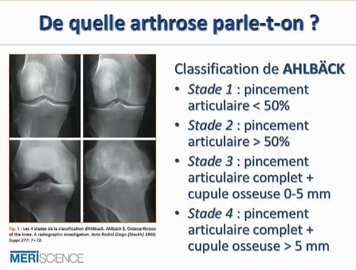
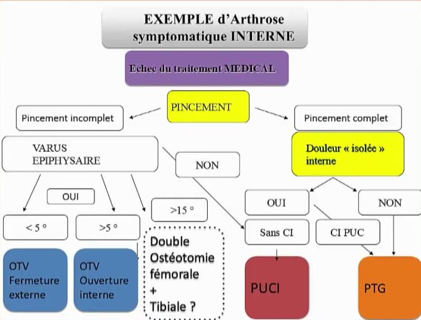
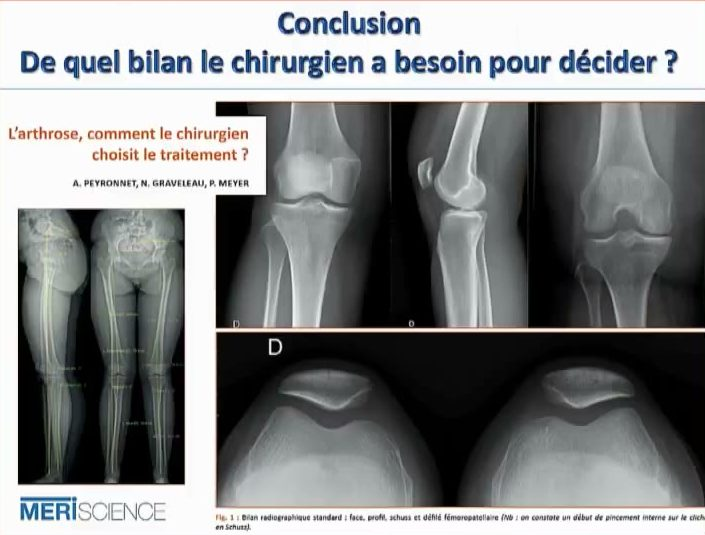

# L'arthrose du genou : comment le chirurgien choisit le traitement

> [!abstract] L'essentiel
> **Le chirurgien décide sur des radios en charge : pincement (schuss), stade d'Ahlbäck, axes et LCA** : ostéotomie, PUC ou PTG, presque jamais arthroscopie.

> [!success] À retenir
> 1. Bilan **toujours** : face, profil, **schuss**, DFP à **30°** en charge + **pangonogramme / EOS** ; IRM, arthroscanner, scanner seulement « parfois ».
> 2. **Ahlbäck** : stade 1 pincement **< 50 %**, 2 **> 50 %**, 3 pincement complet + cupule **0-5 mm**, 4 cupule **> 5 mm**.
> 3. Arthrose médiale : pincement **incomplet + varus épiphysaire** → **ostéotomie tibiale** (fermeture externe < 5°, ouverture interne > 5°, double si > 15°) ; pincement **complet** isolé → **PUC** si LCA compétent, sinon **PTG**.

## Images clés
 [▶ 1:40](https://www.youtube.com/watch?v=DzNy-oKd1pQ&t=100s)
 [▶ 9:49](https://www.youtube.com/watch?v=DzNy-oKd1pQ&t=589s)
 [▶ 10:06](https://www.youtube.com/watch?v=DzNy-oKd1pQ&t=606s)

## Points clés
- Arthrose = maladie évolutive par phases (stabilisation, aggravation) : la décision dépend du moment et s'appuie sur une « boussole » clinique et radiologique.
- Ne pas confondre dans les CR **arthrose** et **lésions cartilagineuses focales** (hors sujet ici).
- Radiographies : pincement et signes classiques, mais aussi **subluxation** et translation (ex. tiroir postérieur sur rupture ancienne du LCP non opérée) ; caractère comparatif ; **classification d'Ahlbäck** (pincement, cupule d'usure osseuse) fréquemment utilisée.
- Pas de corrélation stricte entre intensité des symptômes et gravité radiologique.
- Indication = gain attendu de la chirurgie, selon l'écart entre attentes du patient, résultat fonctionnel réel et état au moment de l'opération.
- **Arthroscopie** : quasi pas d'indication (corps étranger, languette méniscale déplacée symptomatique) ; la « ménisco-arthrose » ne se traite pas ; risque d'accélération de l'arthrose (consensus ESSKA).
- **Ostéotomie** : corrige l'axe frontal (parfois sagittal, pathologie du LCA), patient jeune et actif, surtout avec tibia vara constitutionnel ; permet des activités sportives (étude de M. Bonnin) ; ostéotomies de la TTA dans l'arthrose fémoropatellaire isolée.
- **Prothèse unicompartimentale** (médiale, latérale — bons résultats des équipes lyonnaises —, rarement fémoropatellaire) : usure d'un seul compartiment, déformation réductible, genou stable, patient peu lourd ; contre-exemple d'une PUC médiale chez un patient sans LCA avec dégradation rapide.
- **Prothèse totale** : quand les autres options sont fermées ; indication la plus fréquente.
- **Arthrodèse** : n'a plus de place dans l'arthrose (gêne pour la marche, l'escalier, le vélo, le relevé de chaise), sauf échec de PTG notamment septique.
- Contre-indications générales : obésité, antécédents septiques, vasculaires, comorbidités.

## Sémiologie et technique d'imagerie
- Le chirurgien compte sur le radiologue pour le **schuss** (atout français) et les grands axes ; le scanner permet désormais la planification de certaines prothèses.
- Bilan de décision (diapo de conclusion) : **toujours** radiographies en charge (face, profil, schuss, défilé fémoropatellaire à 30°) et axes par pangonogramme / EOS ; **parfois** IRM (ménisques, nécrose, LCA), arthroscanner (corps étrangers, butoirs), scanner (TA-GT, défect osseux, guides de coupe) ; **rarement** scintigraphie, échographie (kyste).
- Classification d'Ahlbäck : stade 1 pincement < 50 %, stade 2 > 50 %, stade 3 pincement complet + cupule osseuse 0-5 mm, stade 4 cupule > 5 mm.

## Pièges et diagnostics différentiels
- Méconnaître une insuffisance du LCA avant prothèse unicompartimentale.
- Indiquer une arthroscopie sur une lésion méniscale découverte fortuitement lors d'une poussée.

> [!WARNING] À ne pas manquer
> La lésion méniscale d'une arthrose ne relève pas de l'arthroscopie : elle peut accélérer la dégradation.

> [!TIP] Pour le compte rendu
> Préciser le compartiment atteint, le stade d'Ahlbäck, la subluxation, l'axe et l'état du LCA, éléments qui orientent entre ostéotomie, PUC et PTG.

## Liens
- Congrès : [[SIMS 2017 - Index]]
- Voir aussi : [[La prise en charge médicale de l'arthrose]], [[Prise en charge des lésions méniscales sur genou arthrosique]], [[La prothèse douloureuse - les attentes du chirurgien]]
