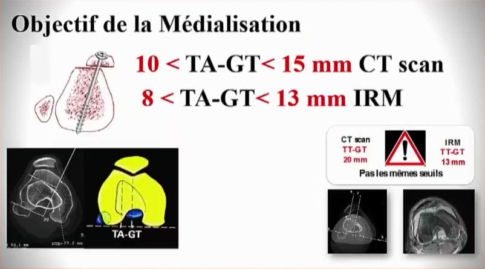
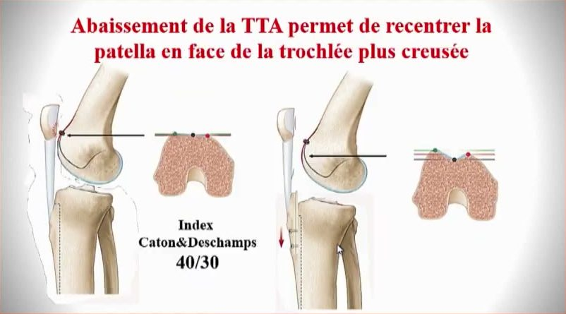

# L'instabilité patellaire objective : indications chirurgicales

> [!abstract] L'essentiel
> **On opère une patella qui se luxe, jamais une patella qui fait mal** : le chirurgien corrige au millimètre d'après les mesures du compte rendu.

> [!success] À retenir
> 1. **TA-GT pathologique : ≥ 20 mm au scanner, ≥ 13 mm en IRM** ; cible après médialisation **10-15 mm (TDM) / 8-13 mm (IRM)** → toujours préciser la modalité.
> 2. **Caton-Deschamps** = index chirurgical (cible **≈ 1**) ; patella alta + **engagement sagittal** négatif → abaissement de la TTA + LFPM.
> 3. Dysplasie de haut grade avec **éperon (types B/D)** → discuter la **trochléoplastie** ; jamais d'arthroscopie isolée.

## Images clés
 [▶ 8:11](https://www.youtube.com/watch?v=uF71EGvPSOQ&t=491s)
 [▶ 8:49](https://www.youtube.com/watch?v=uF71EGvPSOQ&t=529s)

## Points clés
- Distinguer **douleur et instabilité** ; analyser le système local (trochlée, patella, cartilage), l'alignement global (appareil extenseur, bascule, TA-GT, torsions) et le système d'activation (muscles, cerveau).
- Anamnèse : antécédents familiaux (composante génétique de la dysplasie), vraie luxation vs sensation d'instabilité.
- **Luxation objective** : premier épisode marquant, haute énergie, rupture du rétinaculum médial et hémarthrose. **Instabilité subjective** : « luxation » en descendant un escalier = inhibition réflexe du quadriceps.
- Trois populations : **instabilité patellaire objective** (toujours une anomalie anatomique), **instabilité patellaire potentielle** (anomalies + douleurs, souvent le genou controlatéral), **syndrome patellaire douloureux** (radiographies normales).
- Trois facteurs principaux (identifiés en 1987) : **dysplasie trochléenne** (classer en combinant radiographies et imagerie en coupes), **TA-GT**, **patella alta** ; facteurs secondaires : torsions, valgus, recurvatum.
- **Seuils TA-GT : 20 mm au scanner, 13 mm en IRM** ; cible postopératoire 10-15 mm au scanner, 8-13 mm en IRM ; mesure peu fiable (variations marquées).
- **Caton-Deschamps** : index le plus « chirurgical » (modifié par l'abaissement de la TTA), cible = 1 ; à confronter à l'**index d'engagement sagittal**.
- IRM en phase aiguë : siège de rupture du LFPM (patellaire, fémoral, intermédiaire), fractures ostéochondrales invisibles en radiographie, bascule.

## Sémiologie et technique d'imagerie
- Indication chirurgicale après 1 à 3 épisodes de luxation objective ; **jamais d'arthroscopie isolée** ; pas de chirurgie pour la douleur fémoropatellaire ; peu d'indications dans l'instabilité potentielle.
- **Reconstruction du LFPM** (greffe de gracilis) : luxation objective avec peu de dysplasie et TA-GT subnormale.
- **Ostéotomie de la TTA** : médialisation pour corriger la TA-GT, abaissement en cas de patella alta (conflit pôle inférieur de la patella / haut de la trochlée dysplasique). Patella alta avec engagement sagittal positif : LFPM isolé possible ; engagement négatif : abaissement + LFPM.
- **Trochléoplastie** : dysplasies de haut grade avec éperon (types B ou D), creusement du spongieux sous-trochléen et repositionnement de la gorge ; geste rare, équipes spécialisées.

## Pièges et diagnostics différentiels
- Utiliser le seuil scanner de TA-GT sur une IRM (ou l'inverse).
- Traiter une lésion cartilagineuse isolée comme une instabilité.

> [!WARNING] À ne pas manquer
> Le chirurgien corrige « au millimètre » d'après vos mesures : préciser la modalité (scanner ou IRM) de la TA-GT.

> [!TIP] Pour le compte rendu
> Grade de dysplasie, TA-GT avec modalité, Caton-Deschamps, index d'engagement sagittal, siège de la lésion du LFPM, lésions ostéochondrales.

## Liens
- Congrès : [[SIMS 2017 - Index]]
- Voir aussi : [[Imagerie de l'instabilité fémoropatellaire]], [[Apports du système EOS dans les pathologies du genou]], [[Comment je prends en charge un syndrome fémoropatellaire douloureux chez un jeune adulte]]
