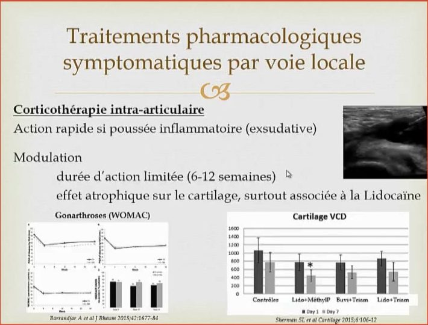
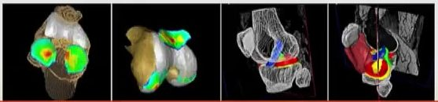

# La prise en charge médicale de l'arthrose du genou

> [!abstract] L'essentiel
> **Gonarthrose : perte de poids + exercice d'abord, infiltration cortisonique seulement si poussée exsudative** : traitements de fond décevants, avenir aux PRP, facteurs de croissance et cellules souches.

> [!success] À retenir
> 1. **Corticoïde intra-articulaire** si **épanchement / synovite** : effet limité (**6-12 semaines**), effet atrophique sur le cartilage, surtout avec la **lidocaïne**.
> 2. **AINS topiques** (NNT **6-10**, passage systémique **< 5 %**) ; antalgiques inutiles au-delà de **2 semaines** si inefficaces ; **pas de palier 3**.
> 3. Glucosamine, chondroïtine, acide hyaluronique : **aucun effet structural** ; l'IRM quantitative du cartilage servira à valider les nouvelles thérapies.

## Images clés
 [▶ 5:36](https://www.youtube.com/watch?v=KzVuZgA35TU&t=336s)
 [▶ 11:26](https://www.youtube.com/watch?v=KzVuZgA35TU&t=686s)

## Points clés
- Synthèse fondée sur des recommandations d'experts internationaux de l'OARSI (2014 et 2016) complétées de méta-analyses récentes.
- **Non pharmacologique** : **perte de poids** en premier (amélioration de la douleur et surtout de la fonction, sans effet structural, difficile à maintenir) ; chirurgie bariatrique (étude de 536 patients) : amélioration précoce puis plateau, non entièrement expliquée par la perte de poids (piste des adipokines, leptine).
- **Exercice physique** recommandé quelle que soit la modalité (intensité optimale non établie) ; orthèses (surtout genou instable), semelles valgisantes, canne jugées positives, observance modeste ; cures thermales non validées (sauf polyarthrose avec comorbidités) ; éducation thérapeutique validée.
- **Antalgiques** : efficacité modeste ; inutile de prolonger au-delà de 2 semaines si inefficaces ; prudence avec les paliers 2 chez le sujet âgé et **éviter les paliers 3**.
- **AINS / coxibs** : supérieurs aux antalgiques ; adapter au terrain digestif, rénal, cardiovasculaire, éviter le long terme.
- **Duloxétine** : efficacité modeste (environ 1 point sur 10), utile en cas de dépression ou fatigue associée.
- **Anti-NGF** (trois molécules en phase 3) : environ 1,5 point sur 10, mais arthroses destructrices rapides et paresthésies ; alternative possible en cas de contre-indication opératoire.
- **Voie locale** : corticoïdes intra-articulaires seulement en poussée inflammatoire avec épanchement (effet limité à 6-12 semaines ; potentiel effet délétère sans composante inflammatoire, surtout associés à la lidocaïne) ; AINS topiques (NNT 6 à 10, passage systémique < 5 %) ; capsaïcine (réactions cutanées) ; acupuncture (fort placebo) ; TENS débattu ; laser, ultrasons, électrothérapie inefficaces.
- **Traitements de fond** (glucosamine, chondroïtine, insaponifiables d'avocat et de soja) : pas d'effet structural, effet modeste sur la douleur, déremboursés en France ; bisphosphonates et anticytokines décevants.
- **Acide hyaluronique** : effet sur douleur et fonction à 3-6 mois dans les méta-analyses, mais pas de viscosupplémentation réelle (demi-vie courte), effet différé, pas d'effet structural, études de qualité médiocre ; en voie de déremboursement.
- **PRP** : études positives à 6 mois (qualité de vie, douleur), piste intra-osseuse sous-chondrale.

## Sémiologie et technique d'imagerie
- L'IRM quantitative devrait permettre de mesurer l'effet anabolique des nouveaux traitements (FGF-18, BMP-7), de la thérapie génique et des cellules souches mésenchymateuses (essais en cours, nanoparticules pour un effet rémanent).

## Pièges et diagnostics différentiels
- Évolution naturelle en poussées avec retour à la ligne de base : biais d'interprétation de l'efficacité des injections.

> [!WARNING] À ne pas manquer
> Infiltration cortisonique réservée aux poussées inflammatoires avec épanchement ; éviter les opioïdes forts chez le sujet âgé arthrosique.

> [!TIP] Pour le compte rendu
> Signaler l'épanchement et la synovite, qui conditionnent l'indication d'une infiltration cortisonique.

## Liens
- Congrès : [[SIMS 2017 - Index]]
- Voir aussi : [[L'arthrose, comment le chirurgien choisit le traitement]], [[Prise en charge des lésions méniscales sur genou arthrosique]]
