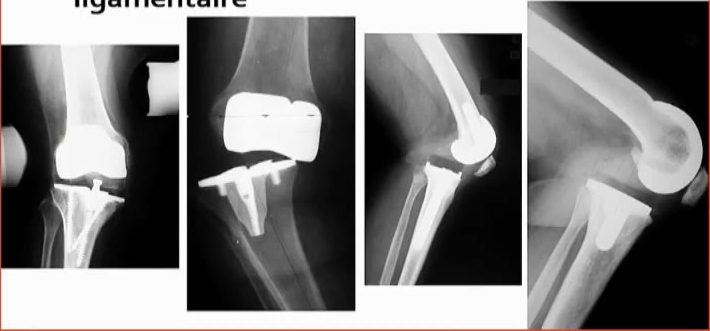
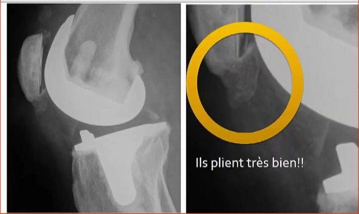
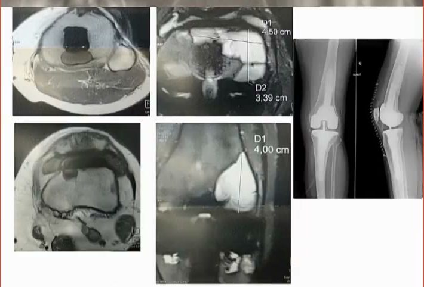

# La prothèse douloureuse : les attentes du chirurgien

> [!abstract] L'essentiel
> **PTG douloureuse : éliminer d'abord l'infection, puis dérouler 8 causes mécaniques** : malposition, laxité, descellement, fémoropatellaire, ossifications, ostéolyse, usure, tendinopathie/allergie.

> [!success] À retenir
> 1. **CRP < 10 et VS < 30 mm** : infection très improbable (**94 %**) ; sinon ponction et scintigraphie aux **polynucléaires marqués**.
> 2. **Scanner 3D** pour les rotations (ICC **0,89 à 0,99** contre 0,29 en 2D) ; le **bouton patellaire** (descellement, nécrose) et l'**ostéolyse** sont sous-estimés en radiographie.
> 3. Demander **clichés en stress (aussi en flexion)** pour la laxité et **profil en hyperflexion** pour le conflit tendon patellaire / pièce tibiale ; comparer l'épaisseur du tendon au côté sain.

## Images clés
 [▶ 5:27](https://www.youtube.com/watch?v=GeVUg8O7jko&t=327s)
 [▶ 13:16](https://www.youtube.com/watch?v=GeVUg8O7jko&t=796s)
 [▶ 11:34](https://www.youtube.com/watch?v=GeVUg8O7jko&t=694s)

## Points clés
- Environ 95 % de patients satisfaits ou très satisfaits, mais 20 % gardent des douleurs et près de 5 % prennent des opiacés quotidiennement.
- Deux situations : **pas de « lune de miel »** postopératoire vs **douleur secondaire** après intervalle libre.
- **Infection = obsession** : CRP < 10 et VS < 30 mm à la 1re heure rendent l'infection peu probable (94 % selon la diapo) ; ponction ; si sepsis suspecté, scintigraphie osseuse puis aux polynucléaires marqués ; sinon SPECT-CT. Arthroscopie peu contributive.
- **Malposition** : l'alignement strict à 180° n'est plus exigé si le tibia est à 90° dans le plan frontal (petit varus résiduel acceptable) ; torsions fémorales mesurables, tibiales plus contestées ; scanner 3D recommandé.
- **Surdimensionnement** : rapport médio-latéral / antéro-postérieur inadapté des anciens dessins ; débord frontal ou augmentation de l'offset sagittal (raideur) ; comparer au controlatéral ou au préopératoire.
- **Laxité** : radiographies en stress, surtout en flexion (appareillage encore insuffisant).
- **Bouton patellaire** : malposition, sous-dimensionnement, **descellement souvent visible seulement au scanner** ; **nécrose de la patella** (douleur secondaire, fracture, tableau pseudo-septique, densification).
- **Ossifications** résiduelles ou du LLI : exérèse parfois efficace.
- **Ostéoporose** : une observation et un article suggèrent une amélioration des douleurs sous alendronate ; fractures de fatigue avec désaxation.
- **Ostéolyse** / hyperclarté par stress shielding (surtout autour de la pièce fémorale) : toujours plus étendue au scanner et en peropératoire qu'en radiographie.
- **Usure** : cas d'une femme jeune opérée d'une PTG à 30 ans après méniscectomie, ligamentoplastie du LCA et ostéotomie, avec ostéolyse étendue à 9 ans (scanner, SPECT, IRM avec réduction d'artefacts) ayant nécessité une reprise.
- **Tendinopathie patellaire** : conflit avec une pièce tibiale débordante ou avec le polyéthylène en hyperflexion ; épaississement du tendon à comparer au controlatéral au scanner, ossifications de la pointe de la patella.
- **Allergie aux métaux** (nickel, chrome, cobalt) : environ 10 % des patients suspectés en Allemagne, où une attestation est obligatoire ; tableau pseudo-infectieux, tests cutanés peu informatifs.
- Hypersensibilité individuelle à la douleur (facteurs génétiques ou psychologiques).

## Sémiologie et technique d'imagerie
- Examen en flexion, radiographies en stress y compris en flexion, **profil en hyperflexion**, et scanner assez systématique devant une douleur persistante.

## Pièges et diagnostics différentiels
- Malposition du bouton patellaire méconnue pendant des années faute d'incidence axiale.
- Nécrose patellaire simulant un sepsis.

> [!WARNING] À ne pas manquer
> Toujours éliminer l'infection avant d'attribuer la douleur à une cause mécanique.

> [!TIP] Pour le compte rendu
> Mesurer rotation et encombrement des pièces, épaisseur du tendon patellaire comparée au côté sain, état du bouton patellaire et étendue réelle des ostéolyses.

## Liens
- Congrès : [[SIMS 2017 - Index]]
- Voir aussi : [[La prothèse douloureuse - que rechercher sur les radiographies]], [[Arthroplasties du genou et imagerie en coupes - scanner, IRM et échographie]]
