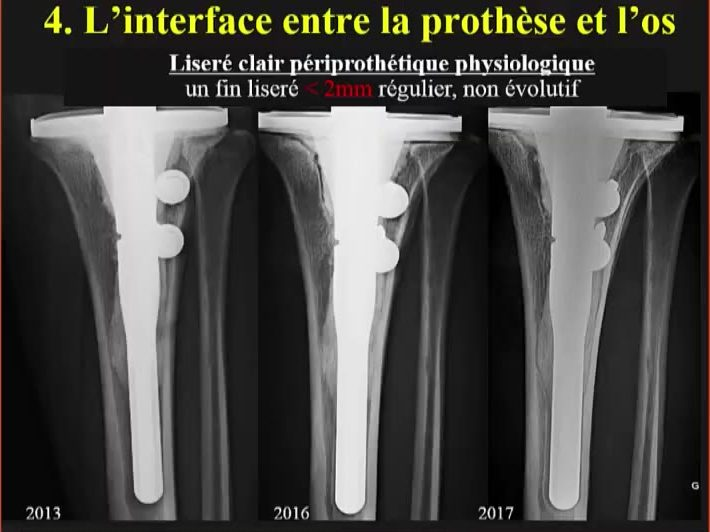
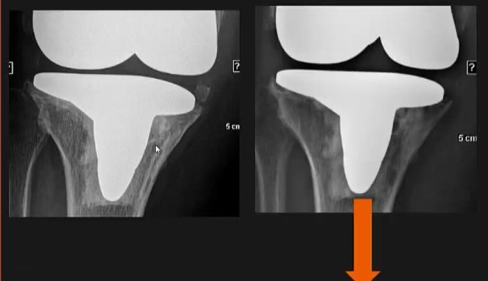
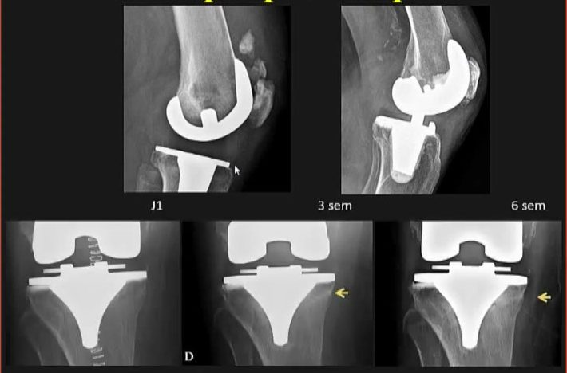

# La prothèse douloureuse : que rechercher sur les radiographies

> [!abstract] L'essentiel
> **Prothèse douloureuse : clichés de qualité, en charge, dynamiques et comparés aux antérieurs, lus en 6 points** : axes, patella, implant, interligne/polyéthylène, interface, os et parties molles.

> [!success] À retenir
> 1. **Malposition initiale** = 1re cause de descellement (**27 %** des douleurs) : vérifier axes en charge, pente tibiale **0-7°**, rotation au scanner.
> 2. Liseré **< 2 mm, régulier, non évolutif** = physiologique ; liseré évolutif, flou, multi-compartimental ou apposition périostée → **infection / descellement**, toujours en **rayon tangent** (3/4 de Miura, scopie).
> 3. Laxité = **clichés en stress en extension et en flexion** ; fracture de contrainte périprothétique visible seulement sur clichés à **3 puis 6 semaines**.

## Images clés
 [▶ 6:15](https://www.youtube.com/watch?v=K2nqqe7unDQ&t=375s)
 [▶ 7:19](https://www.youtube.com/watch?v=K2nqqe7unDQ&t=439s)
 [▶ 8:35](https://www.youtube.com/watch?v=K2nqqe7unDQ&t=515s)

## Points clés
- **Objectifs chirurgicaux** : prothèse unicompartimentale = ne pas surcorriger (usure du compartiment opposé) ; PTG = axe proche de la normale et équilibre ligamentaire en flexion et en extension.
- **1. Axes** : radiographies en charge (EOS utile, flessums fréquents) ; interligne perpendiculaire aux axes mécaniques fémoral et tibial ; profil : coupe fémorale distale perpendiculaire à l'axe anatomique, pente tibiale de 0 à 7° ; la rotation se suspecte de face mais s'analyse au scanner.
- **2. Patella** : hauteur (liée à l'interligne prothétique), centrage du médaillon, coupe patellaire excentrée, bascule ; patella très basse = rechercher une rupture tendineuse.
- **3. Implant** : surdimensionnement (comparer au controlatéral ou aux radios antérieures) ; dans le plan sagittal, conflit avec la patella (nodule fibreux entre tendon quadricipital et patella, **syndrome du clunk**) ou postérieur (fabella) ; dans le plan frontal, débord médial irritant la patte d'oie (couple radio-écho).
- **4. Interligne et polyéthylène** : position et usure du polyéthylène sur l'évolution des clichés ; laxité recherchée par **clichés en stress en extension et en flexion**, couché ; appui monopodal parfois utile.
- **5. Interface os-prothèse** : liseré < 2 mm, régulier, non évolutif = physiologique ; zones codifiées pour dialoguer avec le chirurgien ; clichés de 3/4 (Miura) pour les zones postéro-latérales ; rayon tangent indispensable ; clichés en traction possibles.
- **Signes d'infection** : liseré flou fémoral, tibial et patellaire, résorption focale, apposition périostée.
- **Complications patellaires** : ostéonécrose (patella condensée puis fracturée), fracture sur patella trop amincie.
- **Fracture de contrainte / par insuffisance** visible sur clichés successifs (3 puis 6 semaines).
- **6. Parties molles** : ossifications, épanchement, collections orientant vers l'infection.

## Sémiologie et technique d'imagerie
- Clichés en charge, stress en extension et flexion, 3/4, sous scopie si besoin pour la tangence.
- Toujours penser aux douleurs projetées (hanche, rachis) sur des clichés à distance.

## Pièges et diagnostics différentiels
- Descellement masqué par une incidence non tangente (visible au scanner).
- Laxité méconnue sans cliché en flexion.

> [!WARNING] À ne pas manquer
> Liseré évolutif, flou, multi-compartimental ou apposition périostée : évoquer l'infection.

> [!TIP] Pour le compte rendu
> Comparer aux clichés antérieurs, dater et mesurer les liserés par zones, décrire axes, position patellaire, polyéthylène et laxité.

## Liens
- Congrès : [[SIMS 2017 - Index]]
- Voir aussi : [[La prothèse douloureuse - les attentes du chirurgien]], [[Arthroplasties du genou et imagerie en coupes - scanner, IRM et échographie]]
