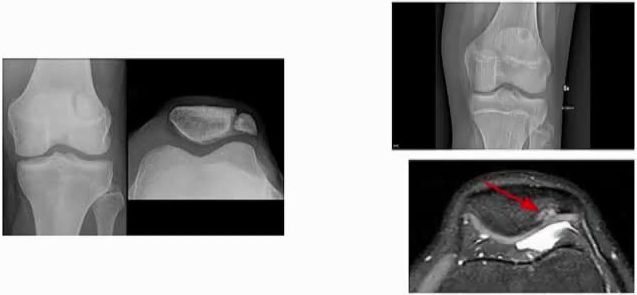
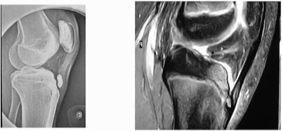
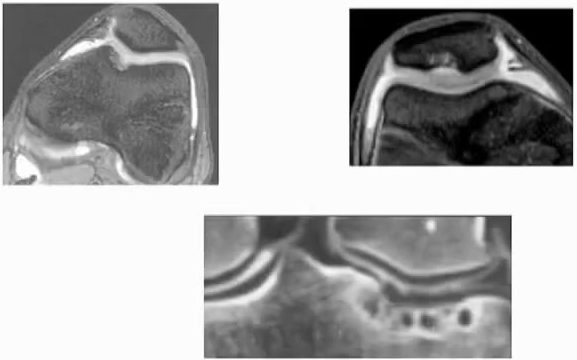

# Le genou douloureux non traumatique de l'enfant (partie 1)

> [!abstract] L'essentiel
> **Genou douloureux unilatéral de l'enfant > 21 jours = radiographie d'abord, penser tumeur ou infection** : jamais d'échographie « de débrouillage » isolée.

> [!success] À retenir
> 1. Drapeaux rouges : **délai > 3 semaines**, boiterie constante, épanchement, amyotrophie, blocage → bannir « post-traumatique » ou « tendinopathie ».
> 2. **Ostéosarcome / Ewing** : la plupart des retards diagnostiques sont passés par une échographie première ; **radio face + profil** obligatoire.
> 3. Gonalgie de l'adolescent : **radiographier la hanche** (**épiphysiolyse**) ; douleurs **bilatérales** apophysaires : éviter le CR qui déclenche une escalade thérapeutique.

## Images clés
 [▶ 3:38](https://www.youtube.com/watch?v=A5DXk0dPD-o&t=218s)
 [▶ 7:42](https://www.youtube.com/watch?v=A5DXk0dPD-o&t=462s)
 [▶ 8:20](https://www.youtube.com/watch?v=A5DXk0dPD-o&t=500s)

## Points clés
- Symptôme très banal, souvent imputé à un traumatisme (vie quotidienne de l'enfant, rassurant pour les parents, simplifiant la consultation), rarement grave mais parfois très grave, **sans parallélisme entre douleur et gravité** (« plus c'est grave, moins ça fait mal »).
- Meilleur outil clinique : la **temporalité**. Une douleur de **plus de 3 semaines (21 jours)** impose de remettre en cause l'étiologie traumatique et de pousser les examens.
- **Échographie première de débrouillage** : risque majeur de retard diagnostic ; la plupart des ostéosarcomes et sarcomes d'Ewing reçus par l'orateur sont passés par une telle échographie. La **radiographie standard reste prioritaire** ; une échographie seule ne suffit pas, même devant un « kyste poplité » de l'enfant.
- Questions posées aux radiologues :
  1. Variante de la normale ou anomalie ? Défect dorsal de la patella simple ou ostéochondrite avec cartilage abîmé chez un enfant douloureux ; l'arthroscanner, très remis en cause chez l'enfant, reste parfois très instructif.
  2. Quelle imagerie pour une **douleur bilatérale** de l'adolescent (chondropathie patellaire, ostéochondroses apophysaires, douleurs antérieures diffuses) ? Éviter la dérive chirurgicale, la rééducation intempestive, la dispense de sport injustifiée ; attention aux comptes rendus qui déclenchent une escalade thérapeutique.
  3. **Apophysoses** (Osgood-Schlatter, Sinding-Larsen-Johansson) : douleurs antérieures **électives**, l'enfant montre l'endroit ; faut-il imager si bilatéral ?
  4. **Douleur unilatérale** : cœur du problème (tumeurs, infections). Alarme : délai de plus de 3 semaines, boiterie, épanchement, amyotrophie, blocage.
- Démarche bien codifiée ensuite : ponction des infections articulaires (avec biopsie systématique en même temps), IRM corps entier pour les ostéomyélites multifocales, tumeurs bénignes typiques sans biopsie (fibromes, ostéochondromes, TCG ténosynoviale, chondroblastome), microbiopsies pour les lésions malignes. L'essentiel : **ne pas rater le départ**.
- Ostéochondroses : utilité de l'échographie et de l'IRM quand la radiographie suffit ? L'IRM montre une inflammation locale qui inquiète sans aider. Ostéochondrites : IRM aussi performante que l'arthroscanner pour dire fissurée ou non, à visser ou non ? Débat ouvert.
- Cas (anonymisé) : adolescent de 14 ans, gonalgie depuis 2 mois, difficulté à descendre de la table : radiographie du bassin, **épiphysiolyse de hanche** (douleur projetée). « Signe de la table de radio ».

## Sémiologie et technique d'imagerie
- Radiographie de face et de profil en première intention ; IRM ensuite selon la suspicion, en concertation.
- Nécessité d'un travail commun et d'une disponibilité du plateau d'imagerie, plutôt que des ordonnances laconiques.

## Pièges et diagnostics différentiels
- Gonalgie projetée d'une pathologie de hanche (épiphysiolyse).
- Défect patellaire vs ostéochondrite.
- Termes à bannir devant une douleur unilatérale de plus de 21 jours : « douleur post-traumatique », « tendinopathie » et étiquettes rassurantes du même ordre.

> [!WARNING] À ne pas manquer
> Douleur unilatérale du genou de l'enfant de plus de 3 semaines : radiographie d'abord, penser tumeur (ostéosarcome, Ewing) et infection ; examiner la hanche.

> [!TIP] Pour le compte rendu
> Éviter les conclusions qui déclenchent une escalade thérapeutique pour des douleurs bilatérales bénignes ; indiquer clairement au clinicien l'examen utile suivant face aux ostéochondroses.

## Liens
- Congrès : [[SIMS 2017 - Index]]
- Voir aussi : [[Le genou douloureux non traumatique de l'enfant (partie 2)]], [[Imagerie du genou - variantes à connaître]]
