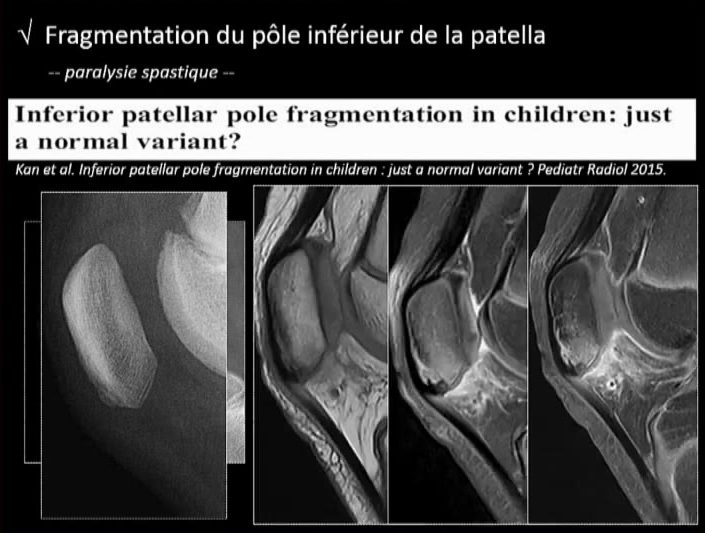
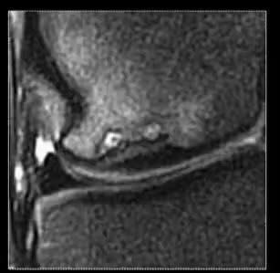
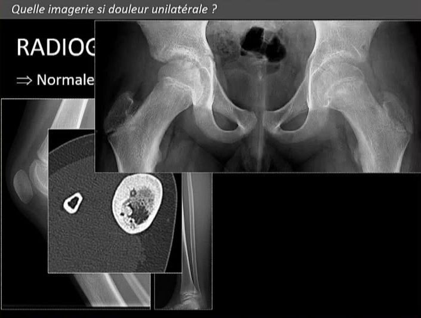

# Le genou douloureux non traumatique de l'enfant (partie 2)

> [!abstract] L'essentiel
> **Genou douloureux de l'enfant : radiographie face + profil d'abord, puis IRM** ; savoir reconnaître les variantes et ne jamais oublier la hanche ni la tumeur.

> [!success] À retenir
> 1. Variantes (irrégularités **condyliennes postérieures**, défect dorsal, patella bipartite) : c'est l'**œdème osseux** qui signe la souffrance, pas le liquide interfragmentaire.
> 2. Radio normale sans épanchement → **hanche** (**1/3** des épiphysiolyses donnent une gonalgie) ou ostéome ostéoïde ; avec épanchement → **AJI** (dépister l'uvéite).
> 3. **Signaux d'alarme** (> **3 semaines**, douleur unilatérale, arrêt des activités, boiterie) → IRM ; apophysose asymétrique ou traînante = éliminer un **ostéosarcome**.

## Images clés
 [▶ 1:35](https://www.youtube.com/watch?v=jKv9ETazuAM&t=95s)
 [▶ 4:30](https://www.youtube.com/watch?v=jKv9ETazuAM&t=270s)
 [▶ 6:14](https://www.youtube.com/watch?v=jKv9ETazuAM&t=374s)

## Points clés
- **Variantes chez le jeune enfant** : irrégularités d'ossification du **tiers postérieur des condyles fémoraux** (environ 20 % des cas, surtout médial, pas toujours bilatérales ni symétriques), sans réaction œdémateuse médullaire importante ; disparaissent avec la croissance.
- **Fragmentation du pôle inférieur de la patella** : classique, plus fréquente en cas de paralysie spastique ; une réaction œdémato-inflammatoire focale en IRM peut traduire une souffrance (micro-avulsions du manchon fibrocartilagineux, voire avulsion aiguë).
- **Défect dorsal de la patella** : lacune supéro-latérale bien limitée ; cartilage intact ou perforé ; symptomatique ou non indépendamment de l'état du cartilage ; quelques patients soulagés par exérèse.
- **Patella bipartite** : défaut de fusion d'un noyau, supéro-latéral ; le liquide entre fragment et patella n'a pas de valeur pathologique, mais **l'œdème osseux** (fragment, patella adjacente, parties molles) est bien corrélé à la douleur. Réponse « de Normand » : attention si réaction focale marquée.
- **Ostéochondroses apophysaires** (Osgood-Schlatter, Sinding-Larsen-Johansson) : radiographie (tuméfaction, écaille, fragmentation), hyperhémie Doppler ; IRM peu utile au diagnostic ; imagerie utile au stade de séquelles (ossicule, indication d'exérèse) et si asymétrie ou évolution traînante (radiographie au minimum : ostéosarcome tibial à ne pas manquer). Lésions étendues de la pointe de patella : coupes T1, voire scanner, pour une fracture-avulsion.
- **Ostéochondrites** : condyles fémoraux (« œuf dans son nid ») ; but : stabilité du fragment (T2 fat-sat, interfaces) ; nid vide avec fragment à distance ; l'arthroscanner analyse le cartilage plus finement que l'IRM conventionnelle. Patella : facette médiale et crête (zones convexes), parfois hypertrophie cartilagineuse focale ; l'ostéochondrose patellaire siège en bas, le défect dorsal en supéro-latéral.
- **Chondropathie patellaire de l'adolescent** : diagnostic d'élimination sauf dysplasie trochléenne ou stigmates de luxation ; œdème supéro-latéral du Hoffa avec patella alta (conflit fémoropatellaire latéral) à interpréter prudemment (fréquent chez l'asymptomatique). Douleur bilatérale possible dans une dysplasie épiphysaire multiple.
- **Douleur unilatérale** : radiographies face et profil d'abord.
  - Normales sans épanchement : lésion plus bas (ostéome ostéoïde) ou **douleur projetée** (un tiers des épiphysiolyses de hanche donnent des gonalgies ; bassin de face, profil du col).
  - Puis IRM : ostéomyélite aiguë, ménisque latéral discoïde, fissure sous-chondrale, **OCMR** (IRM corps entier pour d'autres localisations).
  - Normales avec épanchement : **arthrite juvénile idiopathique** (dépister une uvéite asymptomatique chez l'ophtalmologue) ; échographie pour oligo- vs polyarthrite et guidage d'infiltration ; penser à la TCG ténosynoviale (écho de gradient), plus rare que chez l'adulte.
  - Anormales : fracture de contrainte du tibia proximal, ou IRM pour tumeur bénigne (chondroblastome) ou maligne (ostéosarcome, bilan d'extension).
- **Scintigraphie osseuse** : dose non négligeable, mais « GPS » lorsqu'on ne localise pas la cause ; formes froides d'algodystrophie (plus rares au genou qu'à la cheville chez l'enfant).

## Sémiologie et technique d'imagerie
- Variante condylienne : topographie postérieure, signal focal du cartilage, absence d'œdème.
- Ostéochondrite : séquences T2 fat-sat pour l'interface fragment-épiphyse.

## Pièges et diagnostics différentiels
- Douleur projetée de hanche ; ostéosarcome masqué par une « apophysose » asymétrique.

> [!WARNING] À ne pas manquer
> Signaux d'alarme : symptômes de plus de 3 semaines, douleur franchement unilatérale, arrêt des activités sportives ou ludiques, boiterie persistante.

> [!TIP] Pour le compte rendu
> Qualifier la variante (topographie, absence d'œdème), signaler l'œdème d'une patella bipartite ou d'une fragmentation, préciser la stabilité d'un fragment d'ostéochondrite, et recommander l'examen suivant.

## Liens
- Congrès : [[SIMS 2017 - Index]]
- Voir aussi : [[Le genou douloureux non traumatique de l'enfant (partie 1)]], [[Imagerie du genou - variantes à connaître]]
