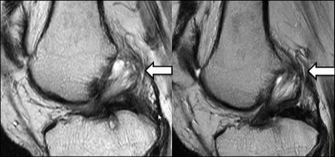
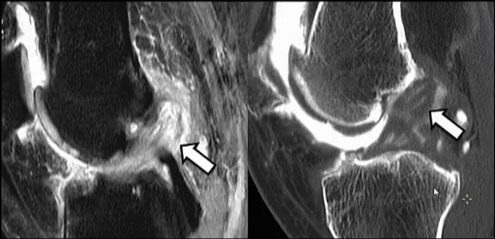
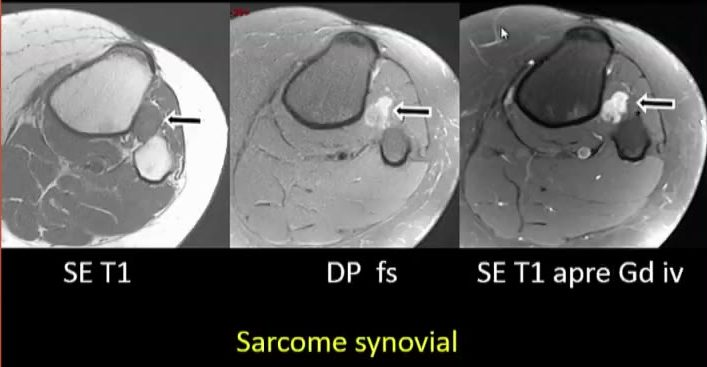

# Les kystes mucoïdes du genou

> [!abstract] L'essentiel
> **Kyste mucoïde = extravasation de liquide synovial par un pédicule articulaire, sans rehaussement : tout « kyste » qui se rehausse est une tumeur jusqu'à preuve du contraire.**

> [!success] À retenir
> 1. Très fréquents : **≈ 25 % des genoux** en IRM (intracapsulaires surtout : LCA ≈ **5 %**, Hoffa, intra-osseux ≈ **8,6 %**).
> 2. Kyste intra-osseux : **tibia rétro-spinal** (insertion LCP / corne postérieure du ménisque médial), **jamais à la patella**, en os non cartilagineux ; ≠ **géode** sous-chondrale (sous cartilage, arthrose).
> 3. **Comparer la même séquence T1 FS avant / après gadolinium** (soustraction) : le mucus est spontanément en hypersignal T1 FS ; rehaussement charnu → penser **sarcome synovial**, même < 2 cm.

## Images clés
 [▶ 3:40](https://www.youtube.com/watch?v=VrcunRW0rdY&t=220s)
 [▶ 7:00](https://www.youtube.com/watch?v=VrcunRW0rdY&t=420s)
 [▶ 9:36](https://www.youtube.com/watch?v=VrcunRW0rdY&t=576s)

## Points clés
- **Définition** : cavité à contenu gélatineux incolore ou bleuâtre, paroi fibreuse **sans revêtement synovial vrai**, reliée à l'articulation par un fin pédicule ; à distinguer du **kyste synovial vrai** (kyste poplité), tapissé de synoviale avec communication généralement large.
- **Épidémiologie** (série de l'orateur, 600 IRM de genou, kystes méniscaux exclus) : formations kystiques dans environ 25 % des genoux ; rares avant 30-35 ans, augmentent entre 30 et 50 ans puis se stabilisent ; extracapsulaires environ 7 %, LCA environ 5 %, intra-osseux fréquents.
- Localisations : graisse de Hoffa, espace dit « du LCP » (en arrière du LCP, en avant de la capsule postérieure), **dégénérescence mucoïde du LCA** (fibres écartées, non nécessairement rompues, effet de masse), intra-osseuses.
- **Kystes intra-osseux** (environ 50 dans la série) : environ 80 % au tibia, notamment en arrière du massif des épines, au croisement de l'insertion du LCP et de la corne postérieure du ménisque médial ; moins souvent fémur ; **aucun à la patella**. Apparition plus précoce que les géodes.
- **Géodes sous-chondrales** (environ 30) : sous un os recouvert de cartilage, réparties de façon homogène entre les trois compartiments, liées à l'arthrose ; le kyste mucoïde se développe en zone non cartilagineuse au contact de la cavité synoviale.
- **Physiopathologie** : hypothèses synoviale, tumorale, résidus embryonnaires, dégénérative, micro-avulsions ; l'orateur retient l'hypothèse **synoviale** (passage par des orifices vasculaires intra-osseux, démontrés par injection veineuse sur cadavre).

## Sémiologie et technique d'imagerie
- IRM : hypersignal T2 hétérogène, coque parfois épaisse, rehaussement périphérique, communication articulaire à rechercher.
- **Arthrographie / arthroscanner** (parfois avec acquisitions tardives) : passage du contraste dans le kyste ou entre les fibres du LCA, par une brèche corticale seulement devinée en IRM ; opacification parfois partielle du fait de la consistance gélatineuse.
- Échographie : masse anéchogène à renforcement postérieur, contours polycycliques.

## Pièges et diagnostics différentiels
- **Tumeur** : exemple d'un synovialosarcome de moins de 2 cm de l'espace tibio-fibulaire supérieur, rehaussé de façon charnue et homogène.
- Faux rehaussement : sur T1 fat-sat, le contenu mucoïde peut être spontanément en signal élevé.

> [!WARNING] À ne pas manquer
> Toute masse « kystique » qui se rehausse franchement après gadolinium doit être considérée comme tumorale jusqu'à preuve du contraire.

> [!TIP] Pour le compte rendu
> Comparer obligatoirement la même séquence avant et après injection (soustraction) pour affirmer l'absence de rehaussement ; décrire la communication articulaire.

## Liens
- Congrès : [[SIMS 2017 - Index]]
- Voir aussi : [[Quoi de neuf en IRM - quelle séquence pour quelle lésion]], [[Les lésions méniscales du patient âgé]]
