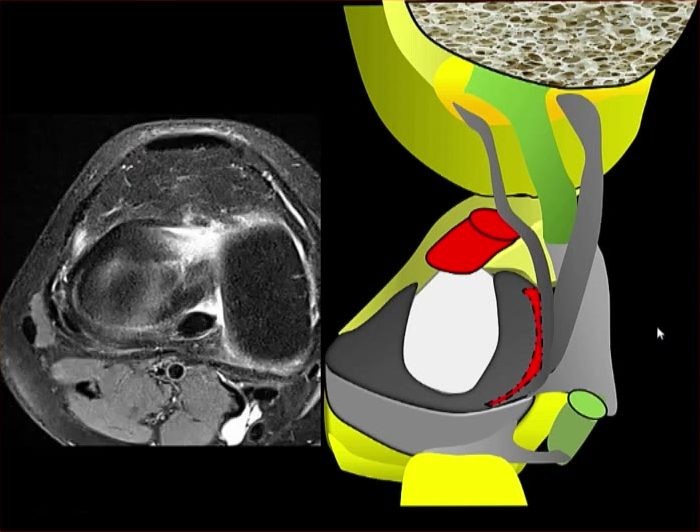
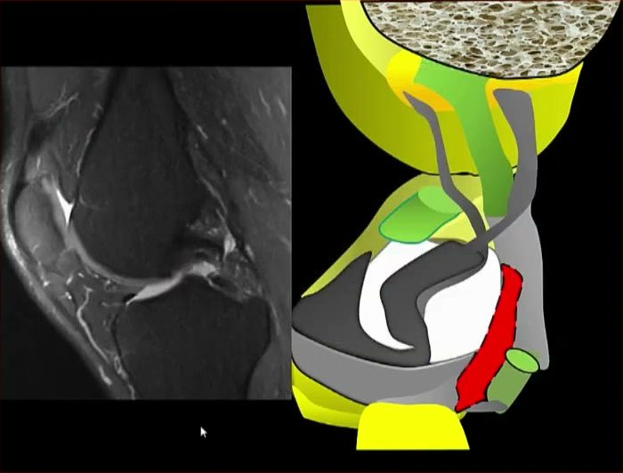
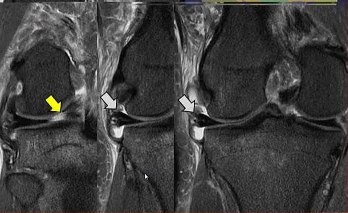

# Les lésions traumatiques des cornes et racines postérieures des ménisques après rupture du LCA

> [!abstract] L'essentiel
> **Devant une rupture du LCA, scruter la corne postérieure du ménisque latéral en se repérant sur les ligaments ménisco-fémoraux** : c'est là que l'IRM manque les lésions.

> [!success] À retenir
> 1. Sensibilité de l'IRM pour la corne postérieure du ML : **94 % → 65 %**, voire **≈ 50 %** si lésion très périphérique ; ne pas se laisser distraire par l'**œdème osseux**.
> 2. **Seconde image verticale en hypersignal** distincte du hiatus poplité = lésion : **en avant** des ménisco-fémoraux = longitudinale intraméniscale (« braguette », anse de seau si **> 10 mm**) ; **en arrière** = désinsertion capsulo-méniscale (cicatrise **≈ 72 %**).
> 3. Lésion radiaire postérieure (**Forkel**) : type 3 = ménisco-fémoraux rompus + **extrusion** du ML → très arthrogène, à signaler.

## Images clés
 [▶ 3:51](https://www.youtube.com/watch?v=KJ2W6Kvus_Y&t=231s)
 [▶ 8:22](https://www.youtube.com/watch?v=KJ2W6Kvus_Y&t=502s)
 [▶ 9:59](https://www.youtube.com/watch?v=KJ2W6Kvus_Y&t=599s)

## Points clés
- Mécanisme rotatoire ou compression par tiroir antérieur : c'est la partie postérieure des ménisques qui est atteinte. La présentation se limite au **ménisque latéral**, atteint dans près de 69 % des lésions méniscales associées au LCA.
- Sensibilité de l'IRM médiocre : de 94 % à 65 % sur la corne postérieure, environ 50 % pour les lésions verticales longitudinales très périphériques.
- Anatomie : hiatus poplité (zone sans fixation capsulaire directe, faiblesse relative du ménisque latéral) ; capsule postérieure sur 10-12 mm en dedans du hiatus, normalement **noire sur toutes les séquences** et non opacifiée en arthroscanner ; ligaments ménisco-fémoraux de **Humphrey** (en avant du LCP) et de **Wrisberg** (en arrière), qui fusionnent avec la corne postérieure.
- **Lésions verticales longitudinales intraméniscales** en avant de la fusion ménisco-ligamentaire : mécanisme « en braguette » (décrit par les équipes de Grenoble), bien vu en axial. Au-delà d'environ 10 mm (vrai aussi en médial), le ménisque peut basculer en **anse de seau** (démontré en flexion de 15°) ; les ligaments ménisco-fémoraux restent alors attachés à la capsule et non à l'anse.
- **Désinsertions capsulo-méniscales** en arrière de la fusion avec le Wrisberg : vraies lésions capsulaires ; cicatrisation dans environ 72 % des cas en 4-5 mois (comblement en hyposignal).
- **Lésions radiaires postérieures** (classification de Forkel) : type 1 racine ; type 2 corne postérieure avec ménisco-fémoraux intacts (stabilité préservée, pas d'extrusion) ; type 3 avec atteinte des ménisco-fémoraux et **extrusion** du ménisque latéral, très arthrogènes.

## Sémiologie et technique d'imagerie
- Analyse sur coupes sagittales en suivant les ligaments ménisco-fémoraux de dedans en dehors : une **seconde image verticale en hypersignal**, distincte du hiatus poplité, signe une lésion intraméniscale.
- Coupes axiales : ouverture en « braguette » en avant du tendon poplité.
- Lésion radiaire de type 3 : ménisque latéral extrus sur les coupes coronales, rupture visible en axial.

## Pièges et diagnostics différentiels
- Pseudo-fissures à la zone de fusion ménisco-ligamentaire : obliques, non liquidiennes, sur 2-3 coupes (moins de 3 mm).
- Hiatus poplité : une seule zone blanche, normale.
- **Ménisque hypermobile** (désinsertion capsulaire postérieure de type Wrisberg sans rupture du LCA, hiatus élargi, liquide entre ménisque et capsule sur plus de 4 coupes de 3 mm) : blocages, lésion pouvant être manquée en arthroscanner ; ici le ligament ménisco-fémoral est solidaire du ménisque luxé.

> [!WARNING] À ne pas manquer
> Ne pas se laisser distraire par l'œdème osseux de la rupture du LCA : scruter la corne postérieure du ménisque latéral et la capsule postérieure, zones de faible sensibilité de l'IRM.

> [!TIP] Pour le compte rendu
> Préciser la position de la lésion par rapport aux ligaments ménisco-fémoraux (intraméniscale en avant vs capsulo-méniscale en arrière), son étendue (seuil d'environ 10 mm), une bascule éventuelle, le type de lésion radiaire et l'extrusion.

## Liens
- Congrès : [[SIMS 2017 - Index]]
- Voir aussi : [[Imagerie des atteintes du pivot central]], [[Actualités sur le traitement chirurgical du LCA]], [[Imagerie postopératoire des ménisques]]
