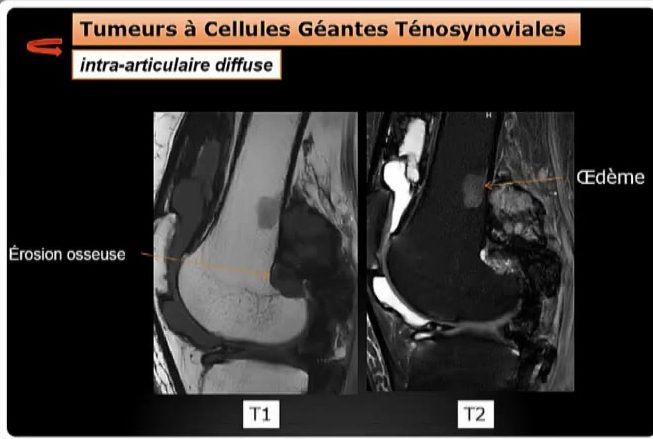
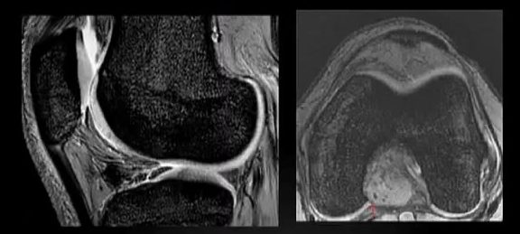
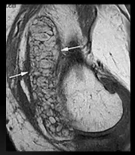

# Pathologie synoviale tumorale et pseudotumorale

> [!abstract] L'essentiel
> **Synoviale en hyposignal T2 avec blooming en écho de gradient = TCG ténosynoviale jusqu'à preuve du contraire** : toute lésion atypique, injecter et penser sarcome.

> [!success] À retenir
> 1. **TCG-TS diffuse** (ex-SVN) : **4 fois** plus fréquente que la focale, **genou 80 %**, adulte **30-50 ans** ; hémosidérine, **érosions marginales** ; différentiel = **synovite hémophilique**.
> 2. **Chondromatose primitive** : corps de taille homogène, interligne **préservé** (≠ formes secondaires) ; chondromes non minéralisés iso T1 / hyper T2, invisibles en radio.
> 3. **Lipome arborescent** = franges de **signal graisseux** du récessus suprapatellaire (T1 tranche) ; **masse ou « bursite » atypique** → **gadolinium** et centre de référence (synovialosarcome).

## Images clés
 [▶ 3:26](https://www.youtube.com/watch?v=XUS4kuXFhaQ&t=206s)
 [▶ 1:29](https://www.youtube.com/watch?v=XUS4kuXFhaQ&t=89s)
 [▶ 6:07](https://www.youtube.com/watch?v=XUS4kuXFhaQ&t=367s)

## Points clés
- Classification de référence : **OMS 2013**.
- **Tumeurs à cellules géantes ténosynoviales (TCG-TS)** : nouvelle dénomination regroupant SVN et TCG de la gaine tendineuse ; dépôts d'hémosidérine, prolifération histiocytaire mononucléée et cellules géantes multinucléées ; formes localisées ou diffuses, intra- ou extra-articulaires.
- **Forme localisée intra-articulaire** : bénigne, rare, souvent asymptomatique ou responsable de blocages ; siège le plus fréquent : **graisse infrapatellaire (Hoffa)**, puis récessus suprapatellaire. Traitement chirurgical, faible taux de récidive.
- **Forme diffuse intra-articulaire** : 4 fois plus fréquente que la forme focale, genou dans 80 % des cas, adulte jeune (30-50 ans) ; radiographie normale dans 30 % des cas, ou épanchement, tuméfaction synoviale, **érosions marginales** bien limitées (zones de réflexion synoviale, zones serrées). Synovectomie la plus complète possible (récidives fréquentes) ; perspectives : thérapies ciblées, **anticorps monoclonal anti-CSF1** (surexprimé) avec diminution du volume tumoral en IRM ; traitement médical encore discuté.
- **Chondromatose synoviale primitive** : prolifération bénigne par métaplasie cartilagineuse, stades de Milgram (membrane épaissie avec nodules, chondromes pédiculés puis libres, membrane inactive et croissance par imbibition, calcification, ossification) ; interlignes préservés, à la différence des formes secondaires.
- **Hémangiome synovial** : malformation vasculaire bénigne à flux lent, intra- ou extracapsulaire.
- **Lipome arborescent** : pseudotumeur par prolifération lipomateuse des villosités, récessus suprapatellaire, souvent réactionnel à une synovite chronique (arthropathie dégénérative).
- Tumeurs malignes : **chondrosarcome synovial** (de novo ou sur chondromatose primitive, diagnostic difficile), envahissement osseux hors zone de réflexion, **synovialosarcome** (tumeur mésenchymateuse ubiquitaire, non dérivée de la synoviale, intra- ou péri-articulaire).

## Sémiologie et technique d'imagerie
- TCG localisée : masse ovoïde bien limitée, iso/hypoT1, **hypoT2** majoré en écho de gradient, parfois seulement des foyers hypointenses ; rehaussement modéré à marqué.
- TCG diffuse : épanchement, synoviale épaissie hétérogène, composantes hyperT2 et hypoT2 franches (hémosidérine), mieux silhouettée après gadolinium, **blooming** en écho de gradient.
- Chondromes non minéralisés : iso T1, hyperT2, non rehaussés ; calcifiés : hyposignal sur toutes les séquences ; ossifiés : hypersignal T1 médullaire, ostéochondromes visibles en radiographie.
- Hémangiome : masse mal limitée, canaux serpigineux hyperT2 (stase), graisse évocatrice, rehaussement hétérogène.
- Lipome arborescent : franges synoviales de signal graisseux sur toutes les séquences (le T1 redresse le diagnostic), épanchement, hypertrophie synoviale visible en échographie.

## Pièges et diagnostics différentiels
- Pathologie synoviale hypointense en T2 : principal différentiel de la TCG = **synovite hémorragique** de l'hémophilie débutante (érosions, œdème), le contexte clinique tranche.
- Petite masse de signal indéterminé ne correspondant ni à un récessus ni à une bursite, ou pseudo-kyste en avant du tractus iliotibial : penser au synovialosarcome et **injecter**.

> [!WARNING] À ne pas manquer
> Une « bursite atypique » ou une lésion de topographie inhabituelle peut être un synovialosarcome : injecter et adresser en centre de référence avant toute biopsie.

> [!TIP] Pour le compte rendu
> Préciser forme localisée ou diffuse, dépôts d'hémosidérine en écho de gradient, extension (récessus, érosions), stade de chondromatose, et orienter vers un centre spécialisé en cas de signal ou de topographie atypiques.

## Liens
- Congrès : [[SIMS 2017 - Index]]
- Voir aussi : [[IRM du genou - quand et pourquoi injecter]], [[Itinéraire diagnostique d'un gros genou du sujet âgé]], [[Itinéraire d'imagerie d'une douleur postérieure - place de l'imagerie]]
