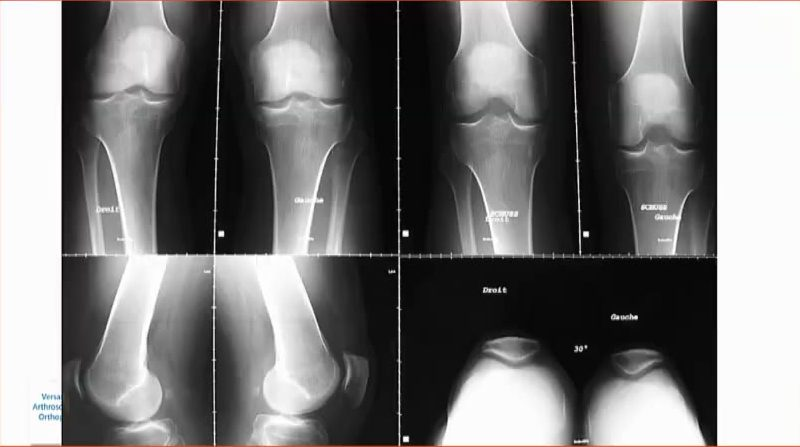
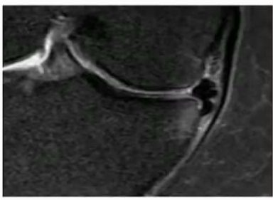

# Prise en charge des lésions méniscales sur genou arthrosique

> [!abstract] L'essentiel
> **Lésion méniscale dégénérative = étape du continuum arthrosique, pas une indication chirurgicale** : radiographies avec schuss d'abord, pas d'IRM d'emblée, traitement médical ≥ 3 mois.

> [!success] À retenir
> 1. **60 %** des LMD sont asymptomatiques ; **8 essais randomisés sur 9** sans supériorité de la méniscectomie (conversion **0-30 %**).
> 2. Bilan initial = **radiographies bilatérales en charge avec schuss** ; IRM seulement si échec du traitement médical et chirurgie envisagée ou signe d'alerte (ostéonécrose).
> 3. À l'IRM, signaler **lambeau luxé** (seule vraie indication mécanique) et signes d'arthrose (**extrusion**, œdème sous-chondral, défects) qui contre-indiquent l'arthroscopie.

## Images clés
 [▶ 7:14](https://www.youtube.com/watch?v=fkN6q6AxyTQ&t=434s)
 [▶ 8:13](https://www.youtube.com/watch?v=fkN6q6AxyTQ&t=493s)

## Points clés
- Environ **115 000 méniscectomies arthroscopiques par an en France**, probablement trop ; les réduire est l'affaire de tous, y compris du radiologue.
- **Lésion méniscale dégénérative (LMD)** : lésion à développement lent, typiquement clivage horizontal, chez un patient d'âge mûr (historique : Noble 1975, classification arthroscopique de H. Dorfmann, T. Boyer et J.-P. Bonvarlet avant l'IRM).
- Prévalence très élevée ; **60 % des LMD sont asymptomatiques**.
- Arthrose définie comme un **continuum** moléculaire → structurel : la LMD s'y insère ; risque d'arthrose multiplié par 7 en présence d'une LMD.
- Résultats à long terme des méniscectomies : arthrose fréquente (série SFA de 2008 : 56 % d'arthrose à 22 ans après méniscectomie latérale) ; état initial du cartilage et du ménisque = facteurs pronostiques.
- **9 essais randomisés, dont 8 sans supériorité de la méniscectomie** sur le traitement non opératoire ; taux de conversion vers l'arthroscopie de 0 à 30 %, avec un résultat secondaire équivalent, pas supérieur.
- **Consensus ESSKA** (publié en accès libre, version française dans la revue d'orthopédie) : genou douloureux non bloqué, patient > 35 ans, histoire compatible.

## Sémiologie et technique d'imagerie
- Première intention : **radiographies des deux genoux avec cliché en schuss**.
- **Pas d'IRM en première ligne**, sauf suspicion d'une autre pathologie.
- IRM secondaire en cas d'échec du traitement non opératoire et si une chirurgie est envisagée : confirmer la LMD, apprécier sa stabilité (lambeau luxé dans la gouttière tibiale), rechercher des signes précoces d'arthrose (extrusion méniscale, œdème sous-chondral en miroir, défects cartilagineux).

## Pièges et diagnostics différentiels
- La coexistence d'une douleur et d'une lésion méniscale, toutes deux fréquentes, ne signifie pas causalité.
- L'IRM d'emblée conduit à l'abus de méniscectomies (« le radiologue a vu une lésion, il faut enlever le ménisque »).

> [!WARNING] À ne pas manquer
> Arthrose radiographique ou IRM associée = pas de débridement arthroscopique, sauf symptômes mécaniques « considérables » (lambeau luxé).

> [!TIP] Pour le compte rendu
> Qualifier la lésion de dégénérative, préciser sa stabilité (fragment luxé) et décrire systématiquement les signes d'arthrose associés, qui orientent vers un traitement médical.

## Liens
- Congrès : [[SIMS 2017 - Index]]
- Voir aussi : [[Les lésions méniscales du patient âgé]], [[L'arthrose, comment le chirurgien choisit le traitement]], [[La prise en charge médicale de l'arthrose]]
