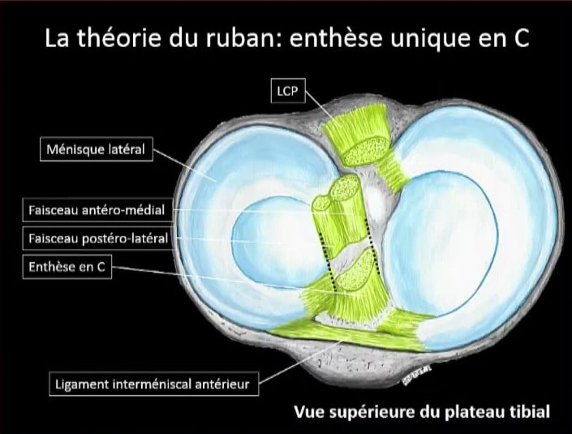
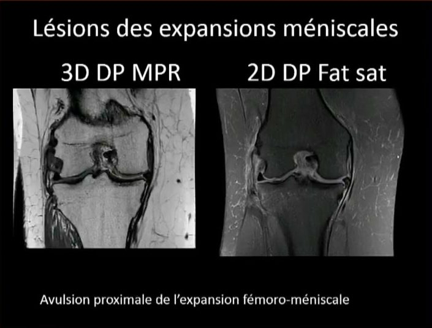
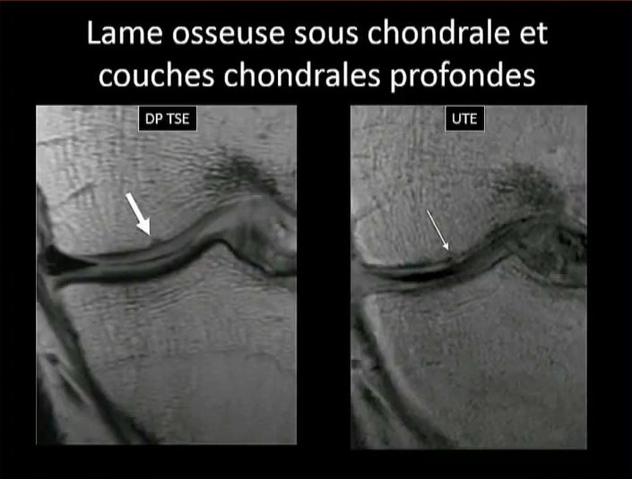

# Quoi de neuf en IRM du genou : quelle séquence pour quelle lésion

> [!abstract] L'essentiel
> **Socle inchangé : DP fat-sat + T1 ; révolution = 3D isotrope 0,3 mm à 3 T** ; UTE et cartographies T2/T1rho restent du domaine de la recherche.

> [!success] À retenir
> 1. **T1 jamais supprimé** : seul à affirmer fracture, impaction, infiltration médullaire ; 3D à **1,5 T** médiocre → refaire des **DP 2D**.
> 2. **Pente tibiale postérieure latérale > 12°** = facteur de risque de rupture du LCA : à mesurer et rapporter.
> 3. **Sans saturation de graisse**, coupes fines : enthèse tibiale du LCA « en ruban » et attaches du **LAL** / expansions méniscales (avulsion fémoro-méniscale).

## Images clés
 [▶ 3:01](https://www.youtube.com/watch?v=kLG_WJl5wGU&t=181s)
 [▶ 7:36](https://www.youtube.com/watch?v=kLG_WJl5wGU&t=456s)
 [▶ 9:14](https://www.youtube.com/watch?v=kLG_WJl5wGU&t=554s)

## Points clés
- **Protocole de base** : turbo spin écho, DP (T2 intermédiaire) avec suppression de graisse, et **T1 indispensable** (fracture, fissure, impaction, infiltration médullaire).
- **2D ou 3D** : performances équivalentes à 3 T, pas toujours sur les anciennes machines à 1,5 T ; si les reconstructions MPR sont médiocres, refaire des DP 2D orthogonaux.
- Diffusion : sans preuve pour les ligaments ; séquences métal (MAVRIC) pas encore au point pour le genou.
- **LCA** : enthèse tibiale unique, fusion des deux faisceaux en ruban avec petit coussinet graisseux rétro-ligamentaire, chevauchement avec la racine antérieure du ménisque latéral (vus en 3D sans saturation de graisse).
- Association fréquente **kyste du ménisque latéral sans lésion méniscale** et **dégénérescence mucoïde du LCA**.
- **Pente tibiale postérieure latérale > 12°** : facteur de risque de rupture du LCA, facile à mesurer en IRM ; certaines équipes proposent une ostéotomie de correction en cas de rupture itérative.
- Neuroplasticité après rupture du LCA (travaux de Grooms) : modifications des aires motrices persistant après ligamentoplastie et dupliquées du côté controlatéral, possible facteur de risque de rupture controlatérale ; le genou rompu bouge paradoxalement moins (compensation proprioceptive).
- **Ligament antéro-latéral** : le fat-sat montre bien le ligament et le pédicule géniculé ; conserver la graisse en coupes fines précise les attaches (expansions ménisco-tibiale et fémoro-méniscale), utile en cas d'avulsion.
- **UTE** : visualise la couche profonde calcifiée du cartilage et la lame sous-chondrale, impliquées dans l'arthrose.
- **Compositionnel** (T1rho, T2 mapping) : altération du plateau latéral après rupture du LCA aggravée à 2 ans et en cas de lésion méniscale ; altération après un marathon, retour à la normale en environ 4 semaines.

## Sémiologie et technique d'imagerie
- Ménisque : un suivi à 6 ans d'environ 300 patients montre une évolution quasi systématique des anomalies de signal intraméniscales vers la fissure horizontale.
- Hypersignal intermédiaire de la corne postérieure du ménisque médial associé à une rupture du LCA : disparition à 2 ans après ligamentoplastie sans geste méniscal (contusion).
- Études dynamiques : extrusion méniscale en charge et hypermobilité des cornes antérieures dans l'arthrose.

## Pièges et diagnostics différentiels
- Accepter une 3D de mauvaise qualité à 1,5 T.
- Prendre une contusion méniscale associée à une rupture du LCA pour une fissure.

> [!WARNING] À ne pas manquer
> Ne jamais supprimer le T1 du protocole : c'est lui qui affirme fracture, impaction et infiltration médullaire.

> [!TIP] Pour le compte rendu
> Mesurer et rapporter la pente tibiale postérieure latérale en cas de rupture du LCA ; décrire les attaches du ligament antéro-latéral lorsqu'elles sont lésées.

## Liens
- Congrès : [[SIMS 2017 - Index]]
- Voir aussi : [[Les lésions méniscales du patient âgé]], [[Les kystes mucoïdes du genou]]
