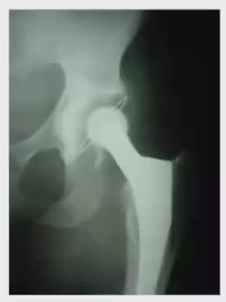
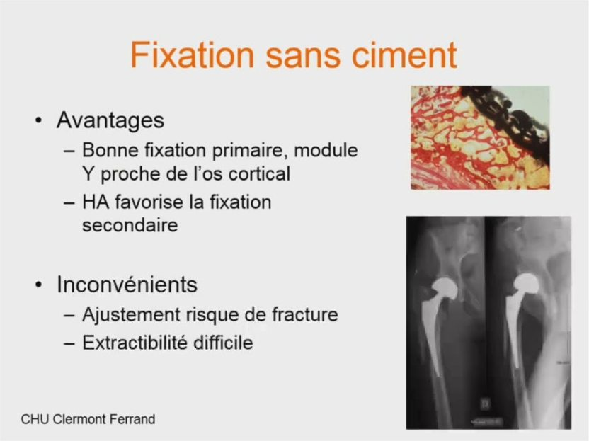

# Actualités sur les matériaux utilisés pour les prothèses

> [!abstract] L'essentiel
> **Lire une PTH = identifier son couple de frottement et son mode de fixation** : sans ciment et dur-dur chez le jeune, cimentée à double mobilité après 75 ans.

> [!success] À retenir
> 1. **Jamais de couple métal-céramique** ; métal-métal → chercher une **pseudotumeur (métallose)**.
> 2. Polyéthylène standard : usure **≈ 0,1 mm/an** (÷ 5 à 10 si réticulé) → mesurer l'excentration de la tête.
> 3. **Double mobilité** fréquente chez le sujet âgé : savoir la reconnaître sur la radio.

## Images clés
 [▶ 8:48](https://www.youtube.com/watch?v=a44CAs1Q-0U&t=528s)
 [▶ 9:25](https://www.youtube.com/watch?v=a44CAs1Q-0U&t=565s)

## Points clés
- Cinq familles de matériaux : métaux (chrome-cobalt, titane), polyéthylène, céramiques, ciment, hydroxyapatite.
- Une hanche subit en moyenne 2 à 4 millions de cycles par an.
- **Chrome-cobalt** : dense et rigide, résistant à la corrosion, facile à travailler et **polissable** (surface de frottement, tige cimentée lisse). Inconvénients : module de Young très éloigné de l'os, réactions immunologiques.
- **Titane (TA6V)** : très biocompatible, module de Young proche de l'os cortical, rugosité favorable à la fixation sans ciment. Inconvénients : coût, traitement de surface nécessaire pour le cimenter, inutilisable comme tête (trop rugueux, d'où plus de débris).
- **Polyéthylène** : versant acétabulaire uniquement, peu coûteux, biocompatible. Il **tolère le conflit** (il se déforme, alors que la céramique casse et que le métal produit des débris). Usure d'environ 0,1 mm par an pour le standard. Le polyéthylène réticulé divise l'usure par 5 à 10, avec des résultats variables. Il doit être cimenté ou placé dans une cupule.
- **Céramique** : dure, autorise de grands diamètres, très biocompatible. Inconvénients : risque de fracture, fixation impossible directement sur l'os, problèmes de jonction. Évolution : alumine pure (casse), puis zircone (se déforme et casse), puis composite des deux.
- **Ciment** : ajuste l'implant à la cavité, avec une rigidité intermédiaire entre l'os et l'implant. Il vieillit, et ses débris peuvent créer un troisième corps.
- **Hydroxyapatite** : revêtement par torche à plasma des implants sans ciment, pour la fixation secondaire. Invisible en radiographie.
- Stratégie citée selon l'âge :
  - moins de 60 ans : sans ciment et couple dur-dur ;
  - 60-70 ans : sans ciment sauf ostéoporose avérée, avec introduction du polyéthylène ;
  - 70-75 ans : bascule vers le cimenté selon la qualité osseuse, surtout chez la femme ;
  - plus de 75 ans, et a fortiori plus de 80 ans : cimenté avec double mobilité.

## Sémiologie et technique d'imagerie
- Couple dur-mou (polyéthylène contre tête céramique ou métal) : peu cher, tolérant aux erreurs de position. La durabilité dépend de l'usure et de l'épaisseur minimale de polyéthylène. Une petite tête (22, 28) augmente le risque de luxation par rapport à 32 ou 36 mm.
- **Double mobilité** (invention française) : effet « grosse tête » et moindre risque de luxation, peut-être plus de débris. Difficile à reconnaître en radiographie sans habitude.
- Couples dur-dur : métal-métal ou céramique-céramique, **jamais métal-céramique**. Usure plus faible, coût élevé, problèmes de jonction.
  - Céramique-céramique : fracture, grincement.
  - Métal-métal : métallose, avec pseudotumeur nécessitant un changement, souvent par problème de jonction.
- Fixation cimentée : peu onéreuse, moins de fractures peropératoires, adaptée à l'anatomie, référence des registres. Elle allonge l'intervention et expose au choc au ciment.
- Fixation sans ciment : bonne fixation primaire, l'hydroxyapatite favorisant la fixation secondaire. Risque fracturaire et extraction difficile.

## Pièges et diagnostics différentiels
- Une PTH à 18 ans de recul sans descellement malgré un manteau de ciment imparfait illustre la robustesse de la fixation cimentée.
- Une pseudotumeur sur couple métal-métal doit faire évoquer une métallose.

> [!WARNING] À ne pas manquer
> Associations contre-indiquées (métal-céramique). Une double mobilité est fréquente chez le sujet âgé ou à risque de luxation (obésité, pathologie neurologique) : savoir la reconnaître en radiographie.

> [!TIP] Pour le compte rendu
> Identifier le couple de frottement, le mode de fixation (cimenté ou non) et une éventuelle double mobilité. Mesurer l'usure du polyéthylène et rechercher descellement, pseudotumeur ou fracture de céramique.

## Liens
- Congrès : [[SIMS 2019 - Index]]
- Voir aussi : [[La hanche en mouvement]], [[Relations normales et pathologiques entre colonne vertébrale et bassin]]
