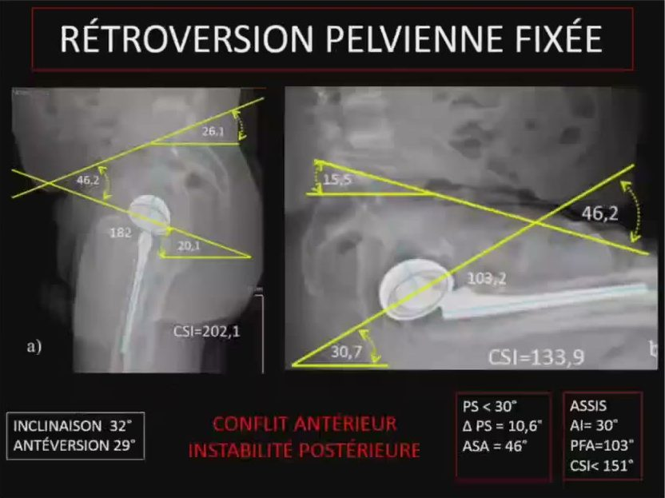
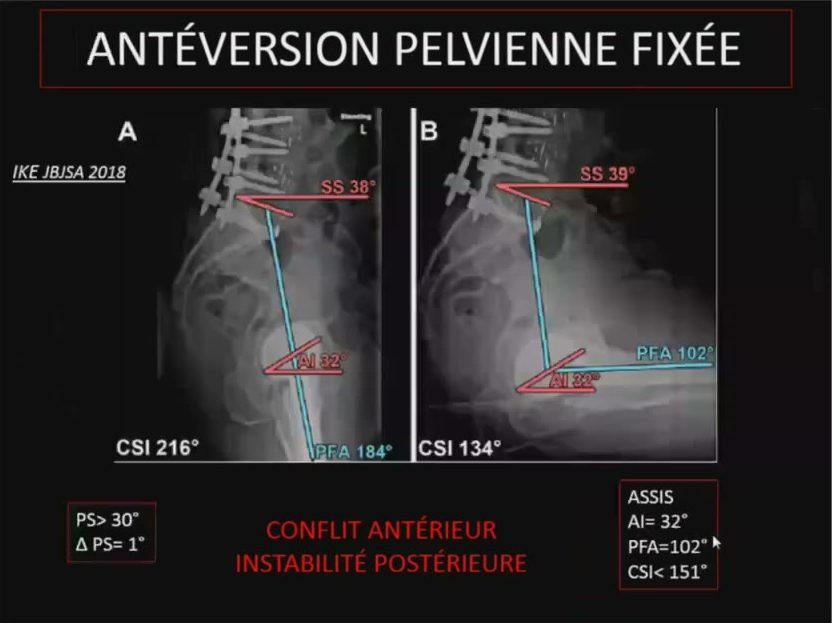
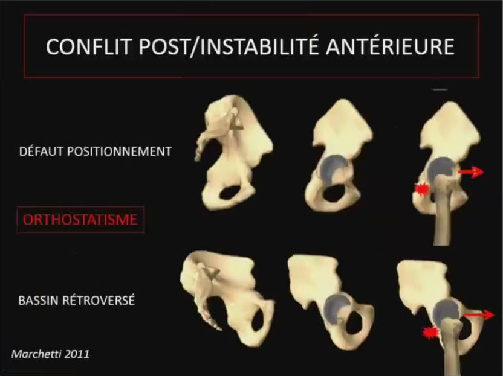

# Analyse du positionnement des pièces prothétiques et complications

> [!abstract] L'essentiel
> **Une cupule « dans la zone de Lewinnek » peut luxer** : l'analyse doit être dynamique (EOS debout/assis) et intégrer la mobilité spinopelvienne.

> [!success] À retenir
> 1. **60 %** des PTH instables sont dans la zone de sécurité (inclinaison **30–50°**, antéversion **5–25°**) : des angles normaux n'excluent pas un malpositionnement fonctionnel.
> 2. **Rigidité spinopelvienne** si Δ pente sacrée debout-assis **< 10°** (normale ≈ 20°) ; arthrodèse lombosacrée = facteur de risque.
> 3. **CSI** (antéinclinaison + angle pelvifémoral) : **> 243° debout** → instabilité antérieure ; **< 151° assis** → conflit antérieur et instabilité postérieure.

## Images clés
 [▶ 6:19](https://www.youtube.com/watch?v=qHL0QGsFvDU&t=379s)
 [▶ 7:09](https://www.youtube.com/watch?v=qHL0QGsFvDU&t=429s)
 [▶ 3:32](https://www.youtube.com/watch?v=qHL0QGsFvDU&t=212s)

## Points clés
- Longévité des PTH ≈ 20 ans ; le positionnement prothétique prévient conflit, usure et instabilité. L'exposé se limite à la **cupule**.
- **Zone de sécurité de Lewinnek** (≈ 40 ans) : inclinaison frontale 30–50°, antéversion 5–25°. Méthodologie critiquée (sélection de 122 PTH sur 300, 5 chirurgiens, 9 PTH instables, mesures selon le plan pelvien antérieur).
- Études récentes : 60 % des PTH instables dans la zone de sécurité (139 patients, 2017) ; proportion comparable de PTH dans la zone chez stables et instables (≈ 7000 patients) ; 65 % des PTH instables posées par voie postérieure dans la zone (Mayo Clinic, ≈ 10 000 patients). Dorr (2019) : « la mort de la zone de sécurité de Lewinnek ».
- **Problème dynamique** : l'acétabulum suit le bassin. Rétroversion pelvienne → antéversion sagittale de la cupule ; antéversion pelvienne → rétroversion de la cupule. Le passage debout-assis rétroverse le bassin et ouvre la cupule pour permettre la flexion.
- **Conflits** : 80 % des prothèses reprises pour instabilité présentent des signes de conflit. Debout : conflit **postérieur** → instabilité **antérieure** (cupule trop antéversée et/ou bassin trop rétroversé). Assis : conflit **antérieur** → instabilité **postérieure** (cupule trop rétroversée et/ou bassin trop antéversé).
- **Paramètres sagittaux** :
  - **Pente sacrée** : ≈ 40° debout, 20° assis (Δ ≈ 20°). **Rigidité spinopelvienne** si Δ < 10° ; bassin rigide en antéversion fixée si pente sacrée > 30°, en rétroversion fixée si < 30° debout.
  - **Antéinclinaison** de la cupule (horizontale/plan équatorial) : ≈ 35° debout, 52° assis.
  - **Angle pelvifémoral** : ≈ 180° debout, ≈ 130° assis.
  - **Index sagittal combiné (CSI)** = antéinclinaison + angle pelvifémoral : > 243° debout → risque d'instabilité antérieure ; < 151° assis → risque d'instabilité postérieure.
- Cas 1 : PTH douloureuse précoce, inclinaison 32°, antéversion 29° (normales) ; EOS : bassin rigide (Δ pente sacrée 10°), rétroversion fixée, CSI assis 134° → conflit antérieur symptomatique.
- Cas 2 (littérature) : arthrodèse lombosacrée, mobilité spinopelvienne nulle, antéversion pelvienne fixée, CSI assis 134° → luxations postérieures récidivantes.
- **Limites** des stratégies de pose personnalisées : valeurs restant dans la zone de Lewinnek (risque d'usure), précision de pose ≈ 5° même naviguée, modification de la pente sacrée après PTH et avec le vieillissement rachidien sur 20 ans.

## Sémiologie et technique d'imagerie
- Bilan standard (inclinaison, antéversion) complété par **EOS de profil debout et assis** : pente sacrée, antéinclinaison, angle pelvifémoral, CSI.

## Pièges et diagnostics différentiels
- Cupule « bien positionnée » selon Lewinnek mais en conflit du fait d'un bassin rigide.
- Arthrodèse lombosacrée : facteur de risque d'instabilité.

> [!WARNING] À ne pas manquer
> Devant une PTH instable ou douloureuse avec angles « normaux », rechercher une rigidité spinopelvienne sur EOS debout/assis.

> [!TIP] Pour le compte rendu
> Donner inclinaison et antéversion de la cupule, puis si EOS : pente sacrée debout/assis et son delta, antéinclinaison, angle pelvifémoral et CSI avec les seuils 243° (debout) et 151° (assis).

## Liens
- Congrès : [[SIMS 2019 - Index]]
- Voir aussi : [[Planification préopératoire]], [[Imagerie du conflit psoas-prothèse]], [[Prothèse douloureuse - l'interface osseuse]]
