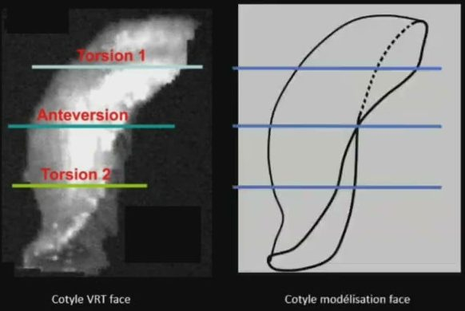
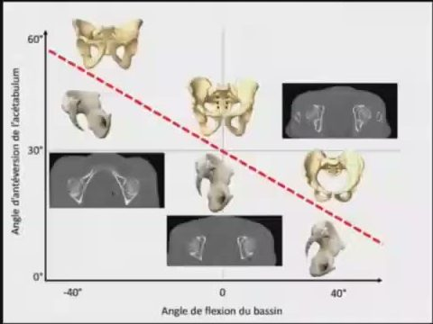
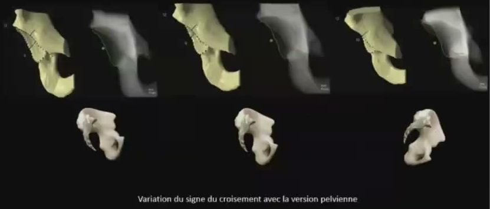

# Anatomie et orientation de l'acétabulum

> [!abstract] L'essentiel
> **L'acétabulum est « twisté » : plus rétroversé en haut qu'en bas, et son antéversion dépend de la version pelvienne** → une seule mesure d'antéversion ne suffit pas.

> [!success] À retenir
> 1. Valeurs normales : **antéversion 16–23°**, **inclinaison 50–56°** ; couverture **postéro-supérieure** prédominante.
> 2. Au scanner, mesurer l'antéversion en **zone supérieure ET moyenne** ; rétroversion isolée du toit = **pince**.
> 3. **Signe du croisement** variable avec la bascule du bassin → ne pas conclure à une rétroversion sans contrôler la version pelvienne (antéversion **fonctionnelle** via la pente sacrée).

## Images clés
 [▶ 3:55](https://www.youtube.com/watch?v=3ozraALQQaY&t=235s)
 [▶ 4:31](https://www.youtube.com/watch?v=3ozraALQQaY&t=271s)
 [▶ 7:41](https://www.youtube.com/watch?v=3ozraALQQaY&t=461s)

## Points clés
- Pourtour (limbus, sourcil) marqué par des échancrures, reliquats de la fusion du cartilage en Y :
  - échancrure ilio-pubienne en avant ;
  - échancrure ischio-pubienne en arrière ;
  - incisure acétabulaire inférieure, au-dessus du foramen obturé.
- Fosse acétabulaire profonde extra-articulaire et surface semi-lunaire cartilagineuse, avec ses cornes antérieure et postérieure.
- Le rebord n'est pas équatorial : il présente **trois sommets et deux vallées** (les échancrures). La mesure varie donc selon le niveau de coupe.
- Asymétrie droite/gauche décrite : rotation antihoraire à droite et horaire à gauche, avec un acétabulum droit plus antéversé et moins couvrant. L'explication avancée tient au cycle de marche (membre droit propulseur, gauche amortisseur).
- Références d'orientation :
  - Murray (1993) ;
  - plan pelvien antérieur de Lewinnek, fin des années 1970 (les deux épines iliaques antéro-supérieures et la symphyse) ;
  - tendance actuelle à se référer au plan sacré pour s'adapter à la posture.
- Valeurs moyennes chez le sujet sain : **antéversion 16-23°**, **inclinaison 50-56°**.
- Torsion (« twist ») de l'acétabulum, surtout démontrée au scanner : il est plus rétroversé dans sa partie haute que dans sa partie moyenne et basse.
- **L'antéversion acétabulaire varie linéairement avec la version pelvienne.** Quand le bassin bascule en avant, la version pelvienne diminue et l'acétabulum regarde en arrière.
- Couverture : les études 3D supplantent la coxométrie radiographique. La couverture **postéro-supérieure** est prédominante chez l'homme comme chez la femme.

## Sémiologie et technique d'imagerie
- Au scanner, mesurer l'antéversion en zone supérieure **et** en zone moyenne : les valeurs diffèrent nettement.
- Calculer l'antéversion fonctionnelle, à partir de la pente sacrée.
- La plupart des données concernent des sujets sains. Chez l'arthrosique, il faudrait s'affranchir des ostéophytes pour retrouver l'antéversion native.

## Pièges et diagnostics différentiels
- **Dysplasie** (première cause de PTH chez le sujet jeune) : cotyle moins profond et de moindre volume, ovoïde (allongé sans s'élargir), verticalisé, avec un twist augmenté. Une dysplasie n'implique pas forcément une arthrose : des études cadavériques montrent des dysplasies sans arthrose.
- **Conflit de type pince** : rétroversion excessive de la zone supérieure.
- **Signe du croisement** : il est subjectif et positionnel. Il apparaît chez un sujet sain dès que le bassin bascule en avant. Ne pas le décrire par excès.

> [!WARNING] À ne pas manquer
> Un signe du croisement isolé sur un bassin antéversé ne signe pas une rétroversion acétabulaire pathologique.

> [!TIP] Pour le compte rendu
> Donner l'antéversion acétabulaire à plusieurs niveaux (supérieur et équatorial), en précisant le plan de référence et, si possible, l'antéversion fonctionnelle (pente sacrée).

## Liens
- Congrès : [[SIMS 2019 - Index]]
- Voir aussi : [[Relations normales et pathologiques entre colonne vertébrale et bassin]], [[Le conflit de hanche (partie 3)]]
