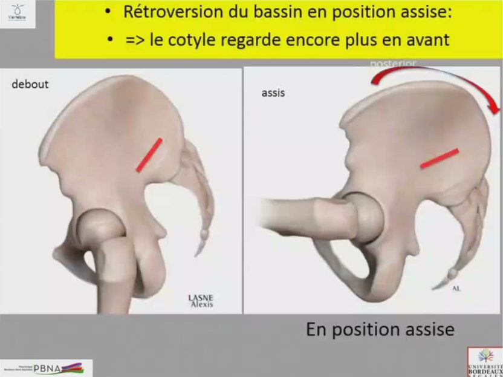
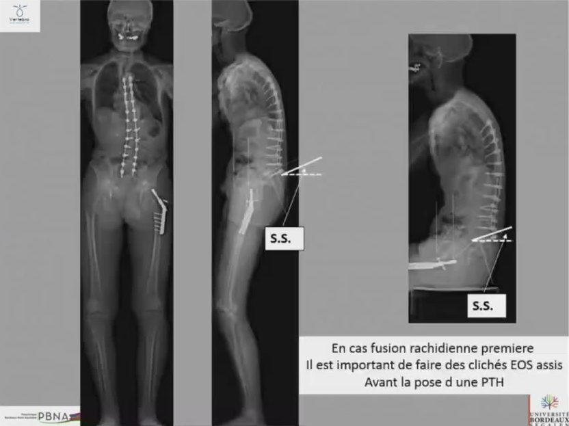
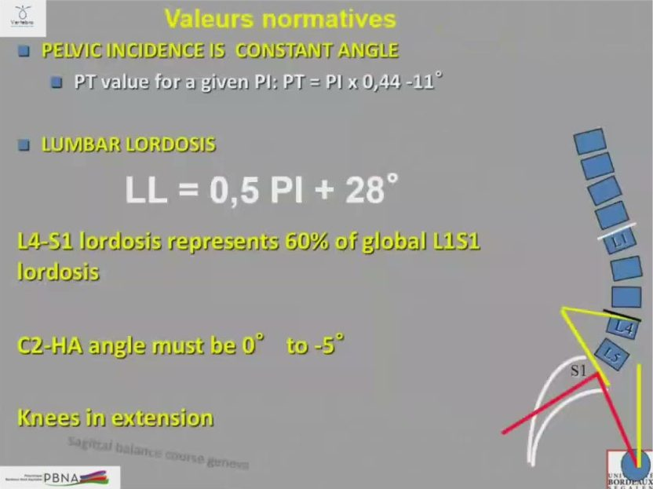

# Comment aborder les pathologies de la hanche et de la colonne vertébrale

> [!abstract] L'essentiel
> **Coxarthrose + rachis raide ou fusionné : EOS de profil debout ET assis avant toute PTH** ; traiter d'abord la hanche, sauf perte de lordose majeure et raide.

> [!success] À retenir
> 1. Perte de lordose → **rétroversion pelvienne** → cotyle orienté en avant : **instabilité / luxation** de PTH et conflit postérieur debout.
> 2. Arthrodèse **L1-S1** : plus de rétroversion assis → **conflit antérieur en position assise** ; chez le non-marchant, fixer à **50 %** de la lordose théorique.
> 3. Normes : **VP théorique = IP × 0,44 − 11°**, **LL = 0,5 × IP + 28°** ; un **flessum de hanche** peut expliquer déséquilibre antérieur et canal lombaire étroit dynamique.

## Images clés
 [▶ 2:44](https://www.youtube.com/watch?v=qXgHAD92J4Y&t=164s)
 [▶ 6:31](https://www.youtube.com/watch?v=qXgHAD92J4Y&t=391s)
 [▶ 11:37](https://www.youtube.com/watch?v=qXgHAD92J4Y&t=697s)

## Points clés
- Équilibre sagittal normal : posture économique avec un minimum de dépense d'énergie.
- Vieillissement : la cyphose et la perte de lordose lombaire entraînent une rétroversion du bassin, puis la flexion des genoux pour maintenir l'équilibre.
- L'EOS permet une analyse 3D du squelette complet, désormais semi-automatisée. Les valeurs normatives de hanche et de rachis sont indispensables.
- L'incidence pelvienne influence l'orientation du cotyle, dans le plan sagittal comme dans le plan frontal.
- En position debout, la rétroversion du bassin expose à un conflit postérieur de hanche.
- En position assise, le cotyle regarde encore plus en avant. Une arthrodèse L1-S1 supprime l'adaptation lombaire et expose à un **conflit antérieur en position assise**.
- Patients neurologiques non marchands (paraplégiques) nécessitant une arthrodèse lombaire : fixer le rachis avec **50 % de la lordose théorique**, sinon on crée un conflit acétabulaire antérieur et une proéminence abdominale majeure.
- Distinguer les incidences fortes (grande capacité de rétroversion) des incidences faibles (faible capacité).

## Sémiologie et technique d'imagerie
- EOS debout **et** assis, de profil, pour mesurer la pente sacrée et sa variation. Clichés en extension de hanche pour anticiper les conflits.
- Valeurs normatives (diapo) : l'incidence pelvienne est constante ; VP théorique = IP × 0,44 − 11° ; lordose lombaire = 0,5 × IP + 28°, L4-S1 représentant 60 % de la lordose L1-S1 ; angle C2-tête fémorale entre 0° et −5° ; genoux en extension.
- Cas 1 : PTH sans bilan rachidien, puis 4 luxations en moins de 6 mois. Un dos plat lombaire avec rétroversion pelvienne faisait regarder le cotyle en avant et en haut. Traitement : restauration de la lordose, après laquelle la hanche est redevenue stable.
- Cas 2 : rachis opéré avec une lordose insuffisante. La PTH a entraîné un conflit postérieur immédiat et une reprise rachidienne.
- Cas 3 : homme de 57 ans, déséquilibre antérieur, douleurs crurales bilatérales, périmètre de marche de 800 m, sténose foraminale L4-L5 à l'IRM.
  - Paramètres : IP 73°, VP 23° (théorique ≈ 21° selon VP = IP × 0,44 − 11°), lordose lombaire 75°, donc sans perte de lordose.
  - Cause réelle : flessum coxarthrosique avec canal lombaire étroit dynamique.
  - Après PTH bilatérale : disparition du flessum, de l'antéflexion et des radiculalgies.

## Pièges et diagnostics différentiels
- Une sténose canalaire à l'IRM peut être secondaire à l'hyperlordose compensatrice d'un flessum de hanche. C'est la hanche qu'il faut traiter.
- Une raideur de hanche limite la compensation rachidienne et aggrave un canal lombaire étroit.

> [!WARNING] À ne pas manquer
> Avant une PTH chez un patient au rachis fusionné, raide ou en perte de lordose, faire un bilan EOS debout et assis. Le risque de luxation et de conflit prothétique est élevé.

> [!TIP] Pour le compte rendu
> Donner l'IP, la VP, la pente sacrée et la lordose lombaire, avec la VP théorique attendue pour l'IP. Signaler un flessum de hanche pouvant expliquer un déséquilibre antérieur. Une tentative de classification de ces conflits a été proposée par C. Rivière (OTSR, 2017).

## Liens
- Congrès : [[SIMS 2019 - Index]]
- Voir aussi : [[Relations normales et pathologiques entre colonne vertébrale et bassin]], [[Prise en charge médicale des déséquilibres pelviens]], [[Les formes cliniques de la coxarthrose]]
