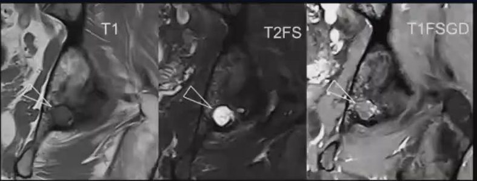
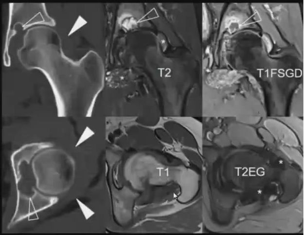
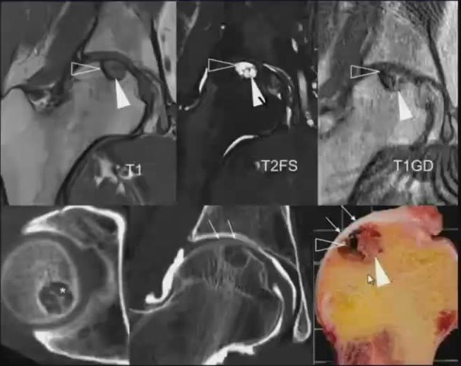

# Diagnostic différentiel et pièges de la coxarthrose

> [!abstract] L'essentiel
> **Lacune sous-chondrale de hanche : sans chondropathie en regard, penser tumeur cartilagineuse, pas géode** : toujours confronter l'IRM à la radio et à l'état articulaire.

> [!success] À retenir
> 1. Une **vraie géode** peut être grande, œdémateuse et se rehausser **en périphérie et au centre** : la clé est le **pincement en territoire d'hyperpression**.
> 2. **SVN** : érosions extrinsèques **des deux versants**, synoviale épaissie, **hémosidérine en écho de gradient**.
> 3. **Chondroblastome, chondrosarcome central, chondrosarcome à cellules claires** (tête fémorale) : matrice calcifiée, **rehaussement chondroïde**, cartilage intact ; prouver la communication par **arthroscanner (± clichés après déambulation)**.

## Images clés
 [▶ 1:53](https://www.youtube.com/watch?v=hlRWrLhXRf0&t=113s)
 [▶ 4:49](https://www.youtube.com/watch?v=hlRWrLhXRf0&t=289s)
 [▶ 8:01](https://www.youtube.com/watch?v=hlRWrLhXRf0&t=481s)

## Points clés
- **Vraie géode typique** : multiples, de taille variable, en territoire d'hyperpression, en regard d'un pincement, bordées de sclérose, liquidiennes.
- **Vraie géode atypique** : grande taille, extension à distance de l'articulation, migration possible dans l'os acétabulaire.
- En IRM sans radiographie, la géode inquiète par :
  - un œdème péri-lésionnel ;
  - un liseré hyperhémique ;
  - un rehaussement périphérique **et central**.
- Ce rehaussement s'explique par le contenu mixte de la géode : fluide central entouré d'un tissu myxoïde plicaturé, avec débris de cartilage, métaplasie cartilagineuse, fibroblastes et vaisseaux hyperplasiques.
- **Fausses géodes synoviales** :
  - arthropathies infectieuses ou rhumatismales, généralement polyarticulaires ;
  - hémopathies, exceptionnelles ;
  - surtout la **synovite villonodulaire**, qui peut mimer une coxarthrose : pincement, érosions extrinsèques sur les deux versants.
- **Fausses géodes tumorales** (trois types histologiques ressortent en staff sarcome) :
  - **chondroblastome** : sujet plus jeune, épiphysaire, lyse arrondie cerclée d'un liseré dense, calcifications environ une fois sur deux, œdème très intense ;
  - **chondrosarcome central de bas grade** : lacune sans lyse corticale, parfois épaississement cortical, tropisme bassin et fémur proximal ;
  - **chondrosarcome à cellules claires** : évolution lente, lésion bien limitée et scléreuse sans destruction corticale, calcifications dans un tiers des cas, tropisme pour la tête fémorale.

## Sémiologie et technique d'imagerie
- Radiographie indispensable : pincement et arthrose en territoire d'hyperpression rendent la géode probable.
- Synovite villonodulaire : synoviale très épaisse, hyperdense au scanner, en hyposignal T2, avec **artefact de susceptibilité en écho de gradient** (hémosidérine).
- Le scanner montre la matrice calcifiée, qui exclut une géode.
- Le rehaussement de type **chondroïde** (petits anneaux et arcs) n'existe pas dans la géode.
- L'**arthroscanner** montre l'absence de lésion cartilagineuse en regard d'une volumineuse lacune sous-chondrale, un argument tumoral.
- Prouver la communication articulation-lacune :
  - gaz spontané dans la géode (vide articulaire, puis effet piston vers les zones de haute pression) ;
  - ou passage d'iode à l'arthroscanner, **parfois tardif** (contrôle après déambulation).

## Pièges et diagnostics différentiels
- Le pertuis cartilagineux peut être minuscule ou situé dans un autre plan que la géode.
- L'œdème et le rehaussement central n'éliminent pas une vraie géode.

> [!WARNING] À ne pas manquer
> Une lacune sous-chondrale volumineuse sans chondrolyse en regard, avec matrice calcifiée, rehaussement chondroïde ou œdème majeur, doit faire évoquer une tumeur cartilagineuse et être discutée en RCP avant toute biopsie.

> [!TIP] Pour le compte rendu
> Toujours confronter l'IRM à la radiographie. Rechercher pincement et territoire d'hyperpression, matrice, type de rehaussement et état du cartilage en regard. Proposer un arthroscanner (± déambulation) pour prouver la communication. Retenir la formule humoristique attribuée au Pr Chevrot : l'anomalie sous-chondrale dépend d'abord de l'état articulaire.

## Liens
- Congrès : [[SIMS 2019 - Index]]
- Voir aussi : [[Sémiologie radiologique de la coxarthrose]], [[L'ostéonécrose de tête fémorale]], [[Les formes cliniques de la coxarthrose]]
