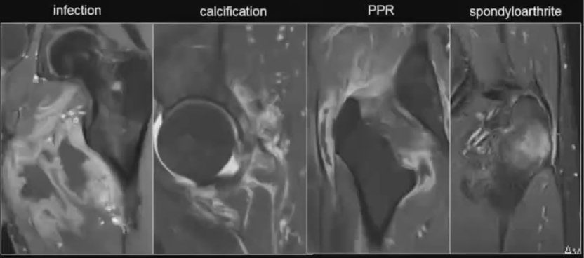
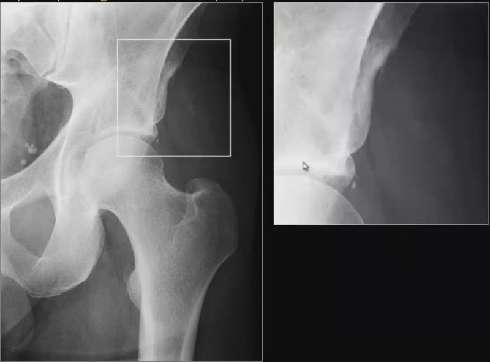
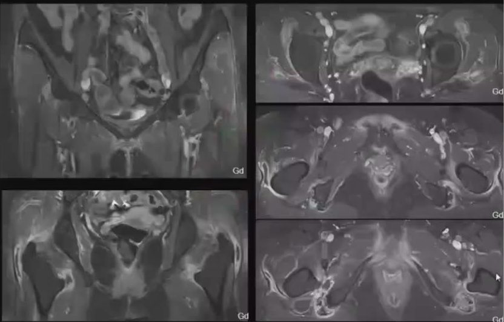

# Hanche inflammatoire périarticulaire

> [!abstract] L'essentiel
> **Hanche périarticulaire inflammatoire : 4 diagnostics, infection, résorption de calcification, PPR, spondyloarthrite** : la radiographie et le gadolinium font la différence.

> [!success] À retenir
> 1. **Résorption aiguë de calcification** : mime une coxite septique ; relire la radio à la recherche d'une **calcification floue, en traînée**, parfois **migrée** loin d'un tendon.
> 2. **PPR** (femme **> 50 ans**, syndrome inflammatoire) : **enthésites + bursites + capsulite bilatérales et symétriques** rehaussées après **gadolinium**, **sans œdème osseux** ; rehaussements **interépineux** au rachis.
> 3. **Spondyloarthrite** : même sémiologie mais **asymétrique** avec **œdème médullaire** → voir les sacro-iliaques ; **infection** : injecter, traquer le petit abcès et sa **source** (symphyse, ostéomyélite).

## Images clés
 [▶ 10:57](https://www.youtube.com/watch?v=yyII88e-Z2Q&t=657s)
 [▶ 4:08](https://www.youtube.com/watch?v=yyII88e-Z2Q&t=248s)
 [▶ 8:34](https://www.youtube.com/watch?v=yyII88e-Z2Q&t=514s)

## Points clés
- **Infection** :
  - Localiser précisément (bourses, muscles, tissus adjacents) ; en IRM précoce, traquer les **petits abcès**, injection de **gadolinium** indispensable.
  - Rechercher une **source** : coxofémorale, **symphyse pubienne** chez l'adulte (abcès pouvant fuser à distance), et les pièces osseuses — chez l'enfant, abcès secondaire à une ostéomyélite (ex. ischion) méconnue.
- **Résorption aiguë de calcification** :
  - Tableau bruyant mimant une coxite septique (radiographies jugées normales, échographie peu contributive, IRM : œdème peu caractéristique, par exemple de la région gemello-obturatrice).
  - Calcifications fréquentes à la hanche, notamment péritrochantériennes ; calcification capsulo-labrale en résorption.
  - Les calcifications peuvent **migrer à distance** (jusque dans la graisse sous-cutanée) : aspect flou, mal limité, « en traînée » sur la radiographie ; œdème musculaire IRM non centré sur un tendon ou ligament, très piégeant.
- **Pseudo-polyarthrite rhizomélique (PPR)** :
  - Femme de plus de 50 ans, enraidissement douloureux inflammatoire des ceintures, myalgies, syndrome inflammatoire biologique marqué ; lombalgies inflammatoires possibles. Patients adressés presque toujours avec un autre diagnostic (ex. suspicion de spondylodiscite).
  - IRM : épanchement/synovite (inconstant, peu spécifique), bursites (parfois marquées, souvent au second plan), anomalies **capsulaires et périarticulaires**, **enthésites** et atteinte des fascias/aponévroses avec petit œdème musculaire adjacent, **bilatérales et symétriques**.
  - Rehaussement intense des enthèses du droit fémoral (direct, indirect, conjoint), des adducteurs et des ischio-jambiers, parfois peu visible en T2 seul.
  - Rachis : anomalies de signal/rehaussements **interépineux et supra-épineux** étendus le long des fascias (décrits comme « bursites interépineuses »).
- **Spondyloarthrite** : sémiologie proche (synovite coxofémorale, enthésites) mais terrain différent (ex. homme de 39 ans), **asymétrie** et **œdème de la moelle osseuse**, absent dans la PPR → examiner les sacro-iliaques.

## Sémiologie et technique d'imagerie
- Radiographies systématiquement analysées, y compris hors topographies classiques.
- Échographie : épanchement intra-articulaire, centrée sur le point douloureux maximal.
- IRM : T2 FS puis **injection de gadolinium** dès que le terrain évoque une PPR ou une infection.

## Pièges et diagnostics différentiels
- Petites anomalies de signal périarticulaires (notamment ischiatiques) très fréquentes et banales chez la femme : ne suggérer une PPR qu'avec un contexte clinico-biologique compatible.
- Calcification migrée prise pour une infection ou une tumeur des parties molles.

> [!WARNING] À ne pas manquer
> « Coxite septique » suspectée avec radiographie dite normale : relire les clichés à la recherche d'une calcification floue en résorption avant d'enchaîner IRM et scanner.

> [!TIP] Pour le compte rendu
> Chez une femme > 50 ans avec syndrome inflammatoire, signaler explicitement l'association enthésites + bursites + atteinte capsulaire bilatérales et symétriques sans œdème osseux et évoquer une PPR ; préciser l'asymétrie et l'œdème osseux en faveur d'une spondyloarthrite.

## Liens
- Congrès : [[SIMS 2019 - Index]]
- Voir aussi : [[Imagerie des tendinopathies glutéales - classique et inhabituel]], [[Imagerie du tendon droit fémoral proximal]]
