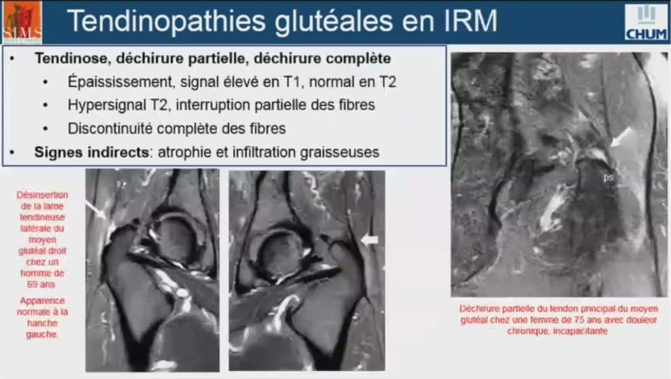
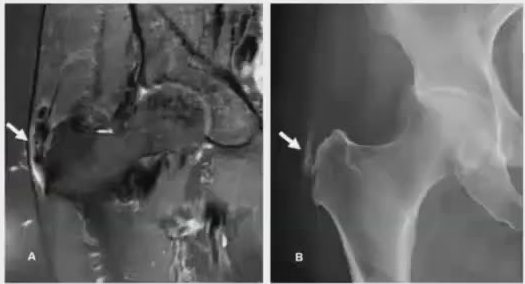
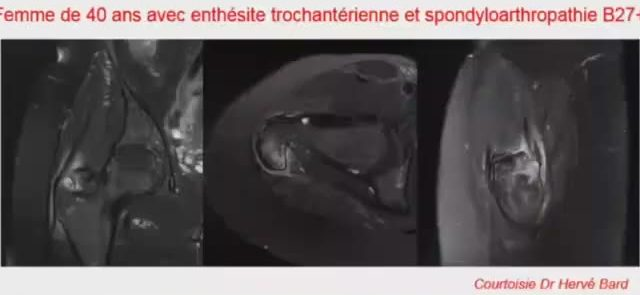

# Imagerie des tendinopathies glutéales - classique et inhabituel

> [!abstract] L'essentiel
> **Radio d'abord, puis écho ou IRM : préciser tendon, facette et grade (tendinose, partielle, complète)** ; penser calcification à hydroxyapatite et enthésite de spondyloarthrite.

> [!success] À retenir
> 1. **4 facettes** du grand trochanter : antérieure = petit glutéal, latérale = lame latérale du moyen glutéal, postéro-supérieure = tendon principal ; signes indirects : **atrophie et infiltration graisseuse**.
> 2. **Œdème péritrochantérien floride** en IRM : chercher une **calcification d'hydroxyapatite** en résorption (radio/scanner) avant d'évoquer infection ou tumeur.
> 3. **Enthésite de SpA** : atteinte péritrochantérienne chez **44 %** des patients, parfois inaugurale ; anomalies fréquentes chez l'asymptomatique, **corrélation clinique faible**.

## Images clés
 [▶ 5:06](https://www.youtube.com/watch?v=oXwHgnLwAJA&t=306s)
 [▶ 6:23](https://www.youtube.com/watch?v=oXwHgnLwAJA&t=383s)
 [▶ 7:28](https://www.youtube.com/watch?v=oXwHgnLwAJA&t=448s)

## Points clés
- Tendon normal : collagène de type 1 aligné → hyposignal homogène en IRM, aspect échogène fibrillaire (anisotrope) en échographie.
- **Grand trochanter à 4 facettes** : antérieure (petit glutéal), latérale (lame tendineuse latérale du moyen glutéal), postéro-supérieure (tendon principal du moyen glutéal), postérieure. Le tractus iliotibial coiffe la région.
- **Radiographies en première intention** : lésions osseuses ou articulaires, calcifications ; les **enthésophytes trochantériens** sont associés à des signes IRM de tendinopathie glutéale (petit glutéal aminci, atrophie et infiltration graisseuse musculaire).
- **Échographie** : corrélation clinico-radiologique, gestes écho-guidés.
- **IRM** : large champ, évaluation globale ostéo-articulaire et musculotendineuse, moins pénalisée chez les patients de fort gabarit ; considérée par plusieurs auteurs comme l'imagerie de choix.
- Les anomalies d'imagerie **ne corrèlent pas** avec la présence ni la sévérité des symptômes ; anomalies fréquentes chez l'asymptomatique.

## Sémiologie et technique d'imagerie
- **Écho – tendinose** : épaississement, hypoéchogénicité, calcifications intratendineuses.
- **Écho – déchirure partielle** : amincissement, interruption partielle des fibres ; **complète** : absence de tendon (chronique) ou interruption complète. Exemple : femme de 67 ans, déchirure complète de la lame latérale avec invagination de la bourse entre les moignons.
- **IRM – tendinose** : épaississement, signal élevé en T1 avec signal T2 relativement normal.
- **IRM – déchirure partielle** : hypersignal T2 d'allure liquidienne au sein des fibres ; **complète** : discontinuité complète (ex. homme de 69 ans, désinsertion complète de la lame latérale droite).
- Imagerie fondée sur une interprétation subjective : moins performante pour la tendinose et les déchirures partielles.

## Pièges et diagnostics différentiels
- **Tendinopathie calcifiante à hydroxyapatite** : hanche = 2e site après la coiffe des rotateurs ; douleur chronique ou crise hyperalgique lors de la résorption. Calcifications mieux vues en radiographie, échographie ou scanner, souvent difficiles voire occultes en IRM ; réaction inflammatoire et œdème des parties molles pouvant mimer une infection ou une tumeur.
- **Enthésite de spondyloarthrite** : atteinte péritrochantérienne chez environ 44 % des patients ; IRM = meilleur examen (œdème osseux de l'enthèse et des parties molles). Exemple : femme de 40 ans dont l'enthésite du moyen glutéal a été la présentation inaugurale d'une spondyloarthrite séronégative.
- Autres causes inflammatoires, infectieuses, tumorales et traumatiques.

> [!WARNING] À ne pas manquer
> Un œdème péritrochantérien floride en IRM peut correspondre à une crise de résorption calcique : vérifier les radiographies/scanner avant d'évoquer infection ou tumeur.

> [!TIP] Pour le compte rendu
> Préciser le tendon et la facette atteints, le type de lésion (tendinose, déchirure partielle, complète), l'état musculaire (atrophie, infiltration graisseuse) et la présence de calcifications ou d'un œdème d'enthèse.

## Liens
- Congrès : [[SIMS 2019 - Index]]
- Voir aussi : [[Pathogénie et clinique des tendinopathies glutéales]], [[Hanche inflammatoire périarticulaire]], [[Prise en charge chirurgicale des tendinopathies du petit et du moyen glutéal]]
