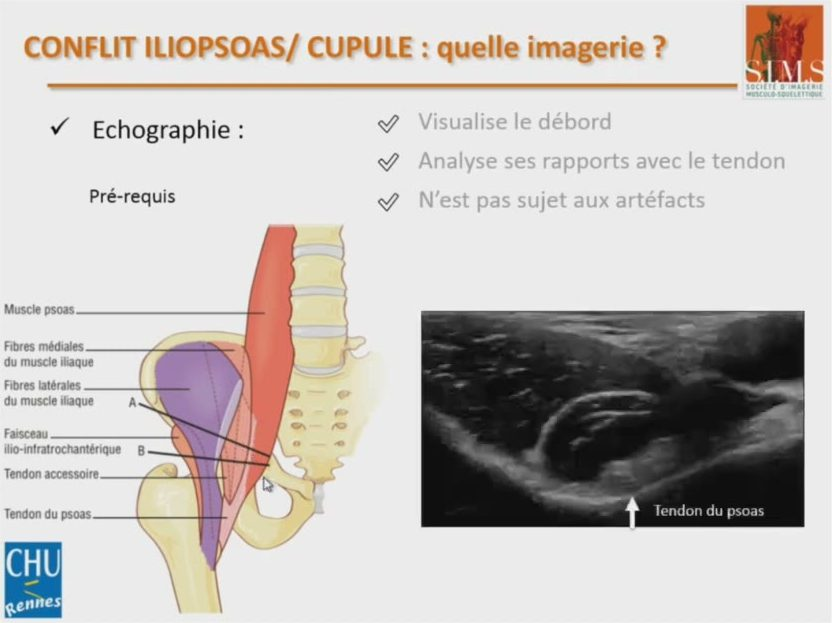

# Imagerie du conflit psoas-prothèse

> [!abstract] L'essentiel
> **Le conflit iliopsoas-cupule se démontre en échographie** : débord de cupule (signe de la double courbe), contact tendineux et bursite, sans artefact métallique.

> [!success] À retenir
> 1. Clinique à écrire dans le CR : douleur **strictement inguinale** en **flexion** (voiture, escaliers, chaussettes), indolore en terrain plat, **intervalle libre** postopératoire.
> 2. **Signe de la double courbe** en axial oblique = débord métallique de la cupule (≠ hyperostose ou ciment) ; scanner : débord axial **> 12 mm**.
> 3. Trois signes spécifiques (Sp **100 %**) : **contact**, saillie sagittale **> 5 mm**, **bursite** ; contact présent chez **12 %** des asymptomatiques → confronter à la clinique.

## Images clés
 [▶ 5:03](https://www.youtube.com/watch?v=JbclHq5-uZk&t=303s)

## Points clés
- **Physiopathologie** : la cupule doit être enfouie sous l'os natif ; une cupule **surdimensionnée ou rétroversée** déborde en avant au contact du tendon iliopsoas (posé sur l'os) → tendinopathie, plus rarement bursite. Tendon accessoire latéral pouvant contribuer. Diagnostic différentiel : vis acétabulaire saillante.
- **Clinique stéréotypée (à mettre dans le CR)** : douleur **strictement inguinale**, montrée du doigt, provoquée par la **flexion** (monter en voiture, escaliers, enfiler les chaussettes), parfois la toux ; **pas de douleur en terrain plat** ; **intervalle libre** fréquent après la chirurgie (reprise de l'appui). Environ 4 % des douleurs sur PTH (chiffre discuté).
- **Gold standard actuel = infiltration test** écho-guidée extra-articulaire entre tendon et cupule (chenal entre droit fémoral en profondeur et nerf fémoral en surface), anesthésique ± corticoïde, asepsie stricte (ou sous scanner, aiguille au contact de la cupule, injection sans résistance). Geste invasif à risque infectieux.
- **Radiographie** (profil) : montre le débord mais pas le tendon. **Scanner** : débord axial corrélé au conflit avec un seuil de **12 mm** (travail de Catherine Cyteval), artefacts historiques.
- **Échographie** : voit le débord, le tendon et leur contact, sans artefact ; sonde 12 MHz suffisante (≈ 90 % de réponses chez des patients de BMI « européen »).
- **Signe de la double courbe** : en coupe axiale oblique, courbe superficielle (cupule) et courbe profonde parallèle de rayon un peu plus petit (tête) → débord métallique ; sans débord, os natif plutôt concave vers le haut sous le tendon. Petites oscillations crâniocaudales pour confirmer.
- Coupe **sagittale** (statique) : mesure du débord par la **distance postéro-antérieure** et la **longueur sagittale maximale** (mesures décrites par Olivier Fantino).
- **Étude asymptomatiques vs symptomatiques** : cupule visible en avant chez 70 % des asymptomatiques ; **contact tendon-cupule chez 12 %** des asymptomatiques à 26 mois. Sur 17 patients symptomatiques : distance postéro-antérieure > 3 mm → performance diagnostique 80 % ; saillie sagittale > **5 mm** → sensibilité 60 %, **spécificité 100 %** ; **bursite** → spécificité 100 %, sensibilité faible.

## Sémiologie et technique d'imagerie
- Repérer le tendon iliopsoas (corde ovalaire réfléchissante sur le rameau pubien supérieur, jouer sur l'anisotropie), puis la cupule en dessous.
- Trois signes spécifiques à retenir : **contact**, **saillie > 5 mm**, **bursite**.

## Pièges et diagnostics différentiels
- Hyperostose de la zone de recoupe ou ciment simulant un débord métallique : le signe de la double courbe tranche.
- Visibilité antérieure de la cupule et même contact possibles sans symptôme.

> [!WARNING] À ne pas manquer
> L'infiltration test péri-prothétique expose au risque de contamination de la prothèse : asepsie chirurgicale impérative.

> [!TIP] Pour le compte rendu
> Rapporter le contexte clinique (douleur inguinale en flexion, intervalle libre), la présence d'un débord (double courbe), sa mesure sagittale, le contact et une éventuelle bursite.

## Liens
- Congrès : [[SIMS 2019 - Index]]
- Voir aussi : [[Conflit iliopsoas-prothèse - la prise en charge chirurgicale]], [[Analyse du positionnement des pièces prothétiques et complications]], [[IRM des prothèses de hanche]]
