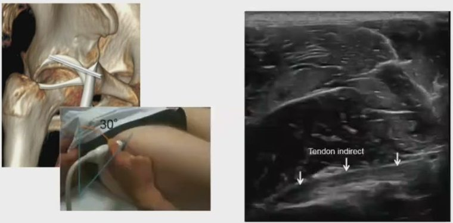
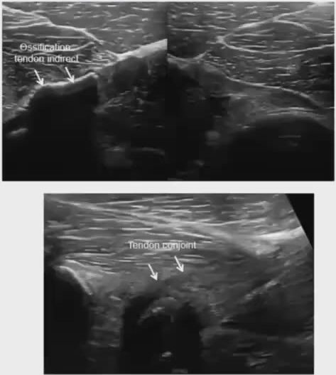
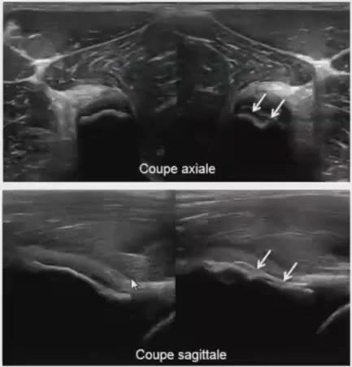

# Imagerie du tendon droit fémoral proximal

> [!abstract] L'essentiel
> **Radiographie + échographie explorent presque toute la pathologie du droit fémoral proximal, à condition d'aller chercher le tendon indirect par voie latérale** : direct = douleur antérieure, indirect = douleur antérolatérale.

> [!success] À retenir
> 1. Tendon **indirect** : balayage axial oblique sur le versant latéral de l'EIAI, sonde inclinée **≈ 30°**, appui sur le talon de sonde (sinon **anisotropie** simulant une tendinopathie).
> 2. Douleur antérolatérale chronique du footballeur étiquetée « psoas » → chercher une **rupture chronique de l'indirect**, souvent **ossifiée** dès la radiographie.
> 3. Enfant : **avulsion non ossifiée de l'EIAI = Rx normale, écho comparative +++** ; penser aussi à la coxarthrose (kyste arthrosynovial, bursite) devant une tendinopathie de l'indirect.

## Images clés
 [▶ 2:03](https://www.youtube.com/watch?v=kx6bhXSyZEQ&t=123s)
 [▶ 4:18](https://www.youtube.com/watch?v=kx6bhXSyZEQ&t=258s)
 [▶ 4:57](https://www.youtube.com/watch?v=kx6bhXSyZEQ&t=297s)

## Points clés
- **Droit fémoral** : chef le plus superficiel et seul biarticulaire du quadriceps (fléchisseur de hanche, extenseur du genou) → exposé aux contractions excentriques (sprint, frappe de balle) ; chef du quadriceps le plus souvent lésé.
- **Insertion** : tendon **direct** sur l'épine iliaque antéro-inférieure (EIAI), tendon **indirect** (réfléchi) sur la fossette supra-acétabulaire, réunis sous l'EIAI en **tendon conjoint** ; fibres directes → aponévrose antérieure (superficielle), indirectes → aponévrose centrale. Un 3e tendon/expansion vers la face profonde du petit glutéal est décrit (peut-être la même structure).
- **IRM = gold standard**, mais ne pas oublier la radiographie : de face, projection du tendon indirect (fossette supra-acétabulaire) ; de profil, EIAI ; évaluer aussi la hanche sous-jacente.
- **Traumatique** : grader correctement ; l'hypothèse d'une progression systématique de l'indirect vers le direct n'est pas confirmée dans l'expérience de l'orateur (rupture complète isolée du direct avec indirect respecté).
- **Lésions chroniques/semi-récentes du tendon indirect** souvent méconnues (jeune footballeur, 4 mois de douleur, initialement adressé pour psoas) ; ossification post-traumatique étendue de l'indirect au conjoint visible dès la radiographie.
- **Jonction myotendineuse proximale/tendon conjoint** : zone difficile (effets de bord) ; lésion aponévrotique pure de la cloison antérieure.
- **Enfant (< 11–12 ans)** : arrachement apophysaire non ossifié de l'EIAI visible seulement en échographie (jeune sprinteuse, décélération avec rétroversion du tronc) ; arrachements déplacés ossifiés vus en radiographie ; **apophysose/apophysite** de l'EIAI (cartilage de croissance épaissi, front d'ossification irrégulier) — comparer au côté sain.
- **Non traumatique** : enthésopathie souvent asymptomatique (forme symptomatique rare) ; **tendinopathie calcifiante** rare (indirect classiquement plus touché que le direct dans la littérature), calcifications parfois invisibles en IRM, accessibles à une ponction-lavage écho-guidée ; enthésite psoriasique ; atteinte péritendineuse dans la PPR.
- **Coxopathie** : rapports étroits du tendon indirect avec capsule et ligament iliofémoral → tendinopathie/bursite péritendineuse au contact d'une coxarthrose (douleur à projection latérale atypique), **kyste arthrosynovial** disséquant le tendon indirect jusqu'au conjoint ; lésions labrales associées décrites chez l'enfant (une dizaine de cas).

## Sémiologie et technique d'imagerie
- Échographie : direct et conjoint par voie antérieure ; **tendon indirect** en remontant en arrière et en haut ou par balayage latéral, sous le petit glutéal, sonde inclinée d'environ 30°, appuyer sur le talon de sonde (sinon anisotropie, tendon faussement hypoéchogène) ; rotation de 90° pour le grand axe, ligament iliofémoral sous-jacent, fusion avec la capsule en arrière.
- Signes : épaississement, hypoéchogénicité, hypersignal ; calcifications hyperéchogènes avec ou sans cône d'ombre (scanner pour confirmation).

## Pièges et diagnostics différentiels
- Douleur antérolatérale étiquetée « psoas » alors qu'il s'agit du tendon indirect.
- Anisotropie du tendon indirect simulant une tendinopathie.
- Calcifications occultes en IRM.

> [!WARNING] À ne pas manquer
> Chez l'enfant, un arrachement non ossifié de l'EIAI est invisible en radiographie : l'échographie comparative fait le diagnostic.

> [!TIP] Pour le compte rendu
> Préciser quel tendon est atteint (direct, indirect, conjoint, jonction myotendineuse, aponévrose), le grade, une calcification ou ossification, et l'état de la hanche sous-jacente.

## Liens
- Congrès : [[SIMS 2019 - Index]]
- Voir aussi : [[Échographie des hernies de l'aine]], [[Hanche inflammatoire périarticulaire]], [[Les lésions traumatiques rares des muscles pelvitrochantériens]]
