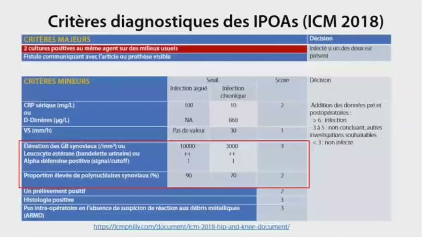
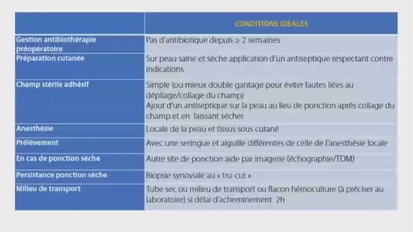

# Infection sur prothèse de hanche - prélèvements et germes

> [!abstract] L'essentiel
> **La ponction articulaire fait 2/3 des diagnostics d'infection de prothèse** : sans antibiotique depuis ≥ 2 semaines, asepsie stricte, culture prolongée 10-14 jours.

> [!success] À retenir
> 1. ICM 2018 : **2 cultures positives au même germe** ou **fistule** = infection ; sinon score (GB synoviaux **> 10 000/mm³** aigu, **> 3 000** chronique ; PNN **> 90 %** / **> 70 %** ; leucocyte estérase, alpha-défensine) → **≥ 6** infecté.
> 2. Ponction sèche → **autre voie sous guidage écho/TDM**, puis **biopsie synoviale** (tru-cut) ; seringue et aiguille différentes de l'anesthésie locale.
> 3. Transport > **2 h** → **flacon d'hémoculture** (prévenir le labo) ; exiger une culture **10-14 j** (*C. acnes*), ne pas classer contaminant un *S. epidermidis* sans RCP.

## Images clés
 [▶ 0:14](https://www.youtube.com/watch?v=MBuXKg4LtHs&t=14s)
 [▶ 2:48](https://www.youtube.com/watch?v=MBuXKg4LtHs&t=168s)

## Points clés
- **Critères du consensus international** : 2 cultures positives au même germe = infection ; sinon, poids important des données de la ponction (leucocytes totaux et % de polynucléaires neutrophiles, seuils différents en aigu et en chronique). Selon la diapo ICM 2018 : GB synoviaux > 10 000/mm³ en aigu et > 3 000/mm³ en chronique, ou leucocyte estérase ++, ou alpha-défensine positive (3 points) ; PNN > 90 % en aigu et > 70 % en chronique (2 points) ; CRP sérique > 100 mg/L en aigu et > 10 mg/L en chronique, ou D-dimères > 860 µg/L en chronique (2 points) ; VS > 30 mm/h en chronique (1 point) ; un prélèvement positif (2), histologie positive (3), pus peropératoire hors réaction aux débris métalliques (3). Total ≥ 6 : infection ; 3 à 5 : non concluant ; < 3 : non infecté.
- « La ponction articulaire est à la prothèse ce que l'ECBU est à l'infection urinaire. »
- **Faux négatifs** : ponction sous antibiotiques → arrêt recommandé **2 semaines** avant (sauf urgence septique, où la positivité reste plus probable).
- **Faux positifs** : défaut d'asepsie → contamination par la flore cutanée ; or les **staphylocoques à coagulase négative** (*S. epidermidis* surtout) sont à la fois commensaux et pathogènes fréquents ; à l'épaule, *S. epidermidis* + *C. acnes* ≈ deux tiers à trois quarts des germes.
- **Technique** : peau sèche, antiseptique, précautions universelles, anesthésie locale (effet bactériostatique non démontré comme significatif), changement de seringue ; ponction sèche → autre site, biopsie synoviale éventuelle ; répéter si forte suspicion clinique et première ponction négative.
- **Transport** : délai > 2 h → milieu de transport adapté ou **flacon d'hémoculture**, en prévenant le laboratoire.
- **Pas de contre-indication** formelle : ponction en zone de cellulite sans risque démontré (préférer une autre voie si possible) ; bactériémie → la question est chirurgicale ; biopsie osseuse associée non recommandée.
- **Culture prolongée 10–14 jours** : *Cutibacterium acnes* (ex-*Propionibacterium*) pousse en 6 à 12 jours ; un rendu stérile à 48 h fait manquer le diagnostic. Antibiogramme sur tous les germes isolés, y compris *S. epidermidis*.
- **Autres tests** : CRP intra-articulaire ; PCR universelle peu sensible, PCR spécifiques utiles (*Kingella kingae* chez l'enfant, tuberculose) ; **alpha-défensine** (intérêt surtout par sa valeur prédictive négative) ; **calprotectine** (en évaluation, moins chère) ; **bandelette leucocyte estérase** (bonne concordance avec le comptage, très peu coûteuse) ; séquençage de nouvelle génération (onéreux, positifs à cultures négatives de signification incertaine) ; tests rapides de résistance du staphylocoque en postopératoire immédiat.

## Sémiologie et technique d'imagerie
- Ponction sous guidage d'imagerie ; changer de voie d'abord en cas de ponction blanche.

## Pièges et diagnostics différentiels
- Contamination cutanée par staphylocoque à coagulase négative.
- Culture arrêtée trop tôt (*C. acnes*).
- Ponction sous antibiothérapie.

> [!WARNING] À ne pas manquer
> Ne jamais ponctionner une prothèse sous antibiotiques si la situation le permet (fenêtre de 2 semaines) et exiger une culture prolongée 10–14 jours.

> [!TIP] Pour le compte rendu
> Mentionner la voie d'abord, l'asepsie, l'aspect et le volume du liquide, le mode de transport (flacon d'hémoculture signalé au laboratoire), la demande de culture prolongée, de cytologie et éventuels marqueurs ; interprétation en RCP.

## Liens
- Congrès : [[SIMS 2019 - Index]]
- Voir aussi : [[Prothèse douloureuse - l'interface osseuse]], [[IRM des prothèses de hanche]]
