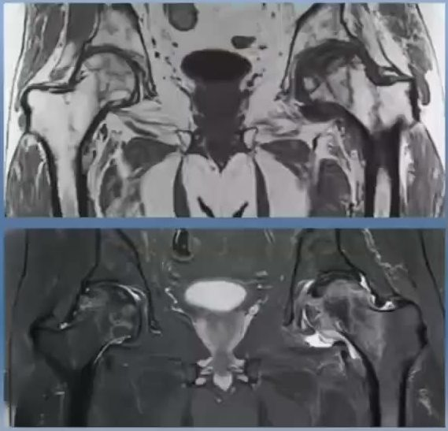
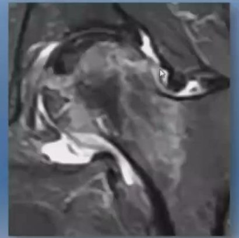
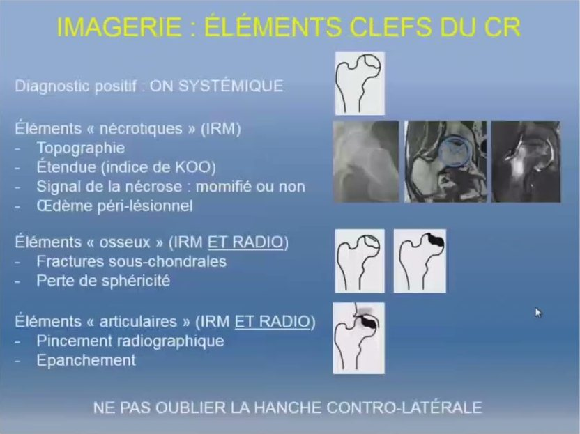

# L'ostéonécrose de tête fémorale

> [!abstract] L'essentiel
> **Liseré T1 rejoignant la surface articulaire sur toutes les coupes = ostéonécrose** : pas d'injection, jamais d'IRM sans radiographie.

> [!success] À retenir
> 1. Toujours **IRM du bassin entier** (bilatéralité) : 3D T1 isotrope + coronal/axial T2 FS ± sagittal T2 ; **pas d'injection systématique** (la nécrose peut se rehausser).
> 2. Pronostic au CR : **étendue (index de Koo)** et topographie portante, **signal de la nécrose** (momifiée = graisseuse, meilleur pronostic), **œdème**, **fracture sous-chondrale**.
> 3. **Effondrement / perte de sphéricité** parfois visible seulement en radio → stade tournant, adresser vite (décharge, chirurgie).

## Images clés
 [▶ 6:48](https://www.youtube.com/watch?v=bSW7j65e0t0&t=408s)
 [▶ 7:33](https://www.youtube.com/watch?v=bSW7j65e0t0&t=453s)
 [▶ 10:16](https://www.youtube.com/watch?v=bSW7j65e0t0&t=616s)

## Points clés
- L'incidence est voisine de celle de la spondyloarthrite et de la polyarthrite rhumatoïde. L'ostéonécrose touche des sujets jeunes, évolue souvent défavorablement et mène fréquemment à la prothèse.
- Elle peut être asymptomatique ou se révéler par une douleur brutale ou d'installation rapide. Toujours explorer la hanche controlatérale.
- Étiologies principales : alcoolisme chronique, corticothérapie orale au long cours, fractures du col. Autres causes : drépanocytose, barotraumatismes ; tabac et chimiothérapies comme facteurs de risque.
- Hypothèse physiopathologique : hyperpression dans un compartiment fermé, qui entretient un cercle vicieux avec l'ischémie.
- Histoire naturelle : nécrose médullaire (radiographies normales, stades 0-1 de Ficat), puis os de régénération périphérique (bande de sclérose), puis résorption trabéculaire, effondrement (tournant évolutif) et enfin coxarthrose.
- Traitement (évoqué brièvement) : médical tant que l'effondrement est limité, forages percutanés de décompression, prothèse en cas d'effondrement significatif ou d'arthrose.

## Sémiologie et technique d'imagerie
- Radiographie d'abord : elle suffit parfois au diagnostic (stade avancé).
- IRM : liseré en hyposignal T1 qui rejoint la surface articulaire en tout point, dans les deux plans.
- Facteurs de mauvais pronostic : signal T1 bas de la nécrose (meilleur si « momifiée », en signal graisseux), œdème extensif, fracture sous-chondrale.
- Extension : quantification par un index angulaire (angles frontal et sagittal, formule donnant un pourcentage de surface atteinte ; index de Koo vraisemblablement, nom déformé dans la transcription). La topographie en zone portante compte aussi.
- Protocole proposé : tout le bassin, 3D T1 à voxels isotropes (reconstructions MPR d'aspect proche du scanner), DP FS (en 3D si possible), sagittal T2 au besoin. **Pas d'injection systématique.**
- Échographie : peu de place.

## Pièges et diagnostics différentiels
- L'hypersignal T2 FS à l'interface correspond surtout à un artefact de déplacement chimique, pas à une fracture ni à du liquide.
- Sur une myélofibrose ou une drépanocytose, le fond noir masque le liseré.
- La nécrose peut se rehausser (tissu de granulation) : piège de l'injection.
- Un effondrement peut être net à la radiographie et invisible en IRM.
- Diagnostic différentiel : fracture sous-chondrale, à rechercher en T1 sans saturation ou en sagittal T2.
- Arthrose secondaire : rechercher les signes hors de la zone effondrée, où l'interligne peut paraître élargi.

> [!WARNING] À ne pas manquer
> Jamais d'IRM d'ostéonécrose sans radiographie. Un patient dont la tête commence à s'effondrer doit être adressé rapidement (prise en charge précoce, mise en décharge).

> [!TIP] Pour le compte rendu
> Indiquer le diagnostic positif (liseré), le signal de la nécrose et l'œdème, l'extension (index) et la topographie, la présence d'une fracture sous-chondrale ou d'un effondrement, l'arthrose, et toujours l'état de la hanche controlatérale.

## Liens
- Congrès : [[SIMS 2019 - Index]]
- Voir aussi : [[Œdème médullaire de la tête fémorale - quand contrôler]], [[Diagnostic différentiel et pièges de la coxarthrose]]
