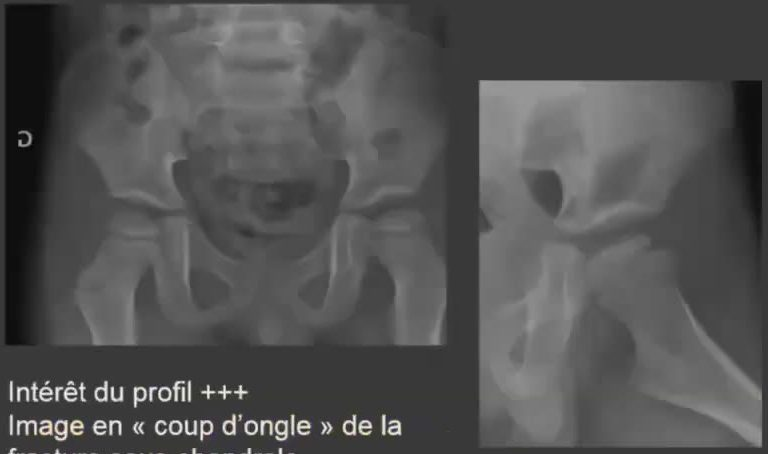
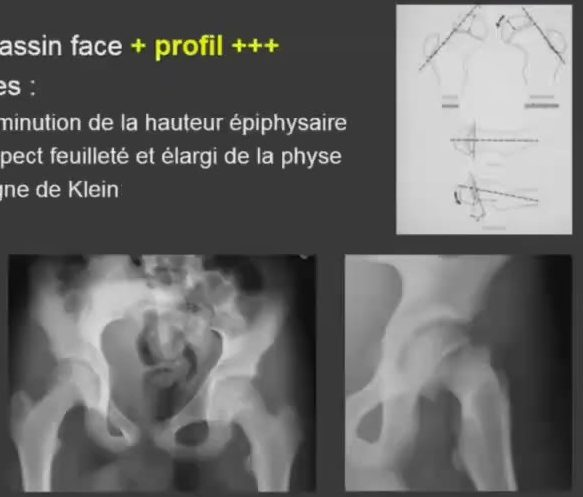

# La boiterie chez l'enfant et l'adolescent

> [!abstract] L'essentiel
> **Boiterie de l'enfant : raisonner par l'âge, radio du bassin face + profil toujours couplée à l'échographie** : IRM comparative en 2e intention si la boiterie persiste.

> [!success] À retenir
> 1. **Jamais d'échographie seule** : l'épanchement est non spécifique ; **synovite transitoire = diagnostic d'élimination** (2-10 ans, guérison en quelques jours).
> 2. **« Rhume de hanche » récidivant → OPH** : chercher sur le **profil** l'image en **coup d'ongle** (fracture sous-chondrale) ; l'IRM voit la nécrose au stade infra-radiologique.
> 3. **Épiphysiolyse = urgence** de l'adolescent en surpoids : **profil +++**, hauteur épiphysaire diminuée, physe feuilletée, **ligne de Klein** ne coupant plus la tête.

## Images clés
 [▶ 6:11](https://www.youtube.com/watch?v=pZmV36Hl7Z4&t=371s)
 [▶ 9:40](https://www.youtube.com/watch?v=pZmV36Hl7Z4&t=580s)

## Points clés
- Motif fréquent aux urgences pédiatriques. Les causes sont locales ou à distance : douleur projetée depuis le rachis ou les membres inférieurs.
- La clinique compte : âge, fièvre, syndrome inflammatoire.
  - Boiterie aiguë : récente, unilatérale, douloureuse.
  - Boiterie chronique : persistante ou épisodique et récidivante.
- **Synovite aiguë transitoire** (« rhume de hanche ») : 2 à 10 ans, boiterie aiguë matinale, pas de fièvre, virose récente possible. Radiographie normale, épanchement en échographie, guérison en 4-5 jours. Elle reste un diagnostic d'élimination. Une échographie de contrôle n'est faite que si la douleur persiste.
- Un « rhume de hanche » qui récidive doit faire rechercher une **ostéochondrite primitive de hanche** (OPH). Exemple : 3e épisode en 4 mois, ostéochondrite visible dès la première radiographie.
- OPH : fracture sous-chondrale, puis fragmentation, revascularisation à partir du col (mois) et reconstruction (années), avec risque de coxa plana ou magna.
- **Épiphysiolyse** : glissement de l'épiphyse fémorale proximale à travers le cartilage de croissance.
  - Terrain : période pubertaire, surpoids.
  - Formes : aiguë, subaiguë ou chronique.
  - Complications : ostéonécrose, chondrolyse, arthrose.
  - **C'est une urgence.**

## Sémiologie et technique d'imagerie
- Radiographie en décubitus (évite les attitudes antalgiques) : bassin de face comparatif, rotules au zénith, et profil type Lauenstein « grenouille » (flexion de 70°), chaque hanche séparément.
- Échographie : coupe sagittale oblique dans l'axe du col, à la recherche d'un épanchement du récessus antérieur (signe non spécifique), à interpréter après la radiographie.
- IRM : supérieure à la scintigraphie et au scanner, non irradiante. Plan coronal, champ large comparatif, séquences anatomiques et « inflammatoires », complétées selon la pathologie (séquence cartilage, autres plans).
- OPH :
  - le profil montre précocement la fracture sous-chondrale ;
  - l'IRM détecte la nécrose à un stade infra-radiologique et évalue le pronostic (cartilage, centrage, couverture, mode de revascularisation par injection ou diffusion) ;
  - la pseudo-excentration correspond parfois à une hypertrophie cartilagineuse.
- Épiphysiolyse : le profil est plus sensible que la face. Signes : épiphyse moins haute, physe d'aspect feuilleté, ligne de Klein qui ne coupe plus la tête. L'IRM ne sert qu'à dépister les signes physaires précoces.

## Pièges et diagnostics différentiels
- Petit enfant : traumatisme à distance (fracture en « cheveu » du tibia, révélée par le cal), arthrite septique, métastases (neuroblastome).
- Grand enfant :
  - pathologie du sport (tendinopathies, bursites) ;
  - ostéomyélite régionale (grand trochanter) à germe lent, parfois sans syndrome biologique ;
  - tumeurs : kyste, sarcome d'Ewing du pelvis, ostéome ostéoïde.

> [!WARNING] À ne pas manquer
> Urgences : arthrite septique (surtout chez le petit enfant, échographie en urgence pour la ponction) et épiphysiolyse aiguë, à évoquer devant toute douleur de hanche chez un adolescent en surpoids. Une boiterie qui dure est organique jusqu'à preuve du contraire.

> [!TIP] Pour le compte rendu
> Toujours associer la radiographie (face et profil) à l'échographie. Proposer une IRM comparative à champ large si l'imagerie initiale est normale et que la boiterie persiste.

## Liens
- Congrès : [[SIMS 2019 - Index]]
- Voir aussi : [[Ostéome ostéoïde de la hanche]], [[L'ostéonécrose de tête fémorale]]
