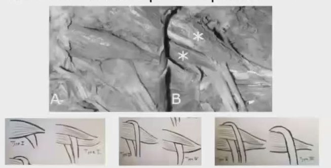

# La chirurgie des syndromes de la traversée pelvifémorale du nerf ischiatique

> [!abstract] L'essentiel
> **Chirurgie du défilé infrapiriforme seulement si l'infiltration test de toxine a soulagé totalement** : neurolyse du nerf ischiatique d'abord, ténotomie à la carte ensuite.

> [!success] À retenir
> 1. Arbre décisionnel : clinique + **EMG dynamique** → rééducation → **toxine botulique écho-guidée** (test) → chirurgie si **soulagement total** puis récidive.
> 2. **Variations anatomiques nerf / piriforme ≈ 40 %** : si des fibres traversent le muscle, une ténotomie isolée aggrave la chicane ; signaler ces variantes et le volume du **carré fémoral**.
> 3. Imagerie surtout pour les **causes secondaires** (lipome, granulome sur PTH, hernie capsulaire, hématome) ; principale cause d'échec = **erreur diagnostique**.

## Images clés
 [▶ 6:16](https://www.youtube.com/watch?v=WHfUCfNmigY&t=376s)

## Points clés
- Syndrome canalaire (défilé) tridimensionnel, sous-diagnostiqué, dont l'incidence est inconnue ; conflit neuro-musculaire voire osseux, primitif ou secondaire (hématome, infection de hanche avec hernie capsulaire postérieure, granulome postérieur sur prothèse de hanche).
- Dans une zone d'environ 2 cm sortent le nerf ischiatique, le **nerf cutané postérieur de la cuisse** et le pédicule glutéal inférieur. Deux tableaux : douleurs de la face postérieure de cuisse (crampe, écrasement, brûlure) ou douleurs plus distales.
- **Arbre décisionnel** (avec rhumatologues et MPR) : diagnostic clinique → **EMG dynamique** de confirmation → rééducation → en échec, **injection écho-guidée de toxine botulique** ; la chirurgie n'est proposée que si le soulagement a été **total** (même transitoire), puis récidive et refus d'une nouvelle injection.
- **Technique (chirurgie ouverte mini-invasive, ambulatoire)** : décubitus latéral, appuis sacré et pubien, AG **sans curare** (neurostimulation peropératoire), membre libre mobilisable en rotation. Incision rétrotrochantérienne remontant vers l'EIPS, dissociation du grand glutéal dans le sens des fibres.
- Repérage du **carré fémoral** (volume très variable, source de conflit), libération du nerf de bas en haut, adhérences fréquentes au carré fémoral ; vigilance absolue pour le **pédicule glutéal inférieur** (risque de boiterie de Trendelenburg) ; libération du nerf cutané postérieur ; neurostimulation avant/après libération.
- **Variations anatomiques** : environ 40 % dans l'étude anatomique de l'équipe (nerf au-dessus du piriforme, une ou deux branches à travers le muscle…).
- **Recalibrage à la carte** : après neurolyse, palpation digitale du foramen infrapiriforme ; ténotomie seulement si calibre insuffisant ; si des fibres traversent le muscle, section de tout ce qui est sous le nerf.
- **Constatations** : adhérences fibreuses avec disparition des vaisseaux et aspect en sablier, **lacis veineux** périneural (coagulation → recoloration du nerf), **lipome** au contact du nerf (4 cas).
- **Suites** : lever immédiat, kinésithérapie d'étirement, consultation à 6 semaines et 6 mois, EMG systématique à 6 mois, pas d'imagerie de contrôle ; vélo/course à 3 mois. Fessalgie disparaissant en une semaine, symptômes distaux irritatifs en un mois.
- **Complications** : pas de complication neurologique ; 2 échecs (probables erreurs diagnostiques) ; 3 hématomes (1 évacuation chirurgicale, 2 résorptions spontanées).

## Sémiologie et technique d'imagerie
- Imagerie préopératoire généralement non contributive ; l'imagerie sert au guidage de la toxine et aux causes secondaires (masse, lipome, granulome, hernie capsulaire).

## Pièges et diagnostics différentiels
- Ténotomie isolée du piriforme quand une partie du nerf traverse le muscle : la rétraction aggrave l'effet chicane.
- Erreur diagnostique = principale cause d'échec.

> [!WARNING] À ne pas manquer
> Toujours un geste mixte : neurolyse d'abord, ténotomie ensuite si nécessaire ; préserver le pédicule glutéal inférieur.

> [!TIP] Pour le compte rendu
> Signaler les causes secondaires compressives (lipome, granulome sur prothèse, hernie capsulaire, hématome), le volume du carré fémoral et les variantes de passage du nerf par rapport au piriforme.

## Liens
- Congrès : [[SIMS 2019 - Index]]
- Voir aussi : [[Les syndromes de la traversée pelvifémorale]], [[Le conflit ischiofémoral en 2019]]
