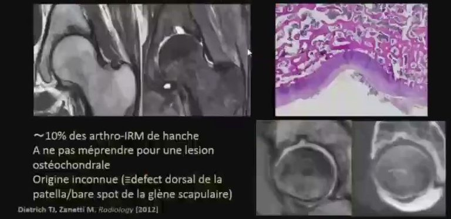
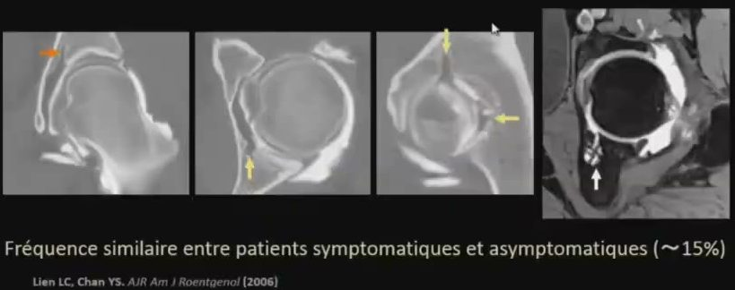
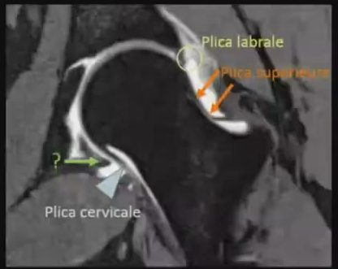

# La hanche articulaire : variantes

> [!abstract] L'essentiel
> **L'IRM voit mal le cartilage de hanche (sensibilité ≈ 60 %) et les variantes acétabulaires sont fréquentes** : comparer au côté opposé et relire la radiographie avant de conclure.

> [!success] À retenir
> 1. Interligne au zénith **2 à 7 mm** (moyenne **4,19 mm**) : pas de norme absolue, seule la **comparaison droite/gauche** compte ; interligne plus fin du côté le plus couvert.
> 2. **Encoches acétabulaires** (≈ **15 %**, autant chez l'asymptomatique) et **fossette supra-acétabulaire** (≈ **10 %** des arthro-IRM) = variantes, pas des lésions ostéochondrales.
> 3. Une **chondrolyse** peut être invisible en IRM : toujours relire la radiographie et inclure une séquence grand champ ; **arthroscanner** si l'on veut la surface cartilagineuse.

## Images clés
 [▶ 9:25](https://www.youtube.com/watch?v=6e4Xvsjo_r4&t=565s)
 [▶ 8:41](https://www.youtube.com/watch?v=6e4Xvsjo_r4&t=521s)
 [▶ 10:27](https://www.youtube.com/watch?v=6e4Xvsjo_r4&t=627s)

## Points clés
- Interligne radiographique : grandes variations inter-individuelles (de 2 à 7 mm au zénith, épaisseur moyenne 4,19 mm selon la diapo), donc pas de norme chiffrée utilisable isolément. On compare les deux hanches, avec peu de variation droite/gauche, sur un bassin de face reproductible.
- L'épaisseur de l'interligne est **inversement proportionnelle à la couverture acétabulaire** : une couverture large répartit les contraintes et le cartilage s'épaissit moins pendant la croissance. Ne pas surestimer un « pincement » du côté le plus couvert.
- L'interligne est habituellement plus épais en latéral qu'en médial, mais dans 10 à 15 % des cas il est égal, voire plus fin en dehors.
- IRM du cartilage : le signal du cartilage acétabulaire varie beaucoup. L'hyposignal décrit comme signe de délamination n'a qu'une sensibilité de 6 % dans une étude récente.
- Performances globales : IRM et arthro-IRM ont une sensibilité d'environ 60 %, le gadolinium intra-articulaire apporte peu, l'arthroscanner fait mieux.
- Explication :
  - articulation très congruente : les surfaces comprimées n'admettent pas de liquide interposé, comme le montre un genou cadavérique en varus/valgus ;
  - le gadolinium n'est vu qu'indirectement, par son effet sur les protons voisins, et nécessite un volume de liquide suffisant, alors que l'iode est vu directement.
- La traction améliore la visualisation, mais elle est inconfortable, allonge l'examen et reste rarement faite.

## Sémiologie et technique d'imagerie
- **Encoches acétabulaires** (supérieure, antérieure, postérieure) : défects de la jonction os-cartilage, internes au sourcil, bilatéraux et symétriques, asymptomatiques.
- **Fossette supra-acétabulaire** : au zénith, environ 10 % des arthro-IRM. Défect rempli de liquide ou de cartilage, analogue au défect dorsal de la patella. Ne pas prendre pour une lésion ostéochondrale.
- **Pli stellaire** (« stellate lesion » des chirurgiens) : irrégularité du cartilage médial, a priori non visible aux résolutions IRM habituelles. Les images ainsi étiquetées sur Internet correspondent souvent aux variantes précédentes.
- **Plicas** (labrale, supérieure, cervicale, d'après la diapo « Combien de plicas voyez-vous ? ») : fréquentes, le plus souvent asymptomatiques sauf si très épaisses, rencontrées chez l'athlète.

## Pièges et diagnostics différentiels
- Cas d'un adolescent de 17 ans, arthrite juvénile, corticothérapie à haute dose : l'ostéonécrose gauche attire l'œil en IRM, mais une **chondrolyse droite majeure**, évidente en radiographie, passe inaperçue en IRM (contraste faible entre l'os et l'interligne).
- Les irrégularités acétabulaires bilatérales et symétriques sont des variantes et non de l'arthrose.

> [!WARNING] À ne pas manquer
> Toujours relire la radiographie avec l'IRM, et toujours inclure une séquence à grand champ pour comparer avec l'autre hanche. Une chondrolyse peut être invisible en IRM.

> [!TIP] Pour le compte rendu
> Ne pas conclure à un pincement isolé sans signe d'arthrose associé ni comparaison controlatérale. Nommer les variantes (encoche, fossette supra-acétabulaire) pour éviter un surdiagnostic. Si l'on veut voir la surface cartilagineuse, l'arthroscanner est la technique de choix.

## Liens
- Congrès : [[SIMS 2019 - Index]]
- Voir aussi : [[Le labrum de hanche - les modalités d'imagerie]], [[Sémiologie radiologique de la coxarthrose]]
