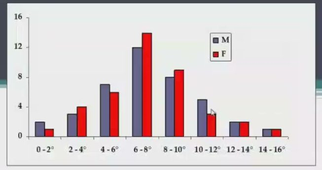
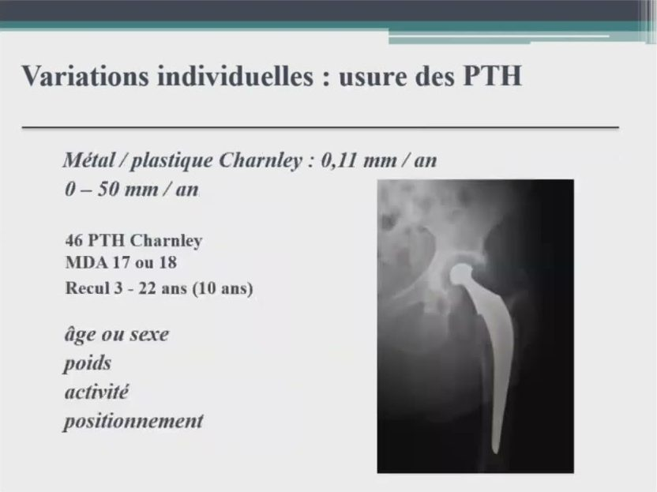
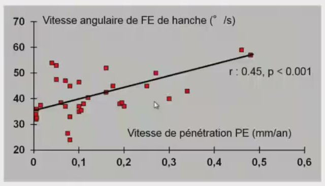

# La hanche en mouvement

> [!abstract] L'essentiel
> **La biomécanique de marche varie autant que la biologie** : rotation de hanche de **0 à 16°** selon les sujets, et usure du PE corrélée à la vitesse de flexion-extension.

> [!success] À retenir
> 1. Rotation de hanche à la marche : **± 4°** en moyenne mais dispersion **0-16°** → pas de norme rigide appliquée à un individu.
> 2. PTH métal-PE (Charnley) : pénétration moyenne **0,11 mm/an**, très dispersée ; ni âge, sexe, poids, activité ni positionnement ne l'expliquent, l'**année de pose** (lot) oui.
> 3. Usure corrélée à la **vitesse angulaire de flexion-extension** (r = **0,45**, p < 0,001) : échauffement de l'interface (≈ **12 °C**) qui ramollit le PE.

## Images clés
 [▶ 8:15](https://www.youtube.com/watch?v=UBemnesyE1g&t=495s)
 [▶ 3:58](https://www.youtube.com/watch?v=UBemnesyE1g&t=238s)
 [▶ 6:15](https://www.youtube.com/watch?v=UBemnesyE1g&t=375s)

## Points clés
- Base de données de marche d'environ 8 600 sujets des deux sexes et de tous âges, constituée pour définir la normalité.
- Rotation de hanche autour de l'axe vertical pendant la marche : en moyenne ±4° autour de la position neutre. La dispersion va de 0 à 16°, sans différence nette entre hommes et femmes.
- Ces variations individuelles expliquent que l'on reconnaisse un proche à sa démarche.
- 51 sujets avec une coxarthrose totalement asymptomatique ont été identifiés parmi environ 2 500 examinés.
  - L'amplitude de flexion-extension à la marche se dégrade avec l'évolution fonctionnelle (indice de Lequesne).
  - La rotation reste normale, voire supérieure à la normale.
- Hypothèse (non vérifiée) : les coxarthroses se recruteraient chez les sujets à forte rotation pelvienne. Une petite rotation pelvienne à l'attaque du talon induit une découverture antérieure de la tête, à bassin identique.
- Prothèses métal-polyéthylène (série de 46 PTH Charnley, recul 3 à 22 ans) : usure (« vitesse de pénétration ») moyenne de 0,11 mm par an, avec une très grande dispersion entre patients.
- Le sexe, le poids, l'activité et le positionnement (prothèses correctement posées) n'expliquent pas cette dispersion. L'**année de pose** apparaît déterminante (lots de fabrication).
- La vitesse de pénétration est corrélée aux **vitesses angulaires de flexion-extension** à la marche.

## Sémiologie et technique d'imagerie
- Simulateur : un capteur thermique placé à quelques centièmes de millimètre de la surface de la tête a montré qu'entre les vitesses minimales et maximales observées à la marche, l'interface s'échauffe avec un écart d'une douzaine de degrés.
- La prothèse est mal refroidie : circulation synoviale médiocre, matériaux mauvais conducteurs.
- Le polyéthylène est un thermoplastique qui se ramollit à la chaleur, ce qui réduit sa résistance à l'usure.

## Pièges et diagnostics différentiels
- Une valeur moyenne (rotation, usure) masque une dispersion considérable. Il ne faut pas appliquer de normes biomécaniques rigides à un individu.
- Les données sur les débris d'usure restent complexes (débris et plastiques différents).

> [!WARNING] À ne pas manquer
> La biomécanique humaine est aussi variable que la biologie. Toute interprétation fonctionnelle (marche, prothèse) doit intégrer cette variabilité individuelle.

> [!TIP] Pour le compte rendu
> Pour une PTH métal-polyéthylène, mesurer et suivre la pénétration de la tête dans l'insert de façon comparative. Une usure rapide n'est pas forcément liée à l'activité ni au positionnement.

## Liens
- Congrès : [[SIMS 2019 - Index]]
- Voir aussi : [[Évolution vers la bipédie - complexe lombo-pelvi-fémoral]], [[Actualités sur les matériaux utilisés pour les prothèses]]
