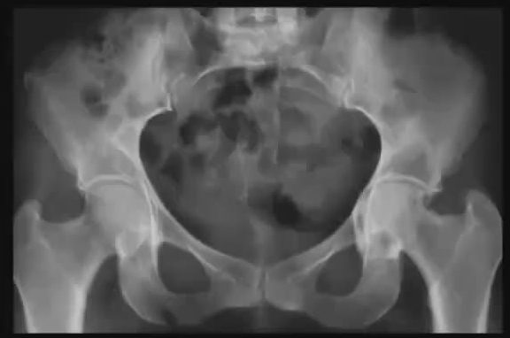

# Le conflit de hanche (partie 3)

> [!abstract] L'essentiel
> **Le conflit fémoro-acétabulaire est un phénomène dynamique, pas une anomalie radiologique** : l'imagerie décrit came, pince, version et torsion, mais le pronostic tient aux lésions chondrolabrales.

> [!success] À retenir
> 1. Came : **angle alpha > 60°**, à mesurer en **reconstructions radiales antéro-supérieures**.
> 2. Pince : **coxa profunda**, protrusion, **signe du croisement** (dépend de la version pelvienne), ossification du labrum ; lésion de **contrecoup postéro-inférieure**.
> 3. Bilan lésionnel **après opacification** : rechercher la **délamination** chondrale (came) et les lésions labrales (pince) ; morphotype seul chez l'asymptomatique ≠ conflit.

## Images clés
 [▶ 2:00](https://www.youtube.com/watch?v=JZ3i-9JMhg8&t=120s)

## Points clés
- Les anomalies morphologiques intrinsèques et les facteurs extrinsèques **favorisent** le conflit sans le diagnostiquer. Elles sont fréquentes chez l'asymptomatique. C'est l'hypersollicitation de la hanche qui crée les lésions irréversibles.
- **Effet came** : hypertrophie de la jonction tête-col.
- **Effet pince** (hypercouverture acétabulaire) :
  - coxa profunda : fond du cotyle en dedans de la ligne ilio-ischiatique ;
  - protrusion : tête en dedans de cette ligne ;
  - ces signes ne s'interprètent qu'avec la coxométrie classique (angle de couverture latérale, voire antérieure).
- **Rétroversion acétabulaire** (hypercouverture focale antérieure) : croisement des rebords antérieur et postérieur au tiers supérieur, ou « signe du 8 ». Elle dépend de la position du bassin : l'antéversion pelvienne génère une rétroversion acétabulaire.
- Une version pelvienne faible caractérise les bassins étroits, chez qui l'incidence des effets came est augmentée.
- Torsion fémorale :
  - antétorsion normale d'environ 13° ; une diminution ou une rétrotorsion favoriserait l'effet came ;
  - on distingue désormais une torsion supra- et infra-trochantérienne par rapport à la ligne intertrochantérienne ; une torsion supra-trochantérienne augmentée favoriserait l'effet pince.

## Sémiologie et technique d'imagerie
- Bassin de face debout et profil du col (type Dunn) pour l'effet came.
- **Angle alpha** : entre l'axe du col passant par le centre de la tête et la droite allant du centre au point où la tête perd sa sphéricité. Il se mesure aussi en coupes axiales obliques et idéalement en **reconstructions radiales** antéro-supérieures. **Seuil pathologique : 60°.**
- La version pelvienne se mesure sur un bassin de profil.
- Lésions chondrales, au premier plan dans l'effet came : la **délamination** (décollement du cartilage de l'os sous-chondral, grade 4) est difficile à voir sans examen focalisé et opacifié.
- Lésions labrales, au premier plan dans l'effet pince : dégénérescence, hypertrophie, imbibition par le contraste (porosité), involution kystique, **ossification du labrum** (qui majore la couverture et l'effet pince).
- Effet pince : lésion chondrale de **contrecoup postéro-inférieure**, la tête étant propulsée en arrière quand le col bute sur le rebord antérieur.

## Pièges et diagnostics différentiels
- Morphotype de conflit chez l'asymptomatique : pas de diagnostic sans corrélation clinique.
- Le signe du croisement dépend de la version pelvienne.

> [!WARNING] À ne pas manquer
> Le bilan lésionnel (cartilage, labrum) doit se faire en imagerie en coupes **après opacification articulaire**. C'est lui qui conditionne le résultat fonctionnel chirurgical.

> [!TIP] Pour le compte rendu
> Donner l'angle alpha (radial antéro-supérieur), les signes de pince (coxa profunda, protrusion, croisement, couverture), la version pelvienne, la torsion fémorale, puis détailler les lésions chondrales (délamination) et labrales. Ne conclure au conflit qu'à la lumière de la clinique.

## Liens
- Congrès : [[SIMS 2019 - Index]]
- Voir aussi : [[Le conflit de hanche (partie 1)]], [[Le conflit de hanche (partie 2)]], [[Le labrum de hanche - les modalités d'imagerie]]
