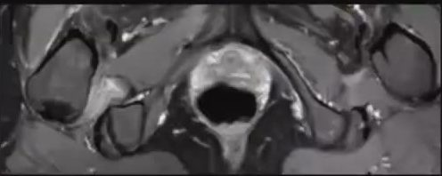
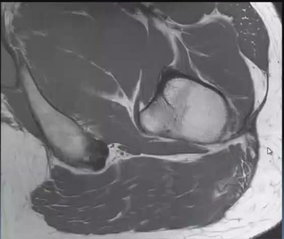
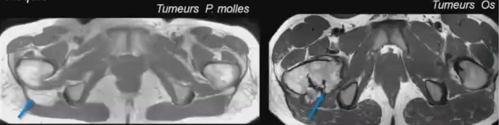
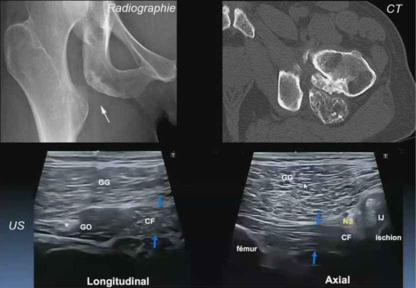

# Le conflit ischiofémoral en 2019

> [!abstract] L'essentiel
> **Conflit ischiofémoral = espace ischiofémoral rétréci + œdème du carré fémoral + clinique compatible** : jamais sur une mesure isolée.

> [!success] À retenir
> 1. IRM **axiale + sagittale** : œdème/bursite puis involution graisseuse du **carré fémoral**, rapport au **nerf sciatique** ; comparer au côté sain.
> 2. Mesures (espace ischiofémoral, espace du carré fémoral) très dépendantes de la **rotation du membre** à l'acquisition → préciser la position.
> 3. Chercher une cause : **ostéochondrome, lipome, enthésopathie ischio-jambière, coxa valga** ; infiltration scanno/écho-guidée **diagnostique et thérapeutique**.

## Images clés
 [▶ 2:23](https://www.youtube.com/watch?v=4IwUF8F2b0s&t=143s)
 [▶ 2:56](https://www.youtube.com/watch?v=4IwUF8F2b0s&t=176s)
 [▶ 5:58](https://www.youtube.com/watch?v=4IwUF8F2b0s&t=358s)
 [▶ 6:59](https://www.youtube.com/watch?v=4IwUF8F2b0s&t=419s)

## Points clés
- **Définition** : réduction de l'espace entre le bord latéral de l'ischion et le petit trochanter, exposant le **carré fémoral** (qui l'occupe transversalement) et le **nerf sciatique** (qui le traverse verticalement).
- Mécanismes : étroitesse du contenant, augmentation du contenu, ou **posturale** (rotation latérale, extension, adduction).
- **Clinique** : douleurs fessières, parfois irradiation sciatalgique sans syndrome rachidien ; aggravées par la marche à grandes foulées et l'extension-adduction, soulagées en abduction ; ressaut parfois perceptible/audible, disparaissant en marche en abduction.
- **Anatomie IRM** : carré fémoral à insertion médiale large sur l'ischion, en rapport avec l'obturateur externe en avant et les ischio-jambiers en arrière ; à sa partie moyenne, nerf sciatique en arrière et terminaison de l'iliopsoas en avant ; insertion latérale compacte. À distinguer du complexe gemello-obturateur (jumeaux centrés par le tendon de l'obturateur interne).
- **Étiologies** : fonctionnelle (sportifs, danse, yoga), congénitale (troubles architecturaux du fémur proximal, coxa valga), acquise (lipome, ostéochondrome sessile, pathologie des ischio-jambiers très fréquemment associée — enthésophytes, hypertrophie tendineuse, déséquilibre postural). Probablement plusieurs entités (sujet jeune, dégénératif, sportif).
- Vision globale : amyotrophie asymétrique des abducteurs (TFL, petit glutéal) suggérant un déséquilibre abducteurs/adducteurs ; rétroversion pelvienne et statique pelvirachidienne évoquées.
- **Traitement** : infiltration de corticoïdes écho- ou scanno-guidée à visée thérapeutique et **diagnostique** ; chirurgie pour cas réfractaires (libération de l'espace, résection du petit trochanter) avec faible taux de complications rapporté.

## Sémiologie et technique d'imagerie
- **IRM** : axial + **sagittal** (carré fémoral sur toute sa hauteur, rapport au nerf sciatique).
- Atteinte musculaire : œdème mal limité du carré fémoral en saturation de graisse, bursite péri-musculaire antérieure ou postérieure ; chronique : involution graisseuse et amyotrophie ; parfois déchirure.
- Mesures : **espace ischiofémoral** (plus petite distance entre les reliefs osseux) et **espace du carré fémoral** (entre tendons ischio-jambiers et petit trochanter), normes issues d'une méta-analyse ; comparaison au côté asymptomatique.
- Limites : rétrécissements sévères asymptomatiques ; dépendance à l'âge, au sexe et surtout à la **rotation** du membre lors de l'acquisition. Volumétrie envisagée.
- **Radiographies** : coxa valga, condensation chronique, processus expansif.
- **Échographie** : carré fémoral = 2e couche par voie postérieure sous le grand glutéal, orientation des fibres caractéristique ; coupe orthogonale pour le distinguer du complexe gemello-obturateur. Perspective dynamique : déformation/raccourcissement du muscle, déplacement du nerf sciatique ; IRM en temps réel expérimentale.

## Pièges et diagnostics différentiels
- Œdème musculaire **sans rétrécissement** : engorgement veineux simulant un œdème, œdème du complexe gemello-obturateur (pas du carré fémoral), œdème réactionnel à une synovite, tumeur intramusculaire bien limitée, déchirure aiguë, œdème de dénervation (polyneuropathie).
- Œdème du carré fémoral possible chez l'asymptomatique.

> [!WARNING] À ne pas manquer
> Ne pas conclure à un conflit ischiofémoral sur une mesure isolée : la rotation du membre pendant l'acquisition modifie considérablement l'espace.

> [!TIP] Pour le compte rendu
> Mesurer espace ischiofémoral et espace du carré fémoral en précisant la position du membre, décrire le signal du carré fémoral, rechercher une cause (ostéochondrome, lipome, pathologie ischio-jambière, coxa valga) et proposer une infiltration test si la clinique est compatible.

## Liens
- Congrès : [[SIMS 2019 - Index]]
- Voir aussi : [[Les lésions traumatiques rares des muscles pelvitrochantériens]], [[Les syndromes de la traversée pelvifémorale]], [[La chirurgie des syndromes de la traversée pelvifémorale du nerf ischiatique]]
