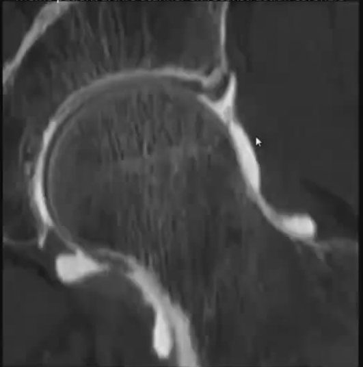
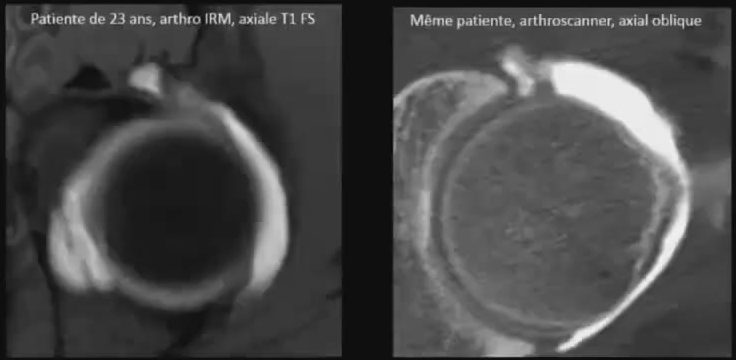
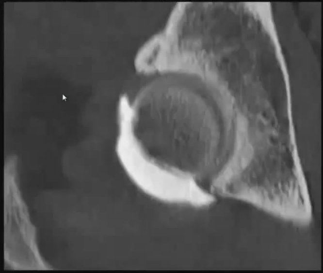

# Le labrum de hanche : les modalités d'imagerie

> [!abstract] L'essentiel
> **Labrum de hanche = arthrographie (arthroscanner ou arthro-IRM), lésion antéro-supérieure 12 h-3 h sur le versant articulaire** : une lésion s'authentifie par son environnement, pas par son signal seul.

> [!success] À retenir
> 1. **Désinsertion ostéo-labrale** largement prédominante ; signes : contraste profond et irrégulier, labrum globuleux, **récessus périlabral effacé**.
> 2. Toujours chercher la **lésion cartilagineuse en regard** (mieux vue en arthroscanner) et le **kyste paralabral** (lésion sentinelle, parfois non opacifié).
> 3. Pièges : jonction chondro-labrale, sillons du ligament transverse, **récessus sous-labral** (postéro-inférieur **48 %**, antéro-supérieur **44 %** ; peu profond, régulier, labrum normal).

## Images clés
 [▶ 2:13](https://www.youtube.com/watch?v=_4vIiKMJfR4&t=133s)
 [▶ 5:10](https://www.youtube.com/watch?v=_4vIiKMJfR4&t=310s)
 [▶ 3:52](https://www.youtube.com/watch?v=_4vIiKMJfR4&t=232s)

## Points clés
- Anatomie :
  - fibrocartilage triangulaire en fer à cheval, avec une base adhérente, une face articulaire et une face capsulaire ;
  - il forme avec la capsule le récessus périlabral ;
  - innervé et vascularisé en périphérie ;
  - rôles : stabilité, étanchéité (effet joint), répartition des contraintes.
- Clinique : douleur mécanique antérieure, ressaut, blocage.
- Étiologies : microtraumatique (conflit fémoro-acétabulaire, hanche instable), traumatique, dégénérative, dysplasie.
- Les **désinsertions ostéo-labrales** prédominent ; les fissures intra-labrales sont plus rares.
- Localisation horaire comme à l'épaule (3 h en antérieur). Les lésions les plus fréquentes siègent entre **12 h et 3 h**, sur le versant interne (articulaire).
- Lésions associées :
  - **lésions cartilagineuses** de même topographie (ulcération, flap, clivage), mieux vues en arthroscanner ;
  - **kyste paralabral**, lésion sentinelle, liquidien. Son contenu épais peut empêcher son opacification.

## Sémiologie et technique d'imagerie
- Lésion : insinuation de contraste ou hypersignal liquidien à la jonction ostéo-labrale ou dans le labrum. Elle est profonde, irrégulière, souvent associée à une anomalie de forme (labrum hypertrophique, globuleux) et à une disparition du récessus périlabral.
- Échographie : lésion hypo- ou anéchogène, visible si elle est antérieure ou antéro-supérieure. Les kystes paralabraux antérieurs sont bien vus.
- L'IRM du bassin sans arthrographie (coronal DP FS) voit mal les fissures.
- Arthro-IRM : une séquence 3D (type CUBE) permet des reconstructions multiplanaires. L'étude du cartilage est possible avec des séquences plus longues, et la traction aide.
- Aspect arthroscopique de la lésion : effilochage « en chair de crabe » du versant interne.

## Pièges et diagnostics différentiels
- Variantes de forme (souvent dégénératives) et de signal : un labrum normal est en hyposignal, mais il peut être iso- ou hyperintense en T1, DP ou T2.
- Opacification de la bourse de l'ilio-psoas ou de l'obturateur externe, à ne pas prendre pour un kyste paralabral.
- « Hypoplasie » labrale, notion débattue : correspond plutôt à une absence du labrum sur certaines coupes dans une lésion complexe.
- **Jonction chondro-labrale** : interposition de cartilage de signal intermédiaire, sans irrégularité.
- Sillons du ligament transverse à ses attaches antérieure et postérieure.
- Récessus périlabral : physiologique, il doit alerter s'il est **absent**.
- **Récessus sous-labral** : existence débattue, surtout postéro-inférieur (48 % ; antéro-supérieur 44 %, Saddik AJR 2006), large et linéaire, habituellement sur le rayon de 4 h. Critères : peu profond, contours réguliers, sans anomalie péri- ou intra-labrale (comme pour le labrum glénoïdien).

> [!WARNING] À ne pas manquer
> Une lésion labrale antéro-supérieure va souvent de pair avec une lésion cartilagineuse en regard. Il faut la rechercher, car elle conditionne la prise en charge.

> [!TIP] Pour le compte rendu
> Préciser le type (désinsertion, fissure, complexe), la localisation horaire et l'extension, la forme du labrum, le récessus périlabral, le kyste paralabral et les lésions chondrales associées. Rester prudent face aux variantes.

## Liens
- Congrès : [[SIMS 2019 - Index]]
- Voir aussi : [[Le conflit de hanche (partie 3)]], [[La hanche articulaire - variantes]]
