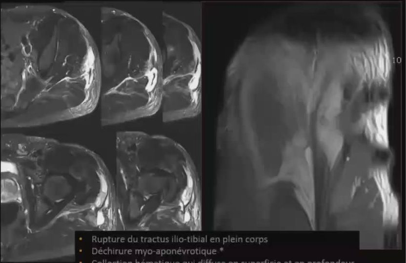
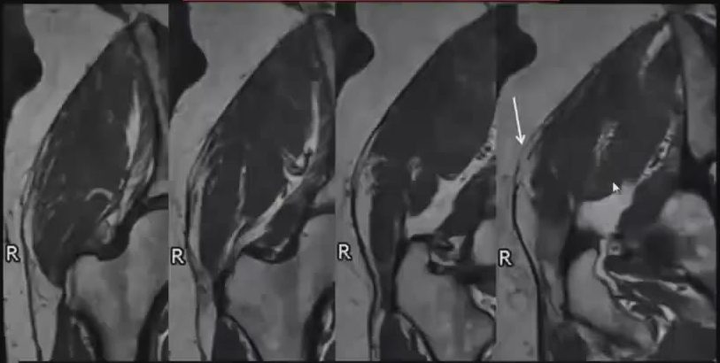
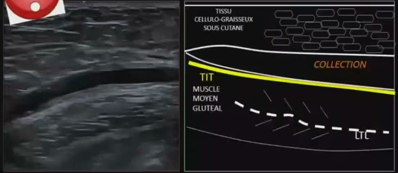

# Le tractus iliotibial de haut en bas

> [!abstract] L'essentiel
> **Le tractus iliotibial a sa propre pathologie, à décrire séparément des glutéaux** : enthésopathie, tendinopathie et déchirure sus-trochantérienne, conflits.

> [!success] À retenir
> 1. **Déchirure myotendineuse sus-trochantérienne** du coureur (2 zones de fragilité : jonction **TFL** et **grand glutéal**) : hématome diffusant en superficie et en profondeur.
> 2. Pronostic : rechercher la **perte d'accolement** tractus / moyen glutéal → gêne fonctionnelle (escaliers, course impossible) ; une collection type **Morel-Lavallée** impose de vérifier l'intégrité du tractus sous-jacent.
> 3. **Hypertrophie du TFL** = indice de **rupture du moyen/petit glutéal** (ne pas la prendre pour une tumeur) ; adolescent **< 15 ans** : **apophysite** du tubercule glutéal (œdème du noyau).

## Images clés
 [▶ 7:33](https://www.youtube.com/watch?v=uuTDtk0od9w&t=453s)
 [▶ 8:48](https://www.youtube.com/watch?v=uuTDtk0od9w&t=528s)
 [▶ 8:01](https://www.youtube.com/watch?v=uuTDtk0od9w&t=481s)

## Points clés
- **Anatomie** : épaississement latéral du fascia lata (« bandelette de Maissiat »), de la crête iliaque (tubercule glutéal) au tubercule de Gerdy, avec expansions vers fémur distal, patella et capsule. Origine proximale en couches superficielle et intermédiaire (autour du TFL) et profonde (sourcil cotyloïdien, près du tendon réfléchi du droit fémoral). Reçoit le TFL en avant et le faisceau superficiel du grand glutéal en arrière (« deltoïde fessier de Farabeuf »).
- **Fonction** : 30 % des forces d'abduction/stabilisation en appui monopodal (70 % pour les glutéaux) ; relais de l'abduction après le moyen glutéal ; **compression sur le grand trochanter**, majorée par tout ce qui favorise l'adduction (coxa vara, offset élevé, bascule du bassin).
- **Enthésopathie proximale** (tubercule glutéal, structure de 2–3 mm chez l'adulte) : coureur ; épaississement, perte du fibrillaire en écho, hypersignal péritendineux en IRM.
- **Adolescent (< 15 ans)** : apophysite par surutilisation, souvent confondue avec une douleur pariétale ; IRM = œdème intra-osseux du noyau non fusionné.
- **Région sus-trochantérienne – histoire naturelle** (3 coureurs) : tendinopathie focale discrète (homme de 34 ans, préparation de marathon), puis péritendinopathie étendue avec hypervascularisation Doppler et œdème, puis **déchirure myotendineuse** complète avec hématome diffusant (pendant un marathon).
- **Zones de fragilité** : jonction avec le TFL (hématome antérieur et haut) et avec le moyen glutéal (plus bas et postérieur).
- Évolution : cicatrisation avec lame épaissie, ou **perte de l'accolement** au moyen glutéal → insuffisance fonctionnelle (instabilité du bassin dans l'escalier).
- **Hypertrophie compensatrice du TFL** en cas de rupture glutéale ; peut simuler une tuméfaction pseudo-tumorale de la racine de cuisse ; à l'inverse, une hypertrophie du TFL doit faire rechercher une rupture du moyen ou petit glutéal.
- **Conflits trochantériens** : ressaut latéral (coxa saltans externe) du sujet jeune, matériel d'ostéosynthèse, trochanter « chauve » (friction directe sur la corticale → grandes bursites), offset élevé avec latéralisation du grand trochanter.

## Sémiologie et technique d'imagerie
- Regarder systématiquement **en superficie** des muscles et tendons glutéaux.
- Échographie : épaississement, perte du fibrillaire, Doppler ; épreuves dynamiques pour le ressaut.
- IRM : épaississement du tractus, œdème péritendineux, hématome, œdème apophysaire.

## Pièges et diagnostics différentiels
- **Lésion de Morel-Lavallée** : collection compressible entre hypoderme et fascia par cisaillement tangentiel ; vérifier que le tractus sous-jacent est intact, sinon pronostic différent.
- Apophysite de l'adolescent prise pour une douleur abdominale pariétale.
- Hypertrophie du TFL prise pour une tumeur.

> [!WARNING] À ne pas manquer
> Un « Morel-Lavallée » péritrochantérien post-effort peut masquer une déchirure du tractus iliotibial avec désolidarisation du moyen glutéal, de mauvais pronostic fonctionnel.

> [!TIP] Pour le compte rendu
> Décrire séparément le tractus iliotibial (épaisseur, continuité, accolement au moyen glutéal) et signaler une hypertrophie du TFL comme indice de rupture glutéale.

## Liens
- Congrès : [[SIMS 2019 - Index]]
- Voir aussi : [[Pathogénie et clinique des tendinopathies glutéales]], [[Imagerie des tendinopathies glutéales - classique et inhabituel]]
