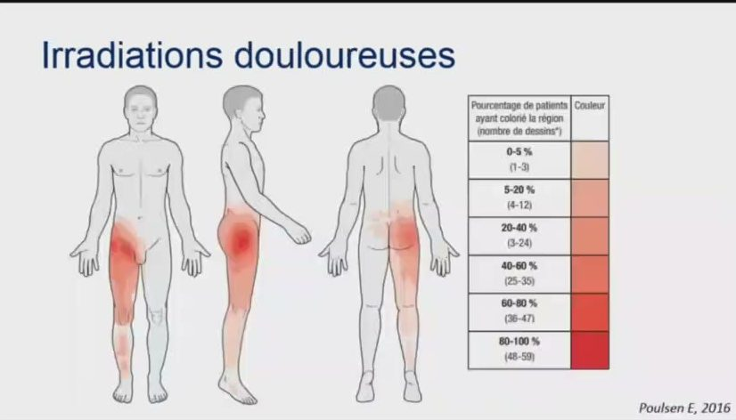
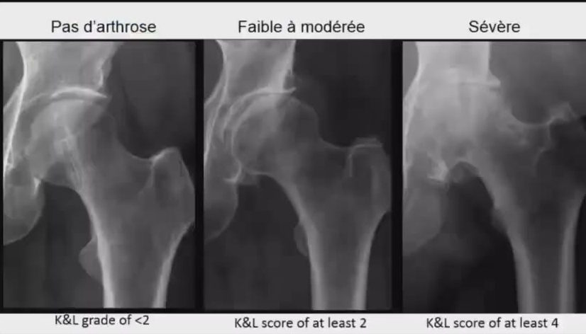

# Les formes cliniques de la coxarthrose

> [!abstract] L'essentiel
> **La coxarthrose douloureuse se déguise (trochantérienne, pseudo-sciatique, pseudo-claudication) et la radio modérée ne prouve rien** : seule l'arthrose sévère corrèle à la douleur ; trancher par test anesthésique.

> [!success] À retenir
> 1. Douleur **trochantérienne** dans **> 70 %** des coxarthroses débutantes ; pseudo-sciatique L5 dans **5 %** (innervation capsulaire fémorale, obturatrice, ischiatique).
> 2. Arthrose **faible à modérée** aussi fréquente chez les non-douloureux que chez les douloureux ; seule l'arthrose **sévère (K&L 4)** est associée à la douleur : ne pas lui attribuer la douleur dans le CR.
> 3. **Test anesthésique intra-articulaire** si doute rachis/hanche : un **test négatif prédit l'échec de la PTH** ; un test positif est moins fiable.

## Images clés
 [▶ 1:34](https://www.youtube.com/watch?v=bDgd1Pvc6lU&t=94s)
 [▶ 6:09](https://www.youtube.com/watch?v=bDgd1Pvc6lU&t=369s)

## Points clés
- Deux cas introductifs :
  - claudication attribuée à une sténose L4-L5, avec des hanches en séquelles d'ostéonécrose. L'infiltration épidurale a été inefficace et les PTH bilatérales spectaculairement efficaces ;
  - douleur pseudo-sciatique jusqu'au dos du pied, rapportée à la hanche par un test anesthésique.
- Étude de cartographie des douleurs (coxarthrose débutante, sujets jeunes) : la région **trochantérienne** est la plus souvent désignée (plus de 70 %), avant la région inguinale. Irradiations postéro-supérieures et crurales, parfois jusqu'au pied, et pseudo-sciatique de type L5 dans 5 % des cas.
- Innervation capsulaire, qui explique ces douleurs projetées :
  - nerf fémoral : partie antéro-latérale (pseudo-cruralgie) ;
  - nerf obturateur : partie antéro-médiale (douleur de la face médiale de cuisse) ;
  - branches du nerf ischiatique : partie postéro-supérieure.
- Mécanisme proposé : convergence, sur le même ganglion et le même deuxième neurone, des afférences capsulaires (organe profond, « quasi viscéral ») et d'un dermatome.
- Examen clinique (rotation de hanche, FABER, squat, etc.) : **aucun test isolé** n'est assez sensible ni spécifique. Il faut combiner les tests, avec 4 à 5 signes dans la « boîte à outils ».

## Sémiologie et technique d'imagerie
- La radiographie pose le diagnostic positif. Le pincement est l'anomalie la plus reproductible et la plus associée à la douleur.
- Étude en population (environ 1 000 sujets de plus de 45 ans, 7 à 10 % de douleurs de hanche) : les anomalies radiographiques modérées sont fréquentes et aussi prévalentes chez les non-douloureux que chez les douloureux. Seule l'arthrose sévère (stade 4 de Kellgren-Lawrence) est mieux corrélée à la douleur.
- Test anesthésique intra-articulaire : l'équipe utilise la lidocaïne de courte durée d'action, d'autres un anesthésique de longue durée.
- Méta-analyse (études de qualité limitée), avec pour critère le succès de la PTH :
  - un **test négatif prédit bien l'échec** de la prothèse ;
  - un test positif est moins prédictif (placebo, diffusion périarticulaire, structures adjacentes).

## Pièges et diagnostics différentiels
- Selon le siège de la douleur (antérieur, latéral, postérieur), le différentiel inclut le rachis (radiculalgie, canal lombaire étroit) et les pathologies périarticulaires.
- Des anomalies radiographiques unilatérales modérées n'expliquent pas forcément une douleur du membre inférieur.

> [!WARNING] À ne pas manquer
> Une coxarthrose peut se présenter en pseudo-sciatique ou en pseudo-claudication radiculaire. Devant une pathologie rachis-hanche intriquée, penser au test anesthésique : s'il reste douloureux après le test, ce n'est a priori pas la hanche.

> [!TIP] Pour le compte rendu
> Grader l'arthrose et éviter d'affirmer qu'elle explique la douleur si elle est modérée. Proposer un test anesthésique intra-articulaire en cas de doute avec le rachis, en rappelant sa valeur surtout négative.

## Liens
- Congrès : [[SIMS 2019 - Index]]
- Voir aussi : [[Sémiologie radiologique de la coxarthrose]], [[Diagnostic différentiel et pièges de la coxarthrose]], [[Comment aborder les pathologies de la hanche et de la colonne vertébrale]]
