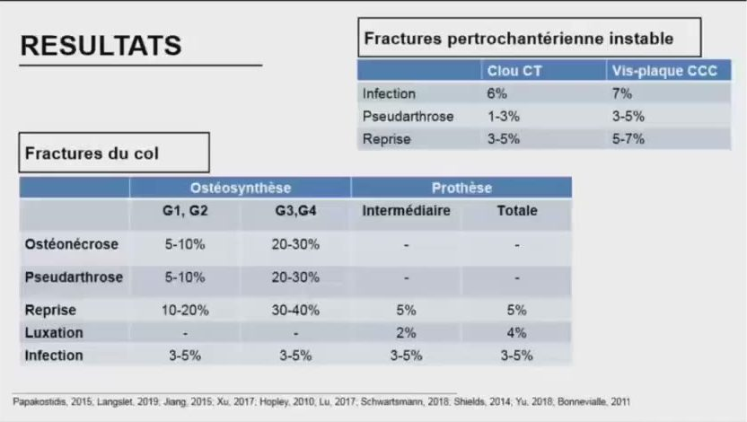
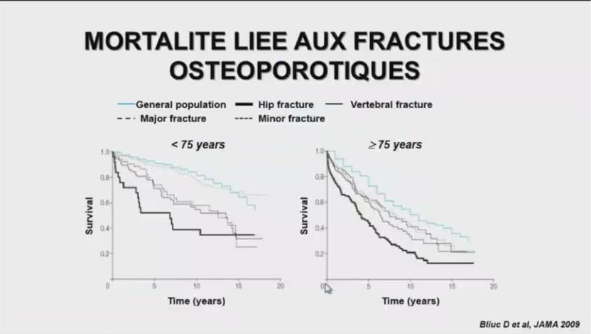

# Les fractures de hanche du sujet âgé

> [!abstract] L'essentiel
> **Col = question vasculaire (Garden), pertrochantérienne = question de stabilité** ; toute FESF à basse énergie est une fracture ostéoporotique **sévère** à orienter en filière fracture.

> [!success] À retenir
> 1. Col **Garden III-IV** ostéosynthésé : ostéonécrose/pseudarthrose **20-30 %**, reprise **30-40 %** → prothèse (reprise **5 %**, luxation **2-4 %**) ; **basicervicale** = se traite comme une pertrochantérienne.
> 2. Pertrochantérienne : décrire **comminution postéro-médiale, mur latéral, extension sous-trochantérienne, trait inversé** (instabilité → clou centromédullaire).
> 3. **Risque imminent** de nouvelle fracture à 2-3 ans, surmortalité (1 homme sur 3 décède dans l'année) ; acide zolédronique **−28 % de mortalité** → le signaler dans le CR.

## Images clés
 [▶ 6:21](https://www.youtube.com/watch?v=EAILWL-ShrU&t=381s)
 [▶ 7:32](https://www.youtube.com/watch?v=EAILWL-ShrU&t=452s)

## Points clés
- **Épidémiologie** : 1,6 million de cas/an dans le monde en 2000, projection 4,5 millions en 2050 ; en France ≈ 80 000/an, ≈ 60 % pertrochantériennes et 40 % cervicales, 75 % de femmes, surtout > 80 ans ; une femme sur 6 (vs 1 sur 9 pour le cancer du sein). **Incidence en baisse** (meilleur état général, obésité ?) mais nombre absolu en hausse (vieillissement).
- **Col vs pertrochantérienne** : vascularisation céphalique par l'artère circonflexe postérieure, menacée dans les fractures du col (ostéonécrose) ; pas de problème vasculaire dans les pertrochantériennes. Distinction intra-/extracapsulaire ; les **basicervicales** (extracapsulaires) se comportent comme des pertrochantériennes.
- **Clinique** : chute, impotence totale, membre raccourci en rotation externe.
- **Bilan** : bassin de face, hanche de face en rotation interne, profil chirurgical ; bassin de face calibré pour planifier une prothèse ; IRM/scanner si doute diagnostique.
- **Garden** : I impactée en valgus, II non déplacée (vascularisation raisonnablement préservée) ; III bascule postérieure avec charnière postérieure conservée, IV charnière rompue (vascularisation compromise).
- **Instabilité pertrochantérienne** : comminution postéro-médiale, extension sous-trochantérienne, fracture du mur latéral, avulsion du grand trochanter, trait oblique inversé.
- **Traitement** : pertrochantérienne → ostéosynthèse (clou cervicotrochantérien préféré à la vis-plaque type DHS, moins de démontages) ; col → coxopathie préexistante = PTH ; sans coxopathie, âge physiologique < 50 ans → réduction-ostéosynthèse ; > 50 ans : Garden I–II ostéosynthèse possible, III–IV prothèse (intermédiaire/bipolaire ou totale selon l'autonomie), avec tendance à la prothèse même pour Garden I–II.
- **Résultats de l'ostéosynthèse** : Garden I–II ostéonécrose/pseudarthrose 5–10 %, reprises 10–20 % ; Garden III–IV 20–30 %, reprises 30 à 40 %. Prothèse (intermédiaire ou totale) : reprises 5 %, risque spécifique de luxation (2 % intermédiaire, 4 % totale). Pertrochantérienne instable : clou centromédullaire (pseudarthrose 1–3 %, reprise 3–5 %) vs vis-plaque (3–5 % et 5–7 %).
- **Partie médicale** : surmortalité nette (étude australienne) ; « fractures sévères » = extrémité supérieure du fémur, bassin, humérus proximal, vertèbres ; années de vie perdues plus importantes avant 75 ans (fragilité systémique). Après la fracture : 1 homme sur 3 et 1 femme sur 5 meurent dans l'année (ministère de la Santé).
- **Risque imminent** de récidive dans les 2–3 ans (données islandaises), intégré aux recommandations.
- **Prévention des chutes** : chirurgie de la cataracte → −16 % de fractures du fémur proximal ; exercices adaptés réduisent les chutes traumatiques.
- **Traitements** (bisphosphonates, dénosumab) : −50 à 70 % de fractures vertébrales, effet moindre mais significatif sur le col ; après fracture du fémur, acide zolédronique vs placebo : moins de récidives et **−28 % de mortalité**.
- **Filières fracture** : moins de mortalité et de récidives à 2 ans (étude néerlandaise), obligatoires au Royaume-Uni, inscrites dans le plan Ma Santé 2022.

## Sémiologie et technique d'imagerie
- Classer Garden et préciser le caractère intra- ou extracapsulaire ; pour les pertrochantériennes, décrire les facteurs d'instabilité.

## Pièges et diagnostics différentiels
- Fracture basicervicale à ne pas assimiler à une fracture du col (pronostic vasculaire différent).
- Fracture non visible en radiographie → IRM ou scanner.

> [!WARNING] À ne pas manquer
> Toute fracture de l'extrémité supérieure du fémur à basse énergie est une fracture ostéoporotique sévère : signaler le risque imminent de nouvelle fracture et orienter vers une filière fracture.

> [!TIP] Pour le compte rendu
> Col : Garden, déplacement, coxopathie associée. Pertrochantérienne : comminution postéro-médiale, mur latéral, extension sous-trochantérienne, trait inversé. Mentionner l'origine probablement ostéoporotique.

## Liens
- Congrès : [[SIMS 2019 - Index]]
- Voir aussi : [[Surutilisation et fractures de stress de la ceinture pelvienne]], [[Planification préopératoire]]
